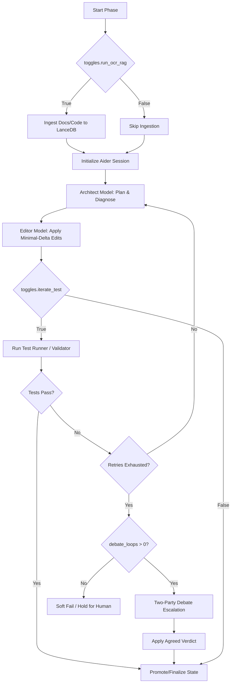

# aider-factory 🏭

I would like to thank Paul Gauthier (Creator and Maintainer of Aider) for creating what we can call a 'no-frills' harness, which ended up being the back bone of Aider-Factory. Also Quantstrat (company I work for) for many of the ideas and funding of this package (running tests with live agents costs $). Both Aider and Quantstrat adhere to core open source philosophilies, which is why every single feature of aider-factory is open source. Note, since the most valuable features of Aider-Factory are CLI tools, they can be used with any harness (Opencode, Codex, Claude, etc). I use many of the features (like aider-research, aider-oracle, and aider-validate) with Opencode frequently.

CLI tool support for aider was inspired by https://www.wearewarp.com/agents/mcp/aider since aider does not have native MCP support.

⚠️ **Stable:** This package is fully usable right now and has been tested in active workflows with great results! Currently, features will continue to be added if useful and are pareto improvements to the package. As of commit 3c6ad34, the package is stable and all features included pass the 600+ tests. Feel free to explore, use it, and star the repo. If there is a desired feature or model usage problems, start an issue and I'll look into it -- as the AI space changes, I'm sure there will be some housekeeping involved on my end. If there is a great idea you want to add then fork it, implement it, and request a merge request. Refer to the package philosophies in the documentation directory for how/what type of code should be added so that merge requests are quickly accepted.

[](https://opensource.org/licenses/Apache-2.0)
[](https://www.python.org/downloads/)
[](https://www.kernel.org/)
[](https://www.apple.com/macos/)
[](https://www.microsoft.com/windows/)
[](https://aider.chat)

**aider-factory** is a modular, lightweight, YAML-driven automation harness, grounding validator, and RAG/debate engine built on top of [Aider](https://aider.chat).

Designed with a "bolt-on, bolt-off" UNIX philosophy, `aider-factory` can be run as a complete file-coupled DAG pipeline, or its components can be used as standalone command-line clients in your standard terminal, shell scripts, or CI/CD pipelines.

---

## 🚀 The Core Draws

### 1. A Barebones, YAML-Configured Aider Harness & Quickstart

If you want a simple, lightweight, and repeatable way to automate Aider without the bloat of heavy agent frameworks, `aider-factory` does this out of the box.

- Fully customizable options through a simple `.env.yml` file to cater to your specific pipeline or workflow needs.
- Easily define phase-based tasks, manage target/editable files, and run test-driven self-healing loops.
- **Native Docling Multi-Format Ingestion**: High-fidelity extraction for digital PDFs, Office documents (`.docx`, `.pptx`, `.xlsx`), HTML, and AsciiDoc with structural metadata extraction, table structure preservation, and automatic Vision OCR fallback.

### 2. Modular, Standalone CLI Clients

You do not have to buy into a monolithic ecosystem. Each component of `aider-factory` is exposed as a global, standalone command-line client that you can lift and use anywhere:

- **`aider-helper`**: Dual-purpose configuration architect and general AI terminal assistant.
- **`aider-oracle`**: A blazing-fast local RAG client.
- **`aider-validate`**: A deterministic fact-checker and quote-stitcher for CI/CD.
- **`aider-research`**: A private metasearch CLI.
- **`aider-factory`**: The pipeline orchestrator and multi-session manager.
- **`aider-launcher`**: Cross-platform workflow launcher with output teeing and cost accounting.
- **`aider-clean-lancedb`**: Cross-platform cleanup of ephemeral RAG artifacts.

For deep dives into the system's architecture, load-bearing rules, and cross-platform matrix:

- **[Core Philosophies & Invariants](src/aider_factory/markdown/docs/core_philosophies.md)**
- **[Cross-Platform OS Support Guide](src/aider_factory/markdown/docs/cross_platform_os_support.md)**

### 3. Deterministic Grounding & Validation (Code & Review)

A multi-tiered, deterministic-first validation system that can be used in both **code** or **review** paths, and in **autonomous** or **pair programming** modes.

- **The tags are the state:** The LLM cannot award itself a passing grade. Only the deterministic validator promotes tags from `[evidence]` to `[validated]` or `[fixed]`.
- **Exact Substring Proof:** A quote is either an exact verbatim substring of the source, or it is a tripwire. No fuzzy thresholds.
- **Raw Text Validation:** Fact-check any quote-less, human-written, or LLM-generated text using semantic chunking, Reciprocal Rank Fusion (RRF), and Entailment scoring.
- **Free Ellipsis Auto-Stitching:** Automatically splits quotes on `...`, matches the fragments in the source, and auto-replaces them with the continuous source span if the gap is small—saving massive token costs with 0 LLM calls.
- **Unique commands and flags** make it a treat to use across different workflows.

### 4. Structured, Refereed Debates Anywhere

Run structured, adversarial debates between the Architect and a specialized, reactive Knowledge Oracle.

- Can be run **anywhere**, in both **autonomous** or **pair programming** modes.
- **Persistent Oracle Sessions:** Unlike standard RAG which flushes context on every turn, the Oracle session accumulates and persists context across debate turns and rounds, ensuring deep, multi-turn reasoning.
- **Deterministic Referee:** A simple script reads the `PROPOSAL:` and `VERDICT:` lines to resolve the debate (agreement or deadlock), preventing credit-burning loops.

---

## 🛠️ The Four Superpowers

```
┌───────────────────────────────────────────────────────────────────────────┐
│                           aider-factory (DAG)                             │
└──────────────┬──────────────────────┬──────────────────────┬──────────────┘
               │                      │                      │
               ▼                      ▼                      ▼
      ┌─────────────────┐    ┌─────────────────┐    ┌─────────────────┐
      │  aider-oracle   │    │ aider-validate  │    │ aider-research  │
      │   (Local RAG)   │    │  (Grounding)    │    │  (Private Web)  │
      └─────────────────┘    └─────────────────┘    └─────────────────┘
```

### 1. 🏭 `aider-factory` (The Orchestrator)

Automates multi-phase development workflows. It manages file context, coordinates the split **Architect/Editor** model pattern, captures test suite failures, and drives iterative self-healing loops with native multi-session persistence and paired configurations.

### 2. 🔮 `aider-oracle` (The Local Knowledge Oracle)

A standalone, terminal-first RAG client. It parses codebases structurally using `tree-sitter` AST chunking, indexes literature into LanceDB, and answers queries using local or cloud models. It includes a built-in **two-party referee debate** engine for high-stakes architectural decisions.

### 3. 🛡️ `aider-validate` (The Fact-Checker)

A deterministic validator designed for CI/CD. It audits generated text against source documents. It features an **exact-substring check**, a **free, deterministic ellipsis auto-stitcher**, and a **raw text hallucination scanner** (`--claims-only`). It natively integrates with `MiniCheck` for state-of-the-art sentence-level entailment verification.

### 4. 🔍 `aider-research` (The Private Search Agent)

A vendor-free metasearch CLI. It auto-provisions a local, rootless **SearXNG** container via Podman/Docker, aggregates search engines, applies academic filters, and generates clean Markdown research reports.

- **Note on Rate Limiting:** Because this tool scrapes upstream engines directly to preserve your privacy, aggressive automated queries may trigger IP rate limits (CAPTCHAs). If you see "0 results" or "Unresponsive engines", simply turn on a VPN or rotate your VPN server to get a fresh IP address.

---

## ⏱️ Quick Start in 5 Commands

```bash
# 1. Install Podman or Docker (for rootless, zero-config SearXNG web research)
sudo apt install -y podman

# 2. Install aider-factory globally via uv
uv tool install --force git+https://github.com/bryan506/aider-factory.git

# 3. Export your API key
export GEMINI_API_KEY="your-api-key-here"

# 4. Navigate to your project directory and initialize workspace
cd /path/to/your-project
aider-factory refactor_feature

# 5. Bootstrap your pipeline config interactively (or edit .aider_factory/sessions/refactor_feature/session.yml directly)
aider-helper bootstrap
```

---

## 📦 Installation Options

Ensure you have Python 3.12 and [uv](https://astral.sh/uv/) installed.

### System Prerequisites

Before installation, ensure your host has the required build tools for Tree-Sitter (C compiler) and Aider's repository map engine (ctags):

```bash
sudo apt update
sudo apt install -y build-essential cmake curl git universal-ctags
```

### Global Installation (Recommended)

```bash
sudo apt install -y podman
uv tool install --force git+https://github.com/bryan506/aider-factory.git
```

#### Optional: Google Cloud Vertex AI Support (`vertex_ai/*`)

If you use Google Cloud Vertex AI models, include `google-cloud-aiplatform` when installing or updating `aider-factory` (and `aider-chat` if installed as a standalone tool):

```bash
# Install or update aider-factory with Vertex AI support
uv tool install --force --no-cache --with google-cloud-aiplatform git+https://github.com/bryan506/aider-factory.git

# If aider-chat is also installed as a separate uv tool
uv tool install --force --with google-cloud-aiplatform aider-chat
```

### Editable Installation (For Developers)

```bash
git clone https://github.com/bryan506/aider-factory.git
cd aider-factory
uv tool install --force --editable .
```

### Updating `litellm` (For Newer Models & Providers)

Because `aider-chat==0.86.2` pins `litellm==1.81.10` in its package metadata, `uv tool install` will initially display `litellm==1.81.10`. On your first invocation of an `aider-*` CLI command (e.g., `aider-oracle --help`), `aider-factory` automatically upgrades `litellm` to the minimum floor configured in the package and patches `aider` for compatibility.

If you want to manually bump the `litellm` version floor in a local/editable clone:

1. **`pyproject.toml`**: Keep `"litellm>=1.35.0"` under `[project] dependencies` (so `uv tool install` does not conflict with `aider-chat`), and update the version under `[tool.uv] override-dependencies`:
   ```toml
   [tool.uv]
   override-dependencies = [
       "litellm>=1.106.2",
   ```
2. **`src/aider_factory/cli.py`**: In `ensure_aider_installed()`, update the version tuple `(1, 106, 2)` and specifier `"litellm>=1.106.2"`.
3. **Lock, reinstall, and trigger the auto-upgrade**:
   ```bash
   uv lock --upgrade-package litellm
   uv tool install --force --editable .
   aider-oracle --help >/dev/null
   ```
4. **Verify the active `litellm` version**:
   ```bash
   "$(uv tool dir)/aider-factory/bin/python" -c "import importlib.metadata as m; print('aider-factory litellm:', m.version('litellm'))"
   "$(uv tool dir)/aider-chat/bin/python" -c "import importlib.metadata as m; print('aider-chat litellm:', m.version('litellm'))"
   ```

---

## 📖 Standalone CLI Examples

### General AI Terminal Assistant (`aider-helper --terminal`)

```bash
# Ask general software engineering questions directly from your terminal
aider-helper query --terminal "Explain compound indexing in SQLite"

# Pass workspace context files to the terminal assistant
aider-helper query -t --context src/main.py "Review this file for potential memory leaks"

# Combine POSIX short flags (Terminal + Ask + Repo-Map) for fast architectural queries
aider-helper query -tar "Which files handle the database connection?"

# Clear the interactive terminal assistant session history
aider-helper -t --clear
```

### Pipeline Configuration & Architecture Expert (`aider-helper --master`)

```bash
# Load the full Factory Service Manual into context to ask deep architectural questions
aider-helper query --master "How do I configure a pre-edit debate in my YAML?"
```

### Metasearch the Web Privately

```bash
aider-research search "negative income tax labor supply" --academic --top 5

# Return only a list of URLs (Supports natural operators like site:, filetype:)
aider-research search "site:lemonade-server.ai/docs" --links-only --out urls.txt
```

### Ingest and Query Local Documentation

```bash
# Ingest a web page or PDF into your active collection
aider-oracle --add-web https://example.com/api-docs.html --collection my_project

# Query the Oracle
aider-oracle \"What is the rate limit for the API?\"
```

### Run a Refereed Architectural Debate

```bash
aider-oracle --debate code \"Should we migrate from SQLite to PostgreSQL?\"
```

### Multi-Session Management Examples

```bash
# Start or resume a named session
aider-factory refactor_ohlcv

# Start a session with a custom configuration file
aider-factory .env.yml refactor_ohlcv

# List all active sessions across registered workspaces
aider-factory --list-sessions --global

# Clear a session (safely backed up to ~/.cache/aider_factory_cache/ by default)
aider-factory --clear-session refactor_ohlcv

# Permanently delete a session without backing up
aider-factory --clear-session refactor_ohlcv --forever

# Clear all sessions across all registered workspaces (backed up to cache)
aider-factory --clear-all --global

# Permanently purge all sessions across all workspaces
aider-factory --clear-all -g --forever
```

### Run Deterministic Quote Validation (CI/CD Ready)

```bash
aider-validate --file review.md --source source_ocr.md --report report.md --autofix
```

### Fact-Check Raw Text for Hallucinations (Zero-Config)

```bash
# Auto-discovers your LanceDB vector store and scores every paragraph
aider-validate --claims-only --file LLM_summary_response.md
```

---

## 🗺️ Architecture & Workflow Skeleton



---

## 📜 License & Disclaimer

This project is licensed under the Apache License 2.0 - see the [LICENSE](LICENSE) file for details.

**aider-factory** is an independent, community-driven open-source project. It is not affiliated with, sponsored by, endorsed by, or associated with Paul Gauthier, the official Aider project, or Oracle Corporation.
