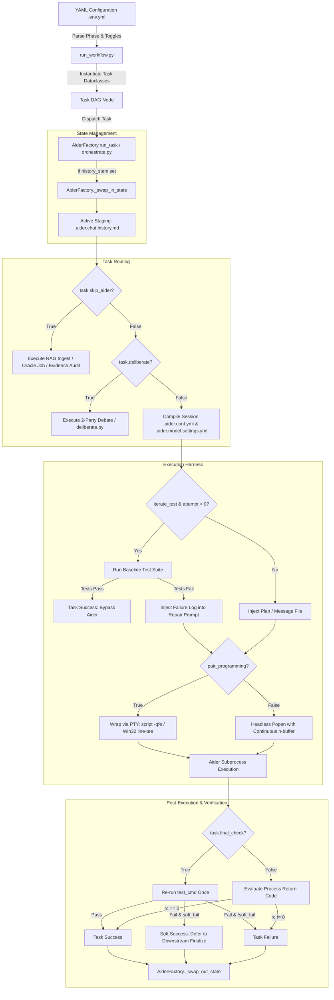

# Aider Orchestration & Native Toggles

## 1. Executive Overview & Foundational Invariants

### 1.1 Architectural Purpose
The AI Factory pipeline wraps the Aider chat engine to orchestrate complex Directed Acyclic Graph (DAG) software engineering workflows. Rather than executing unconstrained interactive AI coding sessions, the pipeline acts as a deterministic, headless-first orchestration harness that governs Aider's execution environment, prompt injection, chat history preservation, model routing, and operational parameters on a per-phase and per-task basis.

By decoupling the high-level workflow definition from Aider's lower-level code editing loop, the pipeline enforces strict scope boundaries, automated multi-turn verification loops, and non-destructive fallback escalation across diverse local and cloud inference backends.

### 1.2 The Eight Foundational Invariants
1. **YAML-Driven Orchestration Scope**: The pipeline configuration file (`.env.yml` or `session.yml`) is the single source of truth for execution parameters. Global default configuration files (`.aider.conf.yml`, `.aider.model.settings.yml`) are overridden dynamically at runtime by task-specific flags parsed from the YAML `toggles:` block.
2. **Tri-Layer Flag Enforcement (Belt-and-Suspenders)**: When overriding Aider flags, the pipeline enforces parameters simultaneously across three execution layers: dynamically compiled session configuration files (`.aider.conf.yml`), CLI command-line arguments (e.g., `--yes-always`, `--map-tokens`), and environment variables (e.g., `AIDER_YES_ALWAYS=true`).
3. **Session State & Per-Target History Isolation**: Multi-turn conversation histories (`.aider.chat.history.md`, `.aider.input.history`) and session cost accounting ledgers are stored inside isolated session directories (`.aider_factory/sessions/<slug>/`). When `shared_history: false` is configured, active staging files are dynamically swapped and wiped per target file via `chat_history/` vaulting, guaranteeing zero conversation bleeding across sequential target files.
4. **Strict Single-Target Scoping & Prompt Defense**: In autonomous execution (`pair_programming: false`), all tasks are strictly bound to their explicitly declared `target_files`. Out-of-scope mid-run confirmation prompts (`Add file to the chat?`, `Create new file?`) are deterministically rejected via a continuous rejection buffer (`b"n\n" * 50`) and the `--exit` flag, preventing model wandering and phantom file creation.
5. **Cross-Platform PTY & Line-Tee Stream Wrapping**: When `pair_programming: true` is configured, Aider is executed inside a platform-tailored wrapper (GNU `script -qfe` on Linux, BSD `script -q` on macOS, and direct line-buffered `Popen` on Windows) to support `prompt_toolkit` interactive prompt rendering while capturing all telemetry to `.pair_capture.log`.
6. **Deterministic Fallback Escalation**: In iterative testing loops (`iterate_test: true`), if an initial execution attempt fails using `editor_agent`, subsequent outer-loop retry attempts automatically escalate model routing to `fallback_editor_model` (if configured) on attempt $N > 0$.
7. **Process Tree Watchdog Termination**: Every subprocess invocation is guarded by an asynchronous watchdog timer (`AIDER_STREAM_TIMEOUT`, default 300s). Upon expiration, `kill_proc_tree` terminates the entire process tree (`taskkill /F /T` on Windows; process group `SIGKILL` on POSIX), preventing zombie background workers.
8. **Stream Output Isolation**: For headless passes (e.g., `apply_agent.py`), raw token emissions, thinking traces, and file echoes are routed to `/dev/tty` (or `CONOUT$`) for live terminal visibility, keeping `stdout` strictly reserved for machine-parseable artifacts (such as unified git diffs).

---

## 2. System Topology & Lifecycle Flowcharts

### 2.1 Complete Pipeline DAG Orchestration Flow
The lifecycle of an Aider task invocation flows from YAML phase parsing through DAG task construction, session configuration compilation, and subprocess execution:



### 2.2 Task Lifecycle State Machine (Produce-Verify-Escalate-Finalize)
The core architecture follows a standardized four-phase lifecycle for every target file:

```
  [Produce Node]
   ├── Job 1 (Implementation): Edits target_files via job_one_plan
   └── Job 2 (Spec Validation): Audits target_files via job_two_plan
          │
          ▼
  [Verify Node]
   └── Iterative Test Loop: Runs test_cmd up to loop_aider_test attempts
          ├── Pass: Exit task with success
          └── Fail (exhausted): Advance to Escalation
          │
          ▼
  [Escalate Node]
   ├── Deliberation (Ask Mode): Architect <-> Oracle multi-turn debate
   │    └── Ledger consensus: 'agreed' | 'deadlock' | 'exhausted'
   └── Apply Pass: Applies verdict resolution to target files
          │
          ▼
  [Finalize Node]
   └── Terminal Authority: Runs validator.py --finalize-unsupported
        ├── Promotes grounded edits -> [validated] / [fixed]
        └── Demotes agreed-ungrounded edits -> [unsupported]
```

### 2.3 Session Vault State Swapping Machine (`shared_history: false`)
When per-target history isolation is enabled, state transitions between active staging and the session vault follow an atomic swap protocol:

```
  [Pre-Task: _swap_in_state(stem)]
   1. Wipe active staging in session root:
      - .aider.chat.history.md
      - .aider.input.history
      - .oracle_session.json, etc.
   2. Inspect .aider_factory/sessions/<slug>/chat_history/
      ├── Found .aider.chat.history_<stem>.md  ──► Copy to active staging
      └── Not Found (First Run)                ──► Active staging remains blank
          │
          ▼
  [Task Execution: Aider reads/writes active staging files]
          │
          ▼
  [Post-Task: _swap_out_state(stem)]
   1. Copy modified active files to chat_history/ vault:
      - active stage/.aider.chat.history.md -> vault/.aider.chat.history_<stem>.md
      - active stage/.aider.input.history   -> vault/.aider.input.history_<stem>
   2. Retain vault artifacts across phases for resumption
```

---

## 3. Technical Mechanics & Deep-Dive Logic

### 3.1 Mathematical Formulations & Token Budgeting

#### 1. Active Context Window Decomposition
Aider's active context window consumption $T_{\text{active}}$ is constrained by the maximum context capacity $T_{\text{max}}$ of the active model:
$$T_{\text{active}} = T_{\text{prefix}} + T_{\text{repomap}} + T_{\text{retrieval}} + T_{\text{history}} + T_{\text{headroom}} \le T_{\text{max}}$$
Where:
- $T_{\text{prefix}}$: Locked immutable system directives and project invariants (`CONVENTIONS.md`).
- $T_{\text{repomap}}$: Token allocation for the ranked repository dependency graph.
- $T_{\text{retrieval}}$: External knowledge context injected via LanceDB RAG chunks.
- $T_{\text{history}}$: Cumulative multi-turn conversational transcript.
- $T_{\text{headroom}}$: Reserved output generation and thinking token buffer (typically 15–20% of $T_{\text{max}}$).

#### 2. Chat History Compaction Bound
The conversation history token count is bounded strictly by `max_chat_history_tokens`:
$$T_{\text{history}} \le T_{\text{max\_chat}} \quad (\text{default: } 100{,}000)$$
When $T_{\text{history}} > T_{\text{max\_chat}}$, Aider truncates the oldest conversational turns while retaining the system prompt and the current turn.

#### 3. Repository Map Scaling
The repository map allocation $T_{\text{repomap}}$ is governed by `map_tokens` and `map_multiplier_no_files`:
$$T_{\text{repomap}} = \begin{cases} 0, & \text{if } \text{map\_tokens} = 0 \\ \min(M_{\text{tokens}}, \mu \cdot T_{\text{budget}}), & \text{if } \text{map\_tokens} > 0 \end{cases}$$
Where $M_{\text{tokens}}$ is `map_tokens` and $\mu$ is `map_multiplier_no_files` (set to `0.0` when explicit target files are loaded).

#### 4. Attempt-Based Fallback Routing Function
In iterative repair loops (`iterate_test: true`), model routing for the editing agent $E(a)$ at outer attempt $a \in \{0, 1, \dots, N-1\}$ is defined by:
$$E(a) = \begin{cases} M_{\text{editor}}, & \text{if } a = 0 \\ M_{\text{fallback}} \lor M_{\text{editor}}, & \text{if } a > 0 \end{cases}$$
Where $M_{\text{fallback}}$ is `fallback_editor_model` (e.g., escalating from a lightweight local model to a frontier cloud model).

#### 5. Vault History Key Derivation
Under `shared_history: false`, the isolated history identifier $\sigma$ is computed deterministically:
$$\sigma = \text{job\_prefix} \mathbin{\Vert} \text{"\_"} \mathbin{\Vert} \text{slug}(F_{\text{target}})$$
Where $\text{slug}(F)$ extracts the sanitized base stem:
$$\text{slug}(F) = \operatorname{strip\_ext}(\operatorname{basename}(F))$$

---

### 3.2 Per-Target History Isolation & State Vaulting (`shared_history: false`)
When `shared_history: false` is configured in a multi-file phase, `run_workflow.py` stems each task's history by its job prefix and target filename base:
$$\sigma = \text{job\_prefix} + \text{"\_"} + \text{base\_name}$$

The `AiderFactory` manages state isolation across sequential tasks using a two-stage vaulting protocol across nine distinct state files:
1. `.aider.chat.history.md`: Full markdown conversational turn transcript.
2. `.aider.input.history`: Command-line raw input history.
3. `.aider.llm.history`: Raw JSON request/response payloads sent to the model inference endpoint.
4. `.oracle_session.json`: Knowledge Oracle side-agent conversational context.
5. `.oracle_session.json.costs.json`: Sidecar tracking cumulative Oracle API usage costs.
6. `.oracle_debate_session.json`: Multi-turn debate KV-cache context for deliberation turns.
7. `.debate_aider_history.md`: Architect conversational turn transcript during ask-mode debate rounds.
8. `.oracle_chat.history.md`: Human-readable markdown audit transcript of Oracle queries and retrieved chunks.
9. `.pair_capture.log`: Terminal screen scrape captured during interactive pair-programming sessions.

The two-stage vaulting lifecycle operates as follows:
- **`_swap_in_state(stem)`**: Before launching a task, `_swap_in_state` iterates over all nine active staging files in `.aider_factory/sessions/<slug>/` and deletes any existing instances. It then checks `.aider_factory/sessions/<slug>/chat_history/` for corresponding vaulted files matching `<base>_<stem>.<ext>`. If matching artifacts exist, they are copied to active staging; if the target file is running for the first time, active staging remains blank. This guarantees that Task $N$ never inherits residual prompts, out-of-scope files, or wandering architectural plans from Task $N-1$.
- **`_swap_out_state(stem, purge_missing=False)`**: Upon task completion, active history files are synced back into the session's `chat_history/` vault under their respective `<stem>` identifiers.

---

### 3.3 Headless Prompt Defense & Stdin Stream Management (`yes_always: false`)
In headless/autonomous mode (`pair_programming: false`), unexpected interactive prompts can cause catastrophic scope drift:
- **The `Add file to chat?` Prompt**: If the Architect proposes edits referencing non-target files, accepting prompts causes Aider to auto-accept future file additions, giving write access to unassigned files.
- **The `Create new file?` Prompt**: When `stdin` is closed prematurely after a single response, secondary prompts hit `EOF`, which falls back to Aider's default `[Yes]` and silently creates duplicate or hallucinated files on disk.

To prevent this, `orchestrate.py` appends `--exit` to the invocation arguments and injects a continuous rejection buffer into `stdin`:
```python
popen_kwargs = {"start_new_session": True} if sys.platform != "win32" else {}
process = subprocess.Popen(
    cmd,
    cwd=self.project_dir,
    env=env,
    stdin=subprocess.PIPE,
    **popen_kwargs,
)

try:
    # Send repeated 'n\n' (No) to gracefully reject all out-of-scope mid-run prompts
    process.stdin.write(b"n\n" * 50)
    process.stdin.flush()
    process.stdin.close()
except Exception:
    pass
```
Because all intended `target_files` and derived test files (`test_{stem}.*`) are declared in YAML and passed as positional CLI arguments at startup, Aider pre-authorizes them with zero confirmation prompts. Any mid-run confirmation dialog represents an out-of-scope prompt and is safely rejected. When execution completes, `--exit` immediately shuts down Aider without polling for trailing interactive chat turns.

---

### 3.4 Dynamic Target Scoping in `--message`
To prevent the Architect model from applying global repository-wide goals across all files simultaneously, `orchestrate.py` dynamically anchors the `--message` payload to the active target file:
```text
ACTIVE TARGET FILE(S): `src/core/engine.py`
STRICT INVARIANT: You MUST ONLY plan and modify the assigned target file(s) (`src/core/engine.py`).
Do NOT propose SEARCH/REPLACE blocks for any other files.
Do NOT create new files.
All files passed via --read are IMMUTABLE context.

Please execute the instructions found in /path/to/plan.md.
```

---

### 3.5 Dynamic Session Configuration Compilation
When `orchestrate.py` executes a task, it dynamically compiles a session-scoped configuration file located at `.aider_factory/sessions/<slug>/.aider.conf.yml`. This compilation merges base default configurations with explicit overrides provided in the `Task` dataclass:

```python
# Extract from orchestrate.py (AiderFactory.run_task)
session_aider_conf = os.path.join(str(self.session_dir), ".aider.conf.yml")
conf_data = {}
if base_aider_conf and os.path.exists(base_aider_conf):
    try:
        with open(base_aider_conf, "r", encoding="utf-8") as f:
            conf_data = yaml.safe_load(f) or {}
    except Exception as e:
        log.warning(f"⚠️ Could not load base config {base_aider_conf}: {e}")

# Strip history-path keys so CLI arguments remain the sole authority
for _hist_key in (
    "chat-history-file",
    "input-history-file",
    "llm-history-file",
    "restore-chat-history",
):
    conf_data.pop(_hist_key, None)

# Inject task-specific overrides into the compiled session config
if task.map_tokens is not None:
    conf_data["map-tokens"] = task.map_tokens
if task.map_refresh is not None:
    conf_data["map-refresh"] = task.map_refresh
if task.map_multiplier_no_files is not None:
    conf_data["map-multiplier-no-files"] = task.map_multiplier_no_files
if task.max_chat_history_tokens is not None:
    conf_data["max-chat-history-tokens"] = str(task.max_chat_history_tokens)
if task.yes_always is not None:
    conf_data["yes-always"] = bool(task.yes_always)
if task.auto_accept_architect is not None:
    conf_data["auto-accept-architect"] = bool(task.auto_accept_architect)
if task.auto_commits is not None:
    conf_data["auto-commits"] = bool(task.auto_commits)
if task.auto_lint is not None:
    conf_data["auto-lint"] = bool(task.auto_lint)
if task.lint_cmd is not None:
    conf_data["lint-cmd"] = task.lint_cmd
if task.suggest_shell_commands is not None:
    conf_data["suggest-shell-commands"] = bool(task.suggest_shell_commands)
if task.detect_urls is not None:
    conf_data["detect-urls"] = bool(task.detect_urls)
if task.disable_playwright is not None:
    conf_data["disable-playwright"] = bool(task.disable_playwright)

with open(session_aider_conf, "w", encoding="utf-8") as f:
    yaml.safe_dump(conf_data, f)
```

---

### 3.6 Session Model Settings Compilation (`ensure_model_settings`)
When configuring weak models or custom local endpoints, `ensure_model_settings` in `env_utils.py` merges endpoint configurations into `.aider_factory/sessions/<slug>/.aider.model.settings.yml`:
- Performs non-destructive upserts for both prefixed (`openai/model`) and bare model names.
- Injects `api_base` and `api_key` under `extra_params`.
- Uses atomic file writes via `tempfile.mkstemp` and `os.replace` to prevent race conditions during parallel task runs.

```python
# Extract from env_utils.py (ensure_model_settings)
def ensure_model_settings(
    target_path: str,
    models_to_configure: list[dict],
    base_settings_path: Optional[str] = None,
) -> str:
    # Loads base settings and merges new entries non-destructively
    ...
    target_dir = os.path.dirname(os.path.abspath(target_path))
    fd, tmp_path = tempfile.mkstemp(dir=target_dir, suffix=".tmp")
    os.close(fd)
    try:
        with open(tmp_path, "w", encoding="utf-8") as f:
            yaml.safe_dump(settings_list, f, default_flow_style=False, sort_keys=False)
        os.replace(tmp_path, target_path)
    except Exception:
        if os.path.exists(tmp_path):
            os.unlink(tmp_path)
        raise
    return target_path
```

---

### 3.7 Subprocess Environment Variable Injection
While the session `.aider.conf.yml` handles base settings, `orchestrate.py` enforces a belt-and-suspenders approach by directly injecting critical overrides into the `env` dictionary immediately prior to subprocess execution:
- **Automation Flags**: `AIDER_YES_ALWAYS`, `AIDER_AUTO_COMMITS`, `AIDER_AUTO_LINT`, `AIDER_SUGGEST_SHELL_COMMANDS`, `AIDER_DETECT_URLS`.
- **KV-Cache Prefix Seeding**: Injects `PYTHONHASHSEED="0"` into the subprocess environment. This forces Python to use deterministic set iteration, ensuring that generated prompt strings are byte-for-byte identical across multiple runs and eliminating random cache invalidation on local inference engines.
- **Model Endpoint Credentials**: Sets `OPENAI_API_BASE`, `OPENAI_API_KEY`, `WEAK_MODEL_API_BASE`, and `AIDER_WEAK_MODEL_API_BASE`.

---

### 3.8 Iterative Testing Loop & Initial Baseline Test Evaluation
When `iterate_test: true` and `test_cmd` are configured:
1. **Initial Baseline Evaluation (Attempt 0)**: Before invoking Aider, `orchestrate.py` runs `test_cmd` directly in Python using `subprocess.Popen` with line-buffered character streaming (`char = test_proc.stdout.read(1)`). If the test suite already passes, Aider execution is bypassed completely, saving model tokens.
2. **Failure Capture & Repair Injection**: If the initial baseline test fails, the combined `stdout` and `stderr` output is captured and injected into `.aider_factory/temp/.aider_repair_prompt_<tmp>.txt` along with the `FIX_CONSTRAINTS` specification:
   ```text
   CONSTRAINTS FOR THIS FIX:
   - You may edit the source file and the test file to ensure the tests pass and the logic is mathematically sound.
   - Make targeted, minimal edits to the source code. Do not attempt to rewrite massive blocks of code to fix a single-line bug.
   - Do not create new files
   - Do not delete existing passing tests
   - Your SEARCH blocks must exactly match current file content
   ```
3. **Escalation**: Subsequent outer-loop attempts pass the repair prompt via `--message-file`.

---

### 3.9 Final Check & Soft-Fail Semantics
- **`final_check: true`**: In standard iterate loops, edit attempt $N$ is verified by the test check at the start of attempt $N+1$. Consequently, the final attempt's edit is never re-tested within the loop. When `final_check: true` is configured, `orchestrate.py` re-runs `test_cmd` once after loop completion to establish the true final pass/fail status of the file.
- **`soft_fail: true`**: In evidence grounding apply passes, the terminal authority is a downstream step (`validator.py --finalize-unsupported`), which promotes verified quotes and demotes ungrounded residuals. Setting `soft_fail: true` ensures that exhausting outer test loops is treated as a soft success rather than halting the entire pipeline DAG.

---

### 3.10 Cross-Platform Pseudo-Terminal (PTY) Wrapping in Pair Programming Mode
Standard Python `subprocess.Popen` calls attach pipes to `stdout` and `stdin`. In autonomous mode, this works cleanly. In pair-programming mode, however, Aider's interactive prompt requires a TTY terminal device for `prompt_toolkit`.

`orchestrate.py` provides cross-platform execution branching:

```python
cmd_str = " ".join(shlex.quote(arg) for arg in cmd)
if sys.platform == "win32":
    # Windows: ConPTY cannot be injected via standard script; run directly and
    # tee stdout line-by-line to the capture file for cost accounting.
    _cap_fh = open(_pair_capture, "w", encoding="utf-8", errors="replace")
    process = subprocess.Popen(
        cmd, env=env, cwd=self.project_dir,
        stdout=subprocess.PIPE, stderr=subprocess.STDOUT,
        text=True, bufsize=1,
    )
    try:
        if process.stdout:
            for _line in process.stdout:
                sys.stdout.write(_line)
                sys.stdout.flush()
                _cap_fh.write(_line)
            process.stdout.close()
    finally:
        _cap_fh.close()
elif sys.platform == "darwin":
    # macOS BSD script: positional arguments, no -e/-f flags.
    _shell = os.environ.get("SHELL", "/bin/bash")
    process = subprocess.Popen(
        ["script", "-q", _pair_capture, _shell, "-c", cmd_str],
        env=env, cwd=self.project_dir,
    )
else:
    # Linux GNU script: flag-based invocation.
    process = subprocess.Popen(
        ["script", "-qfe", "-c", cmd_str, _pair_capture],
        env=env, cwd=self.project_dir,
    )
```

#### Flags breakdown:
- `-q`: Quiet mode (suppresses `script` start/done headers).
- `-f`: Flush output after each write operation so terminal streaming is real-time.
- `-e`: Return the exit code of the child process (`aider`), ensuring pipeline failure handling accurately catches non-zero exit statuses.
- `-c`: Execute the escaped command string.
- `_pair_capture`: Path to `.aider_factory/sessions/<slug>/.pair_capture.log`, capturing full terminal output for downstream cost aggregation (`aggregate_costs.py`).

---

### 3.11 Headless Apply Pass Output Isolation (`apply_agent.py`)
When `aider-apply` runs via `apply_agent.py`:
- **Config Sanitization**: Sanitizes `.aider.conf.yml` into a temporary configuration file (`.apply.aider.conf.yml`), stripping `read` and `files` keys to prevent ambient repo map tokens from polluting the apply pass context.
- **Stream Redirection (`/dev/tty`)**: Directs raw inner Aider output (thinking traces, token lines, file echoes) to `/dev/tty` (or `CONOUT$` on Windows) so the user has live terminal visibility without polluting the outer caller's context window.
- **Diff Cleanliness**: Emits only the post-apply unified git diff (`git diff HEAD~1 HEAD`) to standard `stdout`.

---

## 4. Exhaustive CLI & Parameter Reference

### 4.1 Master Toggle Matrix
The table below maps every supported YAML toggle to its corresponding Aider CLI flag, environment variable, default value, and functional description:

| YAML Toggle (under `toggles:`) | Aider CLI Flag | Environment Variable | Default Value | Functional Description |
| :--- | :--- | :--- | :--- | :--- |
| `pair_programming` | N/A (PTY / Line-Tee) | N/A | `false` | **True**: Executes Aider inside an interactive PTY session (GNU `script`, BSD `script`, or Win32 line-tee).<br>**False**: Executes Aider headlessly in autonomous mode. |
| `shared_history` | N/A (Internal State Vault) | N/A | `false` | **False**: Strictly isolates chat history per target file via `chat_history/` vaulting and wipes active staging files between tasks.<br>**True**: Shares a single continuous `.aider.chat.history.md` across all target files. |
| `yes_always` | `--yes-always` (Omitted when `false`) | `AIDER_YES_ALWAYS` | Inverse of `pair_programming` | **True**: Auto-confirms all prompts.<br>**False**: Omitted from CLI; in headless mode, unexpected out-of-scope prompts are answered with continuous `"n"` buffer. |
| `auto_accept_architect` | `--auto-accept-architect`<br>`--no-auto-accept-architect` | `AIDER_AUTO_ACCEPT_ARCHITECT` | Inverse of `pair_programming` | **True**: Automatically applies Architect plans to the Editor without manual review. |
| `auto_commits` | `--auto-commits`<br>`--no-auto-commits` | `AIDER_AUTO_COMMITS` | `true` | **True**: Automatically creates git commits after successful edits.<br>**False**: Leaves edits uncommitted in working tree. |
| `auto_lint` | `--auto-lint`<br>`--no-auto-lint` | `AIDER_AUTO_LINT` | `true` | **True**: Runs automated linter on edited target files before commit.<br>**False**: Bypasses post-edit linting. |
| `lint_cmd` | `--lint-cmd <str>` | `AIDER_LINT_CMD` | `null` | Custom linter command with `{file}` placeholder. When null, uses language default. |
| `suggest_shell_commands` | `--suggest-shell-commands`<br>`--no-suggest-shell-commands` | `AIDER_SUGGEST_SHELL_COMMANDS` | `true` | **True**: Allows the model to propose shell execution blocks.<br>**False**: Disables shell command suggestions. |
| `detect_urls` | `--detect-urls`<br>`--no-detect-urls` | `AIDER_DETECT_URLS` | `false` | **True**: Auto-scrapes URLs found in LLM responses.<br>**False**: Disables web URL scraping. |
| `disable_playwright` | `--disable-playwright` | `AIDER_DISABLE_PLAYWRIGHT` | `false` | **True**: Explicitly disables Playwright/Chromium browser initialization. |
| `sticky_context` | N/A | N/A | `false` | **True**: Automatically passes target files modified in earlier tasks as `--read` context to subsequent tasks. |
| `map_tokens` | `--map-tokens <int>` | N/A (via config) | Config default (`0`) | Sets token budget for repository map generation. `0` disables repository map. |
| `map_refresh` | `--map-refresh <str>` | N/A (via config) | `"manual"` | Controls repository map refresh frequency (`manual`, `auto`, `always`). |
| `map_multiplier_no_files`| `--map-multiplier-no-files <float>`| N/A (via config) | `0.0` | Multiplier for repository map token allocation when no files are in chat context. |
| `max_chat_history_tokens` | `--max-chat-history-tokens <int>` | N/A (via config) | `100000` | Maximum token budget for chat history before truncation occurs. |
| `iterate_test` | N/A | N/A | `false` | **True**: Enables multi-loop iterative testing against `test_cmd`. |
| `auto_test` | `--auto-test` | N/A | `false` | **True**: Enables Aider's internal 3-loop test iteration. |
| `final_check` | N/A | N/A | `false` | **True**: Executes `test_cmd` once after outer loop exhaustion to verify final edit. |
| `soft_fail` | N/A | N/A | `false` | **True**: Treats loop exhaustion as a soft success, deferring authority to downstream finalize step. |

---

### 4.2 Subprocess Environment Variable Matrix
| Environment Variable | Injected Value | Target Subprocess | Purpose |
| :--- | :--- | :--- | :--- |
| `AI_FACTORY_SESSION` | `<slug>` | All sub-agents / tools | Identifies the active session directory under `.aider_factory/sessions/`. |
| `AI_FACTORY_CONFIG` | `/path/to/session.yml` | Sub-agents / apply_agent | Points to the active pipeline YAML configuration file. |
| `AIDER_STREAM_TIMEOUT` | `300.0` | Aider / Tests / Gates | Subprocess watchdog timeout in seconds (default 300s). |
| `PYTHONHASHSEED` | `"0"` | Aider Subprocess | Enforces deterministic set iteration for byte-exact KV-cache prefix hits. |
| `FORCE_COLOR` | `"1"` | Aider Subprocess | Forces Rich terminal library to emit ANSI colors when piped through `OSTee`. |
| `OPENAI_API_BASE` | `<url>` | Aider Subprocess | Base URL for OpenAI-compatible LLM endpoints. |
| `OPENAI_API_KEY` | `<key>` | Aider Subprocess | Authentication token for router/endpoint (or `sk-dummy`). |
| `WEAK_MODEL_API_BASE` | `<url>` | Aider Subprocess | Dedicated endpoint base URL for weak model operations. |
| `AIDER_WEAK_MODEL_API_BASE` | `<url>` | Aider Subprocess | Backup environment variable for weak model endpoint routing. |
| `ORACLE_SESSION_FILE` | `/path/to/.oracle_session.json` | Oracle Side-Agent | Persists Oracle KV-cache state across turns. |
| `ORACLE_DEBATE_SESSION_FILE` | `/path/to/.oracle_debate_session.json` | Oracle Debate Node | Isolates debate KV-cache state from standard query sessions. |

---

### 4.3 Pipeline CLI Entrypoint Matrix
| CLI Command | Source Script | Primary Arguments | Operational Description |
| :--- | :--- | :--- | :--- |
| `aider-factory` | `run_workflow.py` | `[session_name] [config.yml]` | Executes complete multi-phase DAG pipeline across declared targets. |
| `aider-launcher` | `factory_launcher.py` | `[session_name] [config.yml]` | Cross-platform runner teeing all output to timestamped log and aggregating costs. |
| `aider-apply` | `apply_agent.py` | `<files...> [--spec <path>]` | Headless code editing pass driven by chat history specs or markdown plans. |
| `aider-clean-lancedb` | `clean_lancedb.py` | `<collection> [--project-dir <path>]` | Cleans ephemeral images, validations, and debates while preserving LanceDB tables. |
| `aider-oracle` | `oracle_agent.py` | `"<question>" [--debate] [--mode]` | Side-agent interface for LanceDB RAG retrieval and architect debates. |
| `aider-validate` | `validator.py` | `--file <path> --source <path>` | Deterministic evidence grounding auditor and quotation verifier. |

---

### 4.4 Exit Codes & Termination Signals
| Exit Code | Signal / Source | Description | Recovery / Diagnostic Action |
| :--- | :--- | :--- | :--- |
| `0` | Success | Task or pipeline completed successfully; all tests or gates passed. | Normal continuation. |
| `1` | General Failure | Aider subprocess crashed, syntax error, or unhandled exception. | Inspect `.aider_factory/logs/` for traceback. |
| `2` | Configuration Error | Missing required CLI flag or invalid parameter syntax. | Validate arguments against CLI matrix. |
| `130` | `SIGINT` | Process terminated via user interrupt (`Ctrl+C`). | Session state preserved in vault; resume with same session slug. |
| `137` | `SIGKILL` | Subprocess terminated by watchdog timer (`AIDER_STREAM_TIMEOUT`). | Increase timeout via `export AIDER_STREAM_TIMEOUT=600`. |

---

## 5. Configuration Schema & YAML Knobs

### 5.1 Master Pipeline Configuration (`.env.yml` / `session.yml`)

```yaml
name: "Production DAG Pipeline"
working_directory: "/home/user/project"

endpoints:
  architect_api_base: "http://localhost:4000/v1"
  editor_api: "http://localhost:4000/v1"
  editor_api_fallback: "http://localhost:4000/v1"
  weak_model_api_base: "http://localhost:4000/v1"

models:
  architect_agent: "openai/qwen3.5-122b-a10b-90k:latest"
  editor_agent: "ollama/qwen3.6-27b-90k:latest"
  weak_model: "gemini/gemini-2.5-flash"

phases:
  - name: "Autonomous Implementation Phase"
    enabled: true
    models:
      editor_agent_test: "ollama/qwen3.6-27b-90k:latest"
      editor_agent_test_fallback: "openai/qwen3.5-122b-a10b-90k:latest"

    toggles:
      # Execution Mode
      pair_programming: false
      shared_history: false
      sticky_context: true

      # Native Aider Overrides
      map_tokens: 0
      map_refresh: "manual"
      map_multiplier_no_files: 0.0
      max_chat_history_tokens: 100000

      # Automation & Safety Guards
      yes_always: true
      auto_accept_architect: true
      auto_commits: true
      auto_lint: true
      lint_cmd: "flake8 {file}"
      suggest_shell_commands: true
      detect_urls: false
      disable_playwright: true

      # Verification & Testing
      iterate_test: true
      auto_test: false
      final_check: true
      soft_fail: false

    files:
      target_files:
        - "src/core/engine.py"
      extra_editable_files: []
      test_files:
        - "tests/test_engine.py"
      context_files_job:
        - "src/core/types.py"
      context_files_test: []
```

### 5.2 Global Baseline Configuration (`.aider_factory/.aider.conf.yml`)

```yaml
# .aider_factory/.aider.conf.yml
max-chat-history-tokens: "90000"
map-tokens: "0"
map-refresh: "manual"
weak-model: "gemini/gemini-2.5-flash"
user-input-color: "#d97706"
timeout: "10800"
auto-commits: true
attribute-author: false
attribute-committer: false
```

### 5.3 Reasoning Budget & Model Overrides (`.aider_factory/.aider.model.settings.yml`)

```yaml
# .aider_factory/.aider.model.settings.yml
- name: openai/qwen3.6-27B-90k-udq4kxl:latest
  edit_format: editor-diff
  use_repo_map: true
  examples_as_sys_msg: true
  caches_by_default: true
  extra_params:
    think: false
    temperature: 0.1
    top_p: 1.0

- name: ollama/qwen3.6-27B-90k:latest
  edit_format: editor-diff
  examples_as_sys_msg: true
  caches_by_default: true
  extra_params:
    think: false
```

### 5.4 Six-Tier Precedence Hierarchy
When resolving operational parameters, the pipeline evaluates configurations in the following strict order of precedence (highest to lowest):
1. **Runtime CLI Flags**: Explicit arguments passed on the command line (`--yes-always`, `--map-tokens 0`).
2. **Subprocess Environment Overrides**: Environment variables injected immediately prior to execution (`AIDER_YES_ALWAYS=true`, `OPENAI_API_BASE`).
3. **Session Configuration**: Dynamically compiled session file (`.aider_factory/sessions/<slug>/.aider.conf.yml`).
4. **Phase-Level YAML Toggles**: Settings declared under `phases[].toggles`.
5. **Global Workspace Configuration**: Base configuration file (`.aider_factory/.aider.conf.yml`).
6. **Built-in System Defaults**: Default parameter values embedded within the Aider engine binary.

---

## 6. Telemetry, Diagnostics & Operational Edge Cases

### 6.1 Operational Quirks & Shell Command Execution
Getting an LLM to propose and execute shell commands (such as running tests or invoking `.aider_factory/bash/oracle`) involves specific constraints within Aider's internal architecture:

1. **Architect Mode Disables Shell Execution**: When acting as the Architect (`architect: true` or `AIDER_ARCHITECT=true`), Aider disables shell command scanning. Any shell block proposed by an Architect model is treated strictly as explanatory markdown text or converted into a file edit.
2. **`ask` Edit Format Disables Shell Execution**: In `ask` mode (`--edit-format ask`), shell blocks are not parsed or executed by the coder harness.
3. **The `yes-always` Blocking Quirk**: Setting `--yes-always` (or `yes_always: true`) actually **blocks** model-suggested shell commands. Aider requires an explicit, interactive human confirmation before executing shell commands; under `--yes-always`, shell command confirmation defaults to "no" and skips silently (Aider upstream issue #3903).
4. **Slash-Command Syntax Restriction**: The `/run` directive is an interactive human slash-command. If an LLM outputs `/run .aider_factory/bash/oracle` inside a ` ```bash ` block, the system shell attempts to execute the literal `/run` system directory and fails with `Permission denied`. Models must emit bare executable paths (e.g., `.aider_factory/bash/oracle "..."`).

### 6.2 The `E2BIG` Argument Buffer Safeguard
During multi-turn debate escalations or large RAG context queries, debate prompts containing source code, test failure logs, and architectural specifications can exceed several megabytes in size. Passing these prompts directly as CLI string arguments to subprocesses triggers the Linux kernel `E2BIG` error (`Argument list too long`).

To prevent process crashes, `orchestrate.py` and `oracle_agent.py` automatically write large debate prompts to temporary files inside `.aider_factory/temp/.oracle_prompt_<tmp>.txt` and pass them via the `--file` flag:

```python
# Extract from orchestrate.py (_oracle_turn)
temp_dir = os.path.join(str(self.project_dir), ".aider_factory", "temp")
os.makedirs(temp_dir, exist_ok=True)
prompt_file = tempfile.NamedTemporaryFile(
    mode="w",
    suffix=".txt",
    dir=temp_dir,
    prefix=".oracle_prompt_",
    delete=False,
    encoding="utf-8",
)
prompt_file.write(prompt)
prompt_file.close()

args = cmd_base + ["--mode", mode, "--file", prompt_file.name]
```

### 6.3 Process Tree Watchdog Termination (`kill_proc_tree`)
To prevent stalled test suites, frozen inference connections, or deadlocked background threads from hanging the automated pipeline, all subprocess invocations are monitored by an asynchronous watchdog thread (`AIDER_STREAM_TIMEOUT`, default 300s).

Upon timeout expiration, the watchdog executes `kill_proc_tree`:
- **Windows (`win32`)**: Invokes `taskkill /F /T /PID <pid>` to terminate the parent process and all child processes recursively.
- **POSIX (Linux / macOS)**: Resolves the process group ID via `os.getpgid(p.pid)` and sends `signal.SIGKILL` to the entire process group (`os.killpg(pgrp, signal.SIGKILL)`).
- **Stream Cleanup**: Explicitly closes `stdin`, `stdout`, and `stderr` pipes to release OS file descriptor handles.

```python
# Extract from env_utils.py (kill_proc_tree)
def kill_proc_tree(p) -> None:
    if not p:
        return
    try:
        if sys.platform == "win32":
            subprocess.run(
                ["taskkill", "/F", "/T", "/PID", str(p.pid)],
                stdout=subprocess.DEVNULL,
                stderr=subprocess.DEVNULL,
                check=False,
            )
        else:
            import signal
            try:
                pgrp = os.getpgid(p.pid)
                if pgrp > 1 and pgrp != os.getpgrp():
                    os.killpg(pgrp, signal.SIGKILL)
                else:
                    p.kill()
            except (ProcessLookupError, OSError):
                p.kill()
    except Exception:
        pass
    p.wait(timeout=5)
```

### 6.4 OS-Level Telemetry Redirection (`OSTee` & `_TeeWriter`)
Standard Python logging redirects `sys.stdout` and `sys.stderr` in user-space, which misses output from native C/Rust extensions (such as LanceDB), child processes (Aider, pytest, Docker), and PTY script wrappers.

`run_workflow.py` uses low-level OS redirection:
- **POSIX (Linux / macOS)**: Uses `os.dup2` to redirect file descriptors 1 and 2 to an OS pipe pumped by a daemon thread.
- **Windows (`win32`)**: Redirects `sys.stdout` and `sys.stderr` to `_TeeWriter` objects to prevent buffered I/O deadlocks with child processes:

```python
class OSTee:
    def __init__(self, log_path: str):
        self.log_path = log_path
        self.log_file = open(self.log_path, "a", encoding="utf-8", errors="replace")

        if sys.platform == "win32":
            self._orig_stdout = sys.stdout
            self._orig_stderr = sys.stderr
            sys.stdout = _TeeWriter(self._orig_stdout, self.log_file)
            sys.stderr = _TeeWriter(self._orig_stderr, self.log_file)
            self.orig_stdout_fd = None
            self.thread = None
        else:
            self._orig_stdout = None
            self.orig_stdout_fd = os.dup(1)
            self.orig_stderr_fd = os.dup(2)
            self.pipe_r, self.pipe_w = os.pipe()
            os.dup2(self.pipe_w, 1)
            os.dup2(self.pipe_w, 2)
            self.running = True
            self.thread = threading.Thread(target=self._pump, daemon=True)
            self.thread.start()
```

This guarantees that all terminal output is captured into `.aider_factory/logs/<config_stem>_run_<timestamp>.log` across all operating systems for cost accounting (`aggregate_costs.py`).

### 6.5 The Factory Launcher Rationale
The pipeline should be executed using the bundled launcher (`aider-launcher` or `.aider_factory/bash/factory .env.yml`), rather than invoking `python run_workflow.py` directly.

**Why?**
1. **In-Process RAG Ingestion**: The pipeline runs LanceDB vector store creation and PyMuPDF/Docling extraction in-process via `rag_manager.py`. The launcher resolves `AIDER_PY` to point to Aider's isolated `uv` tool environment, which contains the complete ML/vector database stack (`lancedb`, `sentence-transformers`, `fitz`, `Levenshtein`).
2. **Deterministic Telemetry Teeing**: The launcher captures all terminal emissions (including child process output) into a single timestamped log file.
3. **Automated Cost Aggregation**: Upon workflow completion (regardless of exit status), the launcher automatically invokes `aggregate_costs.py` on the log file, computing total tokens sent/received and accurate message-level and session-level costs.

### 6.6 Telemetry & Cost Aggregation Parsing
During pipeline execution, LiteLLM completion calls emit standardized cost lines formatted by `cost_tracker.py`:
```text
Tokens: 12.4k sent, 850 received. Cost: $0.0024 message, $0.0152 session.
```
`aggregate_costs.py` parses these log lines in a single pass using regular expression extraction:
```python
COST_PATTERN = re.compile(
    r"Tokens:\s*(?P<sent>[0-9.,]+[kM]?)\s*sent,\s*(?P<recv>[0-9.,]+[kM]?)\s*received(?:[.\s]*"
    r"Cost:\s*\$\s*(?P<msg>[0-9.,]+)\s*message,\s*\$\s*(?P<sess>[0-9.,]+)(?:\s*session)?)?",
    re.IGNORECASE,
)
```
Token counts are converted from metric suffixes (`k`, `M`) to exact integers, and total run cost is computed as the exact sum of individual `message` costs, guaranteeing accurate billing telemetry even across multi-process and multi-target workflows.
