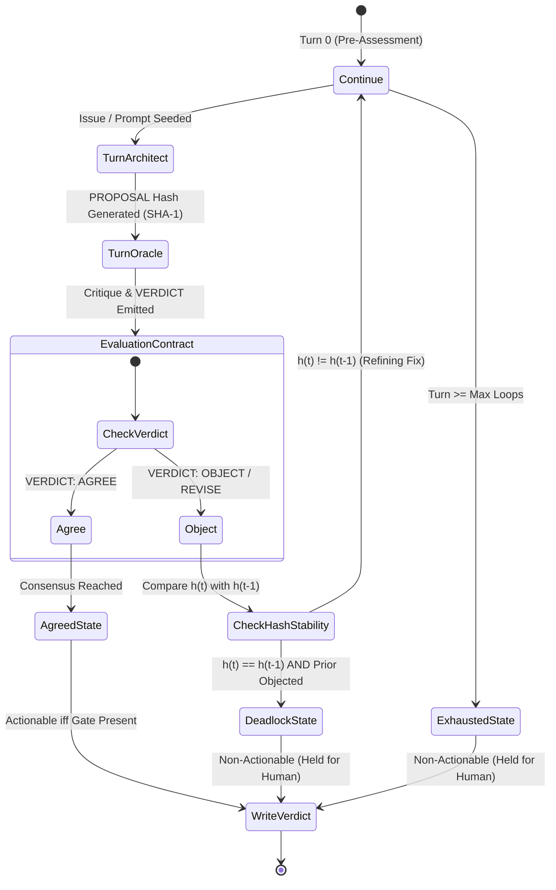

# Autonomous Context Engineering Audit & Document Optimization Playbook

> **Mission Objective:** Provide an authoritative, mathematically rigorous technical specification for context window budgeting, KV-cache prefix stability, multi-persona isolation, and automated grounding verification across the AI Factory pipeline. Reconciles theoretical context engineering invariants with empirical production mechanics.

---

## 1. Executive Overview & Foundational Invariants

### 1.1 Architectural Role within the Pipeline DAG
The Context Engineering subsystem governs the lifecycle, serialization, attention topology, and token allocation of all prompts, retrieved documents, and conversational turns throughout the AI Factory execution Directed Acyclic Graph (DAG). Located at the intersection of interactive multi-turn developer sessions (Aider Architect/Editor) and deterministic verification services (`validator.py`, `oracle_agent.py`, `deliberate.py`), the subsystem guarantees that language models operate with maximal instruction compliance, optimal positional attention, zero token bloat, and predictable VRAM cache reuse.

Within the pipeline DAG, each unit of work executes as an isolated node managed by `orchestrate.py`. The context engineering protocol dictates how context enters each node, how durable memory transitions across nodes, and how intermediate artifacts are pruned to prevent out-of-context crashes.

```
       [ Upstream Task Outputs & Source Code ]
                          │
                          ▼
        ┌───────────────────────────────────┐
        │   Context Engineering Subsystem   │
        │   - Byte-Parity Prefix Locking    │
        │   - Dynamic Token Budgeting (70%) │
        │   - Reciprocal Rank Fusion (c=60) │
        │   - History Vault Swapping        │
        └─────────────────┬─────────────────┘
                          │
        ┌─────────────────┴─────────────────┐
        ▼                                   ▼
┌──────────────────┐               ┌──────────────────┐
│ Interactive Pass │               │ Deterministic    │
│ (Aider Session)  │               │ Verification     │
│ - Ask / Diff     │               │ - Verbatim Substr│
│ - Refereed Debate│               │ - MiniCheck Prob │
└────────┬─────────┘               └────────┬─────────┘
         │                                  │
         └────────────────┬─────────────────┘
                          ▼
            [ Verified Git Commit / Diff ]
```

### 1.2 The Seven Foundational Invariants
All tasks, prompts, and pipeline scripts must strictly comply with the Seven Foundational Invariants. Violations of these invariants trigger immediate pipeline escalation or task termination.

1. **Deterministic Byte-Parity Prefix Invariant:**
   System prompts, static conventions (`CONVENTIONS.md`), and immutable read-only contexts must maintain exact character-for-character, byte-level stability across invocations. Any variation in whitespace, serialization order, or timestamp headers destroys KV-cache reuse, dropping cache hit rates from $\ge 90\%$ to $0\%$.
2. **Strict State Isolation & Zero Blast Radius:**
   Execution state must never leak across adjacent tasks or session boundaries. Active conversational memory, prompt history, and sidecar ledgers must be persisted to versioned disk files and cleared from active memory via session vault swapping (`.aider_factory/sessions/<name>/chat_history/`).
3. **The 70% Active Utilization Ceiling:**
   The active context window utilization $U_{\text{active}}$ must never exceed 70%–80% of the model's physical window ceiling ($C_{\text{window}}$):
   $$U_{\text{active}} \le 0.70 \cdot C_{\text{window}}$$
   Crossing this threshold causes severe multi-hop reasoning degradation, attention dispersion, and instruction neglect. Exceeding 85% utilization mandates compaction or vault swapping.
4. **The Protected Sentinel Set Invariant:**
   During context compaction, multi-turn handoffs, or sliding-window pruning, the Protected Sentinel Set must remain verbatim. Agents must never paraphrase, compress, or generalize:
   - Absolute and repository-relative file paths.
   - Exact symbol signatures, class names, and function identifiers.
   - Active Task IDs (`[Task ID: XXX]`).
   - Cryptographic verification hashes and OS exit codes.
5. **Affirmative Operational Boundaries:**
   Pure negative constraints (e.g., `DO NOT`, `NEVER`) suffer from high failure rates in autoregressive transformers due to semantic negation decay over long token spans. Every negative prohibition must be paired with an affirmative operational boundary and explicit replacement syntax (e.g., *"Do not leave deleted code blank; replace deleted blocks with `# Removed`"*).
6. **Deterministic-First Verbatim Grounding:**
   Grounding and verification must prioritize deterministic, exact-substring logic over model-based evaluation. A claim or citation is considered grounded only if the normalized text is an exact verbatim substring of the normalized source text ($\text{quote} \in \text{source}_{\text{norm}}$). LLM entailment scoring (MiniCheck) is reserved solely as a fallback annotator for surrounding prose.
7. **Output Isolation & Outer Context Protection:**
   Subprocesses executed by or within agents (`apply_agent.py`, `oracle_agent.py`) must isolate verbose execution logs (ANSI escape codes, file echoes, compiler traces) by redirecting them to `/dev/tty` (POSIX) or `CONOUT$` (Windows). Only clean, actionable diffs or concise markdown answers may be written to `stdout`, preventing token pollution in outer agent context windows.

---

## 2. System Topology & Lifecycle Flowcharts

### 2.1 Complete Pipeline Execution Lifecycle
The pipeline progresses through seven strictly defined lifecycle phases, enforcing deterministic gates between design, deliberation, execution, and audit.

```
+-----------------------------------------------------------------------------+
|                      PHASE 1: TARGETED QUERY FORMULATION                    |
|   - Structured prompt decomposition based on Primacy-Middle-Recency         |
|   - Deterministic identification of required corpus tables and dependencies |
+--------------------------------------|--------------------------------------+
                                       v
+-----------------------------------------------------------------------------+
|                      PHASE 2: RAG KNOWLEDGE RETRIEVAL                       |
|   - LanceDB Dense Vector Search + Lexical RRF Fusion (c=60)                 |
|   - Cross-Encoder / Listwise Reranking (Jina-v3.5 / BGE)                   |
|   - Prefix truncation to embedding model context window (6000 chars)        |
+--------------------------------------|--------------------------------------+
                                       v
+-----------------------------------------------------------------------------+
|                      PHASE 3: GAP ANALYSIS & SPEC DRAFTING                  |
|   - Architect Agent Formulates Multi-Task Implementation Blueprint          |
|   - Preservation of Protected Sentinel Set                                  |
|   - Generation of Atomic Task Schemas with Concrete Syntax Examples         |
+--------------------------------------|--------------------------------------+
                                       v
+-----------------------------------------------------------------------------+
|                      PHASE 4: DELIBERATIVE REFEREE GATE                     |
|   - Two-Party Oracle <-> Architect Deliberation Loop (Ask Mode)             |
|   - SHA-1 Proposal Hashing & Consensus Arbitration (`deliberate.py`)        |
|   - Actionable: State == 'agreed' AND Gate == 'present'                     |
|   - Non-Actionable: State in ('deadlock', 'exhausted') -> HELD FOR HUMAN    |
+--------------------------------------| (Approved / Actionable)
                                       v
+-----------------------------------------------------------------------------+
|                      PHASE 5: SURGICAL APPLICATION PASS                     |
|   - Headless Editor Execution (`apply_agent.py`)                            |
|   - Model Settings Upsert for Weak Model Routing                            |
|   - Verbose Inner Logs -> /dev/tty | Pure Git Diff -> stdout                |
+--------------------------------------|--------------------------------------+
                                       v
+-----------------------------------------------------------------------------+
|                      PHASE 6: DETERMINISTIC POST-AUDIT                      |
|   - Verbatim Substring Grounding (`validator.py`)                           |
|   - Ellipsis Splice Auto-Repair (`_autofix`, Gap <= 200 chars)              |
|   - MiniCheck Entailment Scoring on Surrounding Passage Prose               |
|   - Post-Debate Promotion (`[fixed]`, `[validated]`, `[unsupported]`)       |
+--------------------------------------|--------------------------------------+
                                       v
+-----------------------------------------------------------------------------+
|                      PHASE 7: COST AGGREGATION & CLOSE-OUT                  |
|   - Single-Pass Token and USD Ledger Aggregation (`aggregate_costs.py`)     |
|   - Session Cost Sidecar Persistence (`.oracle_session.json.costs.json`)    |
|   - Final Execution Verification & Clean Process Tree Termination           |
+-----------------------------------------------------------------------------+
```

### 2.2 Deliberative Referee State Machine
The two-party deliberation protocol between the Knowledge Oracle and the Coding Architect is mediated by a deterministic, dependency-free finite state machine in `deliberate.py`.



### 2.3 Session History Vault Swapping Topology
To guarantee strict state isolation without cross-session bleeding, `orchestrate.py` implements a state-swapping mechanism that alternates between the active session root and an isolated history vault.

```
Active Session Stage: .aider_factory/sessions/<name>/
  ├── .aider.chat.history.md
  ├── .aider.input.history
  ├── .aider.llm.history
  ├── .oracle_session.json
  ├── .oracle_session.json.costs.json
  └── .debate_aider_history.md
        │
   _swap_out_state(stem) ─── Copies Active Files ───┐
        │                                           │
        ▼                                           ▼
Session History Vault: .aider_factory/sessions/<name>/chat_history/
  ├── .aider.chat.history_<stem>.md
  ├── .aider.input.history_<stem>
  ├── .aider.llm.history_<stem>
  ├── .oracle_session_<stem>.json
  ├── .oracle_session_<stem>.json.costs.json
  └── .debate_aider_history_<stem>.md
        │
   _swap_in_state(stem) ──── Restores Stem Files ───┘
```

When a task targeting file stem `A` completes, its active files are synchronized into the vault under the `A` suffix. Before a task targeting stem `B` begins, all active stage files are wiped, and any existing historical files for stem `B` are copied into the active stage.

---

## 3. Technical Mechanics & Mathematical Formulations

### 3.1 KV-Cache Optimization & Prefix Stability
Autoregressive transformer inference scales with sequence length. In standard Multi-Head Self-Attention, query, key, and value tensors are computed across tokens:
$$\text{Attention}(Q, K, V) = \text{softmax}\left(\frac{Q K^T}{\sqrt{d_k}}\right)V$$

For an ongoing session with prompt sequence length $L_{\text{total}} = L_{\text{prefix}} + L_{\text{delta}}$, recomputing attention across the entire sequence incurs quadratic computational complexity:
$$\mathcal{O}\left((L_{\text{prefix}} + L_{\text{delta}})^2\right)$$

When $L_{\text{prefix}}$ is byte-identical across requests, modern inference engines (vLLM, llama.cpp, LiteLLM) bypass key-value tensor projection for the prefix, streaming the precomputed tensors directly from VRAM:
$$H_{\text{KV}} = \frac{L_{\text{prefix}}}{L_{\text{total}}} = \frac{L_{\text{prefix}}}{L_{\text{prefix}} + L_{\text{delta}}}$$

Where $H_{\text{KV}}$ represents the cache hit ratio. In steady-state execution where $L_{\text{delta}} \ll L_{\text{prefix}}$, computational complexity for the turn simplifies to:
$$\mathcal{O}\left(L_{\text{delta}} \cdot (2L_{\text{prefix}} + L_{\text{delta}})\right)$$

This delivers an empirical reduction in Time-to-First-Token (TTFT) of 75%–90% and eliminates redundant compute overhead.

### 3.2 Dynamic Token Budgeting Model
To maintain active token utilization below the 70% threshold ($U_{\text{active}} \le 0.70$), total prompt context $C_{\text{budget}}$ is governed by the dynamic token budgeting partition:
$$C_{\text{budget}} = T_{\text{prefix}} + T_{\text{repomap}} + T_{\text{retrieval}} + T_{\text{history}} + T_{\text{headroom}} \le 0.70 \cdot C_{\text{window}}$$

| Allocation Segment | Budget Share | Target Window (90k Model) | Description & Operational Function |
| :--- | :--- | :--- | :--- |
| **$T_{\text{prefix}}$** (Static Prefix) | 5% – 10% | 4,500 – 9,000 tokens | Immutable system instructions, core invariants, operational schemas. Must have byte-parity. |
| **$T_{\text{repomap}}$** (Repo Map) | 10% – 20% | 0 – 18,000 tokens | PageRank-weighted AST dependency graph of symbols. Set to 0 for isolated tasks. |
| **$T_{\text{retrieval}}$** (Vector RAG) | 20% – 30% | 18,000 – 27,000 tokens | Top-$k$ RRF-fused chunks from LanceDB tables, filtered by relevance scores. |
| **$T_{\text{history}}$** (State Ledger) | 20% – 30% | 18,000 – 27,000 tokens | Structured multi-turn debate ledgers, user requests, and prior assistant turns. |
| **$T_{\text{headroom}}$** (Generation) | 15% – 20% | 13,500 – 18,000 tokens | Generation buffer reserved for chain-of-thought (`reasoning_effort`) and tool calls. |

### 3.3 Positional Attention & "Lost-in-the-Middle" Mitigation
Autoregressive attention is subject to U-shaped positional bias: tokens located at the extreme beginning (Primacy) and extreme end (Recency) of the context window receive significantly higher attention weights than tokens in the middle (15%–70% relative depth).

```
Attention Weight
   ▲
   │  ████                                                ████
   │  ████                                                ████
   │  ████                                                ████
   │  ████                                                ████
   │  ████       ░░░░░░░░░░░░░░░░░░░░░░░░░░░░░░░░         ████
   │  ████       ░░░░░░░░░░░░░░░░░░░░░░░░░░░░░░░░         ████
   └─────────────────────────────────────────────────────────────►
     Primacy                    Middle                   Recency
    (Invariants & Roles)  (RAG Chunks & Ledgers)   (Active Tasks & Schemas)
```

To counteract the "Lost-in-the-Middle" degradation:
1. **Primacy Anchor (0%–15%):** Place immutable system definitions, behavioral boundaries, and security rules at the absolute start of the prompt.
2. **Context Middle (15%–70%):** House passive retrieved knowledge, code files, and historical conversation excerpts.
3. **Recency Anchor (70%–100%):** Re-state active task directives, concrete output schemas, affirmative constraints, and terminal checklists at the absolute end of the prompt payload.

### 3.4 Multi-Table Reciprocal Rank Fusion (RRF)
When fusing vector hit lists across disparate LanceDB tables (e.g., merging `collection_code` and `collection_docs`), score distributions are not directly comparable. `rag_manager.py` and `oracle_agent.py` normalize scores using Reciprocal Rank Fusion:
$$RRF\_Score(d) = \sum_{m \in M} \frac{1}{c + r_m(d)}$$

Where:
- $M$ is the set of queried tables.
- $r_m(d)$ is the 0-indexed rank of document $d$ within table $m$.
- $c = 60$ is the standard smoothing constant preventing early ranks from dominating.

To prevent filesystem traversal non-determinism from causing tie-breaking jitter, the sorting key enforces deterministic secondary ordering:
$$\text{SortKey}(d) = \left(-RRF\_Score(d),\, \text{source\_file}(d),\, \text{text}(d)[0:64]\right)$$

### 3.5 Proposal Stability & Consensus State Arbitration
In multi-turn debates, `deliberate.py` monitors proposal convergence by hashing the Architect's extracted `PROPOSAL:` line:
$$h_t = \text{SHA-1}\left(\text{normalize}(\text{proposal}_t)\right)[0:12]$$

Where $\text{normalize}(s)$ collapses all whitespace, normalizes unicode punctuation, and strips formatting delimiters.

Consensus state transitions over turn sequence $t = 1, \dots, T_{\text{max}}$ are evaluated via:
$$S_t = \begin{cases}
\text{'agreed'}, & \text{if } \text{verdict}_t = \text{'agree'} \\
\text{'deadlock'}, & \text{if } \text{verdict}_t \in \{\text{'object'}, \text{'revise'}\} \land h_t = h_{t-1} \land \text{verdict}_{t-1} \in \{\text{'object'}, \text{'revise'}\} \land t \ge 2 \\
\text{'exhausted'}, & \text{if } t = T_{\text{max}} \land \text{verdict}_t \ne \text{'agree'} \\
\text{'continue'}, & \text{otherwise}
\end{cases}$$

An agreed resolution is deemed actionable downstream only when backed by a physical verification gate:
$$\text{Actionable} = (S_t = \text{'agreed'} \land \text{gate\_present} = \text{True}) \lor \text{draft\_mode} = \text{True}$$

### 3.6 Normalized Character Error Rate ($CER$)
During optical character recognition and document ingestion in `rag_manager.py`, hypothesis text extracted by vision models is validated against reference PDF digital text layers using alphanumeric Levenshtein distance:
$$CER(\text{ref}, \text{hyp}) = \frac{\mathcal{L}\left(\text{norm}(\text{ref}),\, \text{norm}(\text{hyp})\right)}{\max\left(1,\, \text{len}(\text{norm}(\text{ref}))\right)}$$

Where $\text{norm}(s)$ strips all non-alphanumeric characters and converts text to lowercase:
$$\text{norm}(s) = \text{regex\_replace}(s, \text{r'[^a-z0-9]', ''})$$

- If $\text{len}(\text{norm}(\text{ref})) = 0$, $CER = 0.0$ (scanned image page; passes validation).
- If $CER \le 0.05$, OCR hypothesis is verified and accepted.
- If $CER > 0.05$, the page is retried up to `ocr_max_retries`. If $CER > 0.40$ persists and digital text exists, the pipeline automatically falls back to the native text layer.

### 3.7 Deterministic Ellipsis-Spliced Quote Stitching
In literature audits, agents frequently quote sources with internal ellipsis omissions (`"fragment 1 ... fragment 2"`). `validator.py` applies deterministic anchored stitching (`_autofix`) without invoking an LLM.

Let a quote be partitioned into $K$ fragments by ellipsis delimiters:
$$Q = \{p_1, p_2, \dots, p_K\}$$

Each fragment $p_k$ is located at character span $(s_k, e_k)$ within normalized source text $S_{\text{norm}}$ such that:
$$s_1 < e_1 \le s_2 < e_2 \le \dots \le s_K < e_K$$

The total inter-fragment gap distance $G_{\text{total}}$ is computed:
$$G_{\text{total}} = (e_K - s_1) - \sum_{k=1}^K (e_k - s_k)$$

The stitch is deterministically applied if and only if:
1. Every fragment $p_k$ is an exact substring of $S_{\text{norm}}$.
2. Fragments appear in strict monotonic ascending order.
3. Total gap distance satisfies:
   $$G_{\text{total}} \le 200 \text{ characters}$$
4. Surrounding passage passes semantic region grounding:
   $$\text{CosineSim}(\text{embed}(\text{passage}),\, \text{embed}(\text{source})) \ge \text{threshold}_{\text{region}}$$

If $G_{\text{total}} > 200$, the fragments span disparate regions, and the quote is held for agent deliberation.

### 3.8 Token Arithmetic of Summarization and `/clear`
Empirical verification on live 90k context models confirms that static read-only files ($T_{\text{files}}$) are preserved verbatim across conversational resets. Following an interactive `/clear` command, total context sent to the provider evaluates to:
$$T_{\text{post-clear}} = T_{\text{files}} + T_{\text{summary}} + T_{\text{user\_new}} + T_{\text{assistant\_resp}}$$

Using measured telemetry values from production audits:
$$T_{\text{post-clear}} = 20{,}013 + 2{,}700 + 20{,}000 + 2{,}218 = 44{,}931 \text{ tokens}$$

This releases 39,514 tokens from an overflowing 84k context window, reducing active utilization from $93.7\%$ to $49.8\%$ and completely preventing model crash limits ($90{,}112$ tokens).

---

## 4. Exhaustive CLI Invocations & Command Matrix

### 4.1 `aider-oracle` Command Matrix (`oracle_agent.py`)
Primary side-agent for RAG retrieval, multi-turn deliberative debates, and LanceDB maintenance.

| Parameter / Flag | Argument Type | Default Value | Description & Runtime Behavior |
| :--- | :--- | :--- | :--- |
| `<question>` | Positional String | `None` | Direct prompt or query passed to Knowledge Oracle. |
| `--file <path>` | File Path | `None` | Appends file contents to question; displays `[file: <path>]` in transcript. |
| `--config <path>` | File Path | Auto-detect | Explicit path to `.env.yml` or session configuration file. |
| `--collection <name\|path>` | String / Path | `knowledge` | Target LanceDB collection folder or explicit directory path. |
| `--mode <m>` | Choice | `top_k` | Retrieval mode: `top_k` (similarity), `no_retrieve`, or `full_document`. |
| `--type <code\|docs>` | Choice | `None` | Filters multi-table fusion to code (`*_code`) or docs (`*_docs`). |
| `--no-rag` | Flag | `False` | Disables vector retrieval entirely; forces pure LLM reasoning. |
| `--no-rerank` | Flag | `False` | Disables cross-encoder reranking; keeps raw vector distance order. |
| `--recall-k <N>` | Integer | `75+` | Candidate retrieval pool size prior to cross-encoder reranking. |
| `--debate [code\|review]` | Choice | `code` | Executes multi-turn Architect-Oracle debate with referee arbitration. |
| `--loops <N>` | Integer | `3` | Maximum turn loops per debate round. |
| `--rounds <N>` | Integer | `1` | Number of sequential outer debate rounds. |
| `--persist` | Flag | `False` | Continues debate exploration into deeper audit layers upon agreement. |
| `--pass-history` | Flag | `True` | Preserves accumulated context across sequential debate rounds. |
| `--no-pass-history` | Flag | `False` | Wipes debate session history between sequential rounds. |
| `--oracle-persona <path>` | File Path(s) | `None` | Injects custom persona markdown into Oracle system prompt. |
| `--architect-persona <path>`| File Path(s) | `None` | Injects custom persona markdown into Architect ask turn. |
| `--oracle-file <path>` | File Path(s) | `None` | Injects instructions specifically into Oracle context. |
| `--architect-file <path>` | File Path(s) | `None` | Injects instructions specifically into Architect context. |
| `--claims-only` | Flag | `False` | Runs paragraph claim verification over Oracle's output. |
| `--no-print` | Flag | `False` | Suppresses stdout output report in claims verification mode. |
| `--reasoning-effort <lvl>` | Choice | Config | Reasoning effort level: `low`, `medium`, or `high`. |
| `--temperature <val>` | Float | Config | Sampling temperature override for Oracle responses. |
| `--list` | Flag | `False` | Lists all LanceDB tables in active database and exits. |
| `--list-files` | Flag | `False` | Lists all unique source files across tables in collection. |
| `--add-file <path...>` | File Path(s) | `None` | Incrementally ingests files into active collection. |
| `--add-table <dir...>` | Dir Path(s) | `None` | Incrementally ingests directory tree into active collection. |
| `--add-web <url...>` | URL(s) / Files| `None` | Downloads, converts, and ingests web pages / llms.txt / sitemaps. |
| `--workers, -w <N>` | Integer | `1` | Concurrent worker threads for web fetching. |
| `--rm-table <name>` | String | `None` | Drops specified table from the active database. |
| `--rm-file <filename>` | String | `None` | Surgically deletes all chunks matching source file. |
| `--rm-db` | Flag | `False` | Wipes LanceDB vector store directory (preserves OCR cache). |
| `--clear [oracle]` | Flag | `False` | Wipes conversation history, debate files, and KV sidecars. |

### 4.2 `aider-apply` Command Matrix (`apply_agent.py`)
Executes headless, non-interactive code modifications derived from specifications or chat history.

| Parameter / Flag | Argument Type | Default Value | Description & Runtime Behavior |
| :--- | :--- | :--- | :--- |
| `files` | Positional List | Required | One or more target files to surgically modify. |
| `--spec, -s <path>` | File Path | Auto-detect | Explicit specification markdown file; defaults to parsing chat history. |
| `--turns, -t <N>` | Integer | `1` | Number of recent chat history turns to extract into active spec. |
| `--model, -m <name>` | String | Config | Overrides editor model for the headless edit pass. |
| `--session <name>` | String | Auto-detect | Target session name to resolve chat history and config. |
| `--no-diff` | Flag | `False` | Suppresses git diff output following successful apply pass. |
| `--stream` | Flag | `False` | Streams inner Aider execution output to terminal (`/dev/tty`). |

### 4.3 `aider-validate` Command Matrix (`validator.py`)
Audits evidence anchors, performs deterministic stitching, and scores claim entailment.

| Parameter / Flag | Argument Type | Default Value | Description & Runtime Behavior |
| :--- | :--- | :--- | :--- |
| `--file <path>` | File Path | Required | Target document containing anchors to audit. |
| `--source <path>` | File Path | Conditional | Normalized source text for verbatim substring verification. |
| `--report <path>` | File Path | Conditional | Output report markdown destination. |
| `--tag <name>` | String | `evidence` | Anchor tag family to verify (`evidence`, `validated`, `fixed`). |
| `--autofix` | Flag | `False` | Deterministically stitches ellipsis-spliced quotes ($\le 200$ chars). |
| `--finalize-unsupported` | Flag | `False` | Terminal demotion: marks agreed ungrounded quotes as `[unsupported]`. |
| `--claims-only` | Flag | `False` | Audits raw prose paragraphs without requiring `[evidence]` tags. |
| `--grounding-model <m>` | String | Config | Model identifier for MiniCheck entailment scoring. |
| `--entail-threshold <f>` | Float | `0.5` | Probability threshold for entailment acceptance ($P \ge 0.5$). |
| `--region-threshold <f>` | Float | `0.60` | Cosine similarity threshold for surrounding passage review. |
| `--region-margin <N>` | Integer | `2` | Number of lines surrounding anchor to extract into claim block. |
| `--region-paragraphs <N>`| Integer | `0` | Number of paragraphs surrounding anchor to extract into claim block. |
| `--top-k <N>` | Integer | `5` | Retrieved chunk count from LanceDB for region scoring. |
| `--db <path>` | Dir Path | Auto-detect | Path to LanceDB database directory. |
| `--collection <name>` | String | Auto-detect | Target table or collection name in LanceDB. |
| `--baseline-ledger <p>` | File Path | `None` | Pre-apply ledger tracking baseline quote hashes for deletion guard. |
| `--verify-all` | Flag | `False` | Audits claim prose even for quotes proven verbatim. |

### 4.4 `aider-research` Command Matrix (`research_agent.py`)
Conducts academic research, crawls sitemaps, and harvests web documentation.

| Parameter / Flag | Argument Type | Default Value | Description & Runtime Behavior |
| :--- | :--- | :--- | :--- |
| `search "<query>"` | Positional String | Required | Web research query string passed to SearXNG. |
| `--file <path>` | File Path | `None` | Reads multi-line research query from file. |
| `--academic` | Flag | `False` | Restricts search to arXiv, Google Scholar, CrossRef, and CORE. |
| `--engines <e1,e2>` | String | `None` | Comma-separated list of search engines (e.g., `google,bing`). |
| `--top <N>` | Integer | `10` | Maximum number of search results to harvest. |
| `--time-range <rng>` | Choice | `None` | Recency filter: `day`, `month`, or `year`. |
| `--links-only, -l` | Flag | `False` | Emits plain URL list to stdout (one per line). |
| `--out, -o <file>` | File Path | Auto-detect | Output file path for Markdown research report or URL list. |
| `--sitemap` | Flag | `False` | Switches mode to sitemap and `llms.txt` crawling. |
| `--grep, -g "<pat>"` | Regex Pattern | `None` | Case-insensitive inclusion regex for discovered URLs. |
| `--grep-exclude, -ge` | Regex Pattern | `None` | Case-insensitive exclusion regex for discovered URLs. |
| `--site-depth, -d <N>` | Integer | `1` | Recursive sub-sitemap discovery depth. |

### 4.5 Process Exit Code & Signal Contract
| Subsystem Entrypoint | Exit Code | Invariant Meaning & Telemetry Signature |
| :--- | :--- | :--- |
| `aider-oracle` | `0` | Success: Query answered, debate reached conclusion, or maintenance done. |
| `aider-oracle` | `1` | Execution Failure: Missing models, invalid arguments, or table missing. |
| `aider-apply` | `0` | Edit Success: Headless Aider edit applied cleanly, Git diff produced. |
| `aider-apply` | `1` | Execution Failure: Spec parsing error, timeout ($>300$s), or non-zero Aider exit. |
| `aider-validate` | `0` | Clean Audit: All quotes verbatim grounded, or no-progress guard triggered. |
| `aider-validate` | `1` | Tripped Anchors: Ungrounded quotes detected, or anchor count deletion detected. |
| `docling_runner.py` | `0` | Native Parse Success: Document converted cleanly to Markdown. |
| `docling_runner.py` | `3` | Degraded Content: Extracted text $\le 100$ characters (triggers Vision OCR fallback). |
| `kill_proc_tree(p)` | N/A | Process Tree Termination: POSIX `killpg(SIGKILL)` / Windows `taskkill /F /T`. |

---

## 5. Configuration Schema & YAML Knobs

The unified pipeline configuration file (`.env.yml` or `.aider_factory/sessions/<name>/session.yml`) governs model routing, endpoint resolution, context toggles, and RAG parameters.

### 5.1 Authoritative `.env.yml` Schema

```yaml
# ==============================================================================
# AI FACTORY UNIFIED PIPELINE CONFIGURATION SCHEMA
# ==============================================================================
name: "Context Engineering Production Pipeline"
working_directory: "/workspace/project"

# Global HTTP / Inference Endpoints
# Precedence: CLI Flag > Phase Config > Global Config > Environment Variable
endpoints:
  architect_api_base: "http://router:4000/v1"      # OpenAI-compatible Architect router
  editor_api: "http://router:4000/v1"              # Primary Editor model endpoint
  editor_api_fallback: "http://router:4000/v1"     # Fallback test repair editor endpoint
  weak_model_api_base: "http://router:4000/v1"     # Weak model endpoint for summarization
  rag_agent_api: "http://router:4000/v1"           # Knowledge Oracle side-agent endpoint
  embed_api_base: "http://router:4000/v1"          # Embedding service (None for cloud)
  ranking_api_base: "http://router:4000/v1"        # Remote cross-encoder reranker endpoint
  ocr_api_base: "http://vision-server:8000/v1"     # Vision OCR endpoint (None for cloud)
  grounding_agent_api: "http://localhost:8090/v1"  # MiniCheck entailment server endpoint

# Global Model Identifiers
models:
  architect_agent: "gemini/gemini-3.6-flash"       # Strategic planning & debate model
  editor_agent: "gemini/gemini-2.5-flash"          # Surgical code editing model
  editor_agent_test: "gemini/gemini-2.5-flash"     # Test suite iteration model
  editor_agent_test_fallback: "gemini/gemini-2.5-pro" # Escalation editor for attempt > 0
  weak_model: "openai/qwen3.8-27b-90k-udq4km"     # Local weak model for /clear summarization
  rag_agent: "gemini/gemini-2.5-flash"             # Oracle side-agent model
  embed_model: "gemini/text-embedding-004"         # Embedding model
  ranking_agent: "jinaai/jina-reranker-v3.5"       # Listwise / pairwise reranker model
  grounding_agent: "minicheck-flan-t5-large"       # Grounding verifier classifier model
  reasoning_effort: "high"                         # CoT effort: 'low', 'medium', 'high'
  temperature: 0.2                                 # Global sampling temperature

# Terminal TrueColor Customization (24-bit ANSI Hex)
colors:
  architect_debate: "#38bdf8"                      # Architect terminal stream color (Teal)
  oracle_debate: "#d3869b"                         # Oracle terminal stream color (Rose)

# Global Test Framework Integration
test_command_prefix: "uv run"
test_runner: "pytest {file}"
test_naming_and_path: "tests/test_{stem}.py"
loop_aider_test: 3                                 # Global maximum outer Aider loops
auto_lint: true                                    # Enforce linting after file edits
lint_cmd: "flake8"                                 # Linter command

# Execution Phase Sequence
phases:
  - name: "Phase_01_Architecture_Optimization"
    enabled: true

    # Context Engineering Runtime Toggles
    toggles:
      run_job_one: true                            # Execute Job 1 (Implementation)
      run_job_two: false                           # Execute Job 2 (Spec Validation Audit)
      run_job_three: false                         # Execute Job 3 (Test Authoring)
      iterate_test: true                           # Enable iterative test-driven repair loop
      auto_test: false                             # True: Aider 3-loop; False: Python outer loop
      pair_programming: false                      # True: interactive prompt; False: headless
      sticky_context: false                        # Accumulate completed files into context
      shared_history: false                        # False: isolate history per target stem
      yes_always: true                             # Bypass interactive confirmation gates
      auto_accept_architect: true                  # Auto-accept Architect proposals
      auto_commits: true                           # Generate atomic Git commits on edit
      auto_lint: true                              # Lint automatically on commit
      lint_cmd: "flake8"                           # Lint command override
      suggest_shell_commands: false                # Suppress shell command suggestions
      detect_urls: false                           # Prevent scraping web URLs in prompts
      disable_playwright: true                     # Disable browser automation tools
      map_tokens: 0                                # Repository map token budget (0 = disabled)
      map_refresh: "manual"                        # Repomap refresh: 'manual', 'always', 'auto'
      map_multiplier_no_files: 0.0                 # Multiplier when no files edited
      max_chat_history_tokens: 40000               # Threshold for weak-model auto-summarize

    # Multi-Turn Deliberative Referee Settings
    escalation_debate:
      loops: 3                                     # Maximum turn loops per debate round
      rounds: 2                                    # Number of outer debate rounds
      pass_history: true                           # Preserve chat history across rounds
      persist: false                               # Continue deeper exploration after agree
      oracle_persona: "skills/audit_persona.md"    # Custom persona for Oracle
      architect_persona: "skills/arch_persona.md"  # Custom persona for Architect
      oracle_file: "markdown/instructions/orc.md"  # Specialized instructions for Oracle
      architect_file: "markdown/instructions/ar.md"# Specialized instructions for Architect

    # Oracle Pre-Edit Deliberation Configuration
    oracle:
      start_job: true                              # Generate initial draft via Oracle
      template: "markdown/templates/draft.md"      # Template file for Oracle generation
      full_document: false                         # True: entire table; False: similarity
      pre_edit_debate:
        enabled: true
        insert_debate: [true, false, false]        # Active debate toggles for [Job1, Job2, Job3]
        loops: 3
        rounds: 1
        pass_history: true
        persist: false

    # RAG Vector Store & Ingestion Configuration
    rag:
      run_ocr_rag: true                            # Ingest documents before phase start
      collection_name: "context_engineering"       # Target LanceDB collection folder
      vectordb_overwrite: false                    # Overwrite existing tables
      batch: true                                  # Unified table (True) vs Per-Doc (False)
      retrieval_mode: "top_k"                      # 'top_k', 'no_retrieve', 'full_document'
      top_k: 20                                    # Retrieved chunk count
      recall_k: 75                                 # Candidate pool size before reranking
      chunk_size_chars: 1500                       # Markdown text chunk size
      chunk_overlap_chars: 300                     # Chunk overlap
      code_chunk_size: 2000                        # Tree-sitter AST split limit
      type_filter: "docs"                          # Filter fusion: 'code' or 'docs'
      use_docling: true                            # Parse PDF/docs natively via Docling
      docling_do_ocr: true                         # Enable OCR inside Docling pipeline
      docling_timeout: 120                         # Subprocess timeout in seconds

    # Evidence Grounding & Verification Configuration
    validation:
      enabled: true                                # Enable deterministic autofix & audit
      post_validate: true                          # Trigger healing loop if ungrounded
      validation_tag: "evidence"                   # Target anchor tag
      region_threshold: 0.60                       # Cosine similarity threshold for passage
      region_margin: 2                             # Line margin for claim extraction
      region_paragraphs: 0                         # Paragraph margin for claim extraction
      region_top_k: 5                              # Context chunks retrieved for region
      validation_loops: 3                          # Maximum healing iterations
      redo_oracle_job: false                       # Force re-generation of existing draft
      verify_all_claims: false                     # Verify claims even if quote is verbatim
      entail_threshold: 0.50                       # MiniCheck entailment acceptance cutoff
      claims_only: false                           # Raw prose mode (no [evidence] tags)

    # File Boundary Declarations
    files:
      target_files:
        - "src/aider_factory/python/orchestrate.py"
      extra_editable_files:
        - "src/aider_factory/python/env_utils.py"
      test_files:
        - "tests/test_orchestrate.py"
      context_files_job:
        - "README.md"
      context_files_test:
        - "tests/conftest.py"

    # Sticky Phase Auto-Discovery
    sticky_phases:
      editable: false                              # Inherit targets from strategy template
      readonly: false                              # Inherit context files from template
```

---

## 6. Operational Edge Cases, Failure Modes & Telemetry

### 6.1 Empirical Summarization Mechanics Across Aider Modes
Empirical end-to-end tests utilizing live server telemetry (`journalctl -u llama-server`) reveal critical differences in how Aider handles conversation history compression across execution modes:

| Trigger Mechanism | Coder Mode (`--code`) | Architect Mode (`--architect`) | Root Cause Mechanism & Telemetry Proof |
| :--- | :--- | :--- | :--- |
| **`/clear` Interactive Command** | **Fires reliably** via weak model | **Fires reliably** via weak model | Forces LRU slot allocation in llama.cpp: prompt eval jumps to 18,548 tokens, emitting 819 summary tokens. |
| **`max-chat-history-tokens` Threshold** | **Fires reliably** when crossed | **Bypassed / Does NOT fire** | Live session reached 64,432 history tokens with threshold set to 40k. Auto-summarization is completely bypassed. |
| **`--message --exit` (Headless)** | **Asyncio race failure** | **Asyncio race failure** | Throws `RuntimeError: cannot schedule new futures after shutdown`. Summarization coroutine severed. |
| **Two-Phase Architect Handoff** | N/A | **Decoupled threshold check** | Threshold check guards only the editor phase; the architect phase accumulates tokens without limit. |

### 6.2 The 440-Token vs 18,548-Token Weak-Model Probe Distinction
In Architect mode configured with a cloud main model and local weak model, llama.cpp server logs capture two distinct operational profiles:

```
[440-Token Invocations: Internal Aider Health Probe]
  Inference Type:  Static template probe / token counter
  Slot Selection:  LCP (Longest Common Prefix, f_sim_best = 1.000)
  Prompt Eval:     4 tokens / 140ms
  Generation:      198 tokens / 1.7s
  Total Time:      1.9s
  Graph Reused:    +9 per turn (incremental cache reuse)
  Draft Accept:    0.856 (high template-fitting rate)
  Classification:  INTERNAL TELEMETRY PROBE (NOT conversation summarization).

[18,548-Token Invocation: Genuine Weak-Model Summarization]
  Inference Type:  Authentic chat history compression triggered by /clear
  Slot Selection:  LRU (Least Recently Used slot, zero cache reuse)
  Prompt Eval:     18,548 tokens / 27.7s
  Generation:      819 tokens / 31.9s
  Total Time:      60.5s
  Graph Reused:    +234 (fresh allocation)
  Draft Accept:    0.740 (novel semantic content generation)
  Classification:  GENUINE SUMMARIZATION COMPRESSION.
```

The 440-token calls must not be mistaken for conversation summarization; they represent internal token counting. Only the LRU 18,548-token call represents real context compaction.

### 6.3 Asyncio Event Loop Race in Headless Execution
Executing non-interactive Aider sessions via `--message "<prompt>" --exit` triggers:
```text
RuntimeError: cannot schedule new futures after shutdown
```
This failure occurs because Aider's weak-model summarizer is scheduled as an asynchronous coroutine on the event loop. When `--exit` triggers immediate process shutdown, the event loop tears down before the future resolves.
- **Operational Rule:** Never rely on `--message --exit` to test or execute summarization. Use interactive sessions with stdin feeders or PTY scripts (`script -qfe`).

### 6.4 The Observability Gap & Server-Side Telemetry
In interactive Architect mode, Aider does not log to `stdout` or `stderr` when:
- The context threshold is evaluated.
- The weak model is invoked for summarization.
- Summarization completes or is skipped.

Aider's `--verbose` flag displays token totals but suppresses summarizer lifecycle events. Server-side inference telemetry is required to verify execution:
```bash
# Monitor live llama-server inference events
journalctl -u llama-server -n 50 -f
```

### 6.5 Threshold Propagation Chain
The `max_chat_history_tokens` configuration traverses a multi-layer propagation chain:
```
.env.yml (toggles.max_chat_history_tokens: 40000)
    │
    ▼
run_workflow.py (Task dataclass initialization)
    │
    ▼
orchestrate.py (Compiled into session .aider.conf.yml and CLI flags)
    │
    ▼
aider --max-chat-history-tokens 40000 (Subprocess execution)
    │
    ▼
Aider Runtime: ChatSummary.check()
```
In Architect mode, the dual-agent structure causes `ChatSummary.check()` to evaluate history against only one branch, allowing total conversation history to exceed 64k tokens even when restricted to 40k.

### 6.6 Root Cause of Context Window Overflow
When a session crashes with model context exhaustion ($97{,}723 > 90{,}112$ tokens):
1. **Model Context Ceiling:** 90,112 tokens.
2. **Immutable Read-Only Files:** 20,013 tokens (cannot be summarized).
3. **Effective Conversation Budget:** $90{,}112 - 20{,}013 = 70{,}099$ tokens.
4. **Configured Threshold:** 40,000 tokens.
5. **Actual History at Crash:** 64,432 tokens (auto-summarization never fired).
6. **Active Request Payload:** 20,000 tokens (log dump + prompt).
7. **Total Required:** $20{,}013 + 64{,}432 + 20{,}000 = 104{,}445 > 90{,}112$.

### 6.7 Context Overflow Triage & Recovery Workflow
When a session terminates due to context overflow:

```
[Context Window Overflow Detected]
               │
               ▼
[Step 1: Inspect Read-Only Footprint]
   - Calculate tokens in read_files: T_files
   - If T_files >= 0.50 * C_window:
     Prune comments, set map_tokens: 0
               │
               ▼
[Step 2: Execute Manual Session Clear]
   - In interactive mode: issue `/clear`
   - In pipeline mode: run `aider-oracle --clear oracle`
   - Reclaims ~40,000 tokens immediately
               │
               ▼
[Step 3: Verify Weak-Model Routing]
   - Inspect `.aider.model.settings.yml`
   - Ensure weak_model has valid api_base and api_key
               │
               ▼
[Step 4: Verify Subprocess Isolation]
   - Confirm headless worker output is isolated to /dev/tty
   - Assert only git diff reaches stdout
               │
               ▼
[Step 5: Run Cost Aggregation]
   - python src/aider_factory/python/aggregate_costs.py <log_file>
```

### 6.8 Permanent Regression Test Matrix
The test suite enforces context engineering invariants across the codebase:

| Test File | Verification Scope | Success Assertion |
| :--- | :--- | :--- |
| `test_e2e_max_chat_history_tokens.py` | Coder mode summarization & `--exit` race failure | OS return code `0`, regex matches `RuntimeError` during rapid shutdown. |
| `test_e2e_architect_summarization.py` | Architect mode `/clear` vs threshold bypass | Live `llama.cpp` inference telemetry verifies prompt eval tokens $\ge 15{,}000$. |
| `test_e2e_apply_agent_isolation.py` | Headless execution token isolation | Asserts that stderr receives execution telemetry while stdout contains only diff text. |
| `test_e2e_deliberate_consensus.py` | Referee finite state machine convergence | Asserts proposal hashing, consensus transitions, and ledger persistence. |

---
