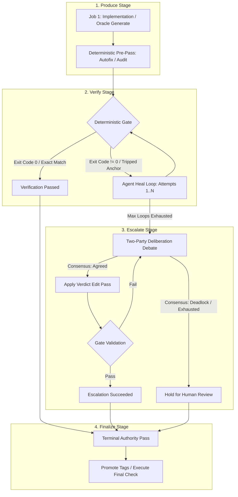
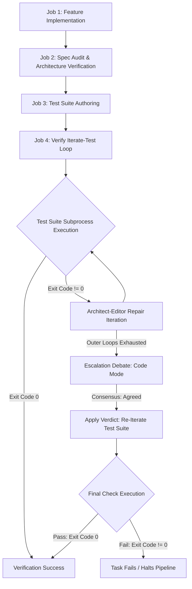
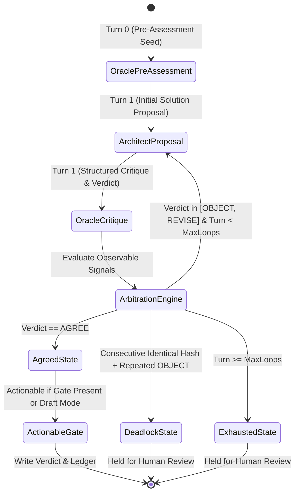

# AI Factory Core Philosophies & Engineering Invariants

## 1. Executive Overview & Foundational Invariants

The AI Factory Pipeline is a language-agnostic, multi-agent orchestration framework designed to execute deterministic software development, test-driven refactoring, and evidence-grounded literature reviews. Rather than relying on fragile, open-ended conversational loops or ungrounded autonomous code synthesis, the pipeline enforces a rigid Directed Acyclic Graph (DAG) execution lifecycle:

$$\text{Produce} \longrightarrow \text{Verify} \longrightarrow \text{Escalate} \longrightarrow \text{Finalize}$$

This unified structural skeleton applies invariant-for-invariant across diverse software domains (Python, R, Rust, Go, TypeScript, C++) and academic research contexts. The fundamental premise of the architecture is the strict demarcation between probabilistic model heuristic reasoning and deterministic program verification: **Large Language Models formulate task proposals and exercise domain judgment; deterministic algorithms, real compiler toolchains, and exact string operations prove system truth.**

### The 13 Foundational Engineering Invariants

The pipeline enforces 13 non-negotiable operational invariants across all agents, runtime tasks, and CLI utilities:

1. **Deterministic-First Verification**: Perform with deterministic code what deterministic code can prove; reserve Large Language Models strictly for authentic human judgment. Grounding and verification rely exclusively on real operating system exit codes (`0`), normalized verbatim substring searches, Tree-sitter Abstract Syntax Tree (AST) grammar checks, and independent logical assertions—never on an LLM's conversational self-assessment or subjective affirmation.
2. **Provable Truth & Precision Over Recall**: Grounding requires exact, normalized substring identity between claim quotes and source text, or clean execution of the permanent test suite. No fuzzy matching, edit-distance thresholds, or vector cosine approximations may grant grounding verification or pass/fail gate authority.
3. **Embeddings as Annotation-Only**: Semantic embeddings and vector database similarity scores operate strictly as diagnostic annotations or candidate retrieval mechanisms. Vector distances flag passages as potentially drifted or retrieve candidate source chunks for referee debates; they are strictly barred from granting or denying grounding.
4. **Only PROMOTE Tags Automatically**: The system never deletes a citation anchor, never fabricates evidence, and never automatically writes sentinel markers such as `"Not specified in paper."`. Ungrounded quotes must be actively repaired to match the source or explicitly flagged for human oversight.
5. **Tags ARE the State**: The deterministic validator (`validator.py`) is the sole authorized writer of terminal grounding tags (`[validated]`, `[fixed]`, `[unsupported]`). Agent prompts and LLM completions are restricted to authoring the initial resting tag `[evidence]` and modifying prose.
6. **Minimal-Delta Scoping**: All edits must be surgical, targeted, and minimal in blast radius. Untouched code paths, existing scaffolding, surrounding valid text, and stable test suites must be preserved with byte-for-byte fidelity.
7. **Full Cross-Validation After EVERY Change**: Verification must leverage verification logic independent of the code under test. Every code mutation must satisfy a multi-stage validation matrix: clean compilation, DAG dry-runs, independent artifact audits, and zero-mock physical disk test execution.
8. **Splittable & Combinable DAG**: Pipeline phases are file-coupled, order-independent, and fully modular. Every task node consumes inputs from physical disk artifacts and yields disk-backed outputs, ensuring that execution scales identically whether partitioned into dozens of granular phases or executed in a single monolithic run.
9. **No Pipeline Git Commits Except Aider Auto-Commits**: Internal pipeline orchestration code (`src/aider_factory/python/`) and working metadata (`.aider_factory/`) remain untracked in host git repositories. Versioned repository provenance is maintained strictly via atomic Aider auto-commits on modified target artifacts, structured ledgers, and referee verdicts.
10. **Single Python Interpreter & Universal Console Scripts**: All pipeline modules execute under a unified Python virtual environment. Core workflows are exposed as native, cross-platform console entrypoints (`aider-factory`, `aider-launcher`, `aider-oracle`, `aider-validate`, `aider-helper`, `aider-apply`, `aider-clean-lancedb`) defined in `pyproject.toml`, complemented by convenience POSIX bash wrappers (`.aider_factory/bash/*`) auto-provisioned on Linux and macOS.
11. **Native Aider Framework Integration**: The pipeline extends native Aider primitives (`--edit-format ask`, `--edit-format editor-diff`, `--message-file`, `.aider.conf.yml`, `.aider.model.settings.yml`) rather than wrapping them in fragile bespoke terminal wrappers.
12. **Reactive Ground-Truth Knowledge Oracle**: The Knowledge Oracle side-agent owns knowledge base ground truth, evaluating Architect proposals by retrieving and citing exact physical chunk evidence. It acts reactively upon specific architectural queries rather than as an unguided full-document generator.
13. **Plain, Objective Communication**: Agents must communicate plainly, concisely, and objectively. Sycophantic agreements, speculative affirmations, conversational filler, and hallucinations are strictly rejected in favor of technical rigor and rapid error correction.

---

## 2. System Topology & Lifecycle Flowcharts

### 2.1 Unified 4-Stage Execution Chassis

The pipeline organizes task execution into four sequential stages: **Produce**, **Verify**, **Escalate**, and **Finalize**.



### 2.2 Literature Review Grounding Lifecycle

The grounding lifecycle governs academic paper reviews, synthesis documents, and evidence verification.

```mermaid
flowchart TD
    L1[Oracle Generate: Fill Template from Vector DB] --> L2[Validator Autofix: Spliced Quote Stitching]
    L2 --> L3{Exact Substring Verification}
    L3 -- "All Quotes Grounded" --> L4[Terminal Finalize Pass]
    L3 -- "Tripped Quotes Found" --> L5[Agent Heal Loop: Post-Validate Script]
    L5 --> L6{Re-Check Grounding Gate}
    L6 -- "Grounding Proven" --> L4
    L6 -- "Validation Loops Exhausted" --> L7[Escalation Debate: Grounding Mode]
    L7 -- "Agreed + Gate Backed" --> L8[Apply Verdict Pass: soft_fail Active]
    L7 -- "Deadlock / Exhausted" --> L9[Hold as Evidence: Flag for Human Review]
    L8 --> L4
    L4 --> L10[Promote Grounded Quotes to [validated] or [fixed]]
    L4 --> L11[Demote Agreed Ungrounded Quotes to [unsupported]]
```

### 2.3 Code & Test Engineering Lifecycle

The code engineering lifecycle governs multi-job software development, test generation, and iterative bug repair.



### 2.4 Deliberation & Arbitration State Machine

The deliberation referee (`deliberate.py`) governs multi-turn debates between the Architect and the Knowledge Oracle without making model calls.



### 2.5 Session & State-Swapping Vault Isolation

The orchestrator isolates multi-file sessions by swapping active state files into a dedicated vault directory (`chat_history/`), preventing context leakage across files and phases.

```mermaid
flowchart LR
    subgraph ActiveStage [".aider_factory/sessions/<session_name>/"]
        A1[".aider.chat.history.md"]
        A2[".aider.input.history"]
        A3[".aider.llm.history"]
        A4[".oracle_session.json"]
        A5[".oracle_debate_session.json"]
    end
    subgraph VaultDir [".aider_factory/sessions/<session_name>/chat_history/"]
        V1[".aider.chat.history_<stem>.md"]
        V2[".aider.input.history_<stem>"]
        V3[".aider.llm.history_<stem>"]
        V4[".oracle_session_<stem>.json"]
        V5[".oracle_debate_session_<stem>.json"]
    end
    ActiveStage -- "_swap_out_state(stem)" --> VaultDir
    VaultDir -- "_swap_in_state(stem)" --> ActiveStage
```



---

## 3. Technical Mechanics & Deep-Dive Logic

### 3.1 Exact Substring Grounding & Normalization

Literature review claims and citations are provably grounded if and only if the normalized quote $Q$ is an exact substring of the normalized source OCR text $S$. The normalization function $\mathcal{N}(\cdot)$ collapses irregular whitespace runs, strips byte-order marks, and unifies unicode quotation marks and hyphens into standard ASCII representations:

$$\mathcal{N}(x) = \text{RegexReplace}\left(\text{Trim}(x), \text{s/\\s+/ /g}\right) \quad \text{with mappings: } \begin{cases} \text{’} \to \text{'} \\ \text{“}, \text{”} \to \text{"} \\ \text{–}, \text{—} \to \text{-} \end{cases}$$

The grounding predicate evaluates deterministically without probabilistic model evaluation:

$$\text{Grounding}(Q, S) = \begin{cases} 1 & \text{if } \mathcal{N}(Q) \subseteq \mathcal{N}(S) \\ 0 & \text{otherwise} \end{cases}$$

If $\text{Grounding}(Q, S) = 1$, the quote is certified verbatim. If $\text{Grounding}(Q, S) = 0$, the anchor trips, triggering automated stitching or escalation.

### 3.2 OCR Character Error Rate (CER) Validation

During rasterization and optical character recognition of multi-format documents (PDF, EPUB, XPS) via Vision-Language Models (VLMs), digital text layers $R$ (reference) are validated against OCR hypothesis markdown $H$ using normalized edit distance over alphanumeric projections $\phi(\cdot)$:

$$\phi(x) = \text{RegexReplace}\left(\text{Lower}(x), \text{s/[^a-z0-9]//g}\right)$$

$$\text{CER}(R, H) = \begin{cases} 0.0 & \text{if } |\phi(R)| = 0 \\ \frac{\text{Levenshtein}(\phi(R), \phi(H))}{|\phi(R)|} & \text{otherwise} \end{cases}$$

The OCR ingestion pipeline enforces three threshold boundaries:
- **Acceptance Boundary**: If $\text{CER}(R, H) \le \theta_{\text{cer}}$ (default $0.05$), the OCR page is accepted and written to disk.
- **Retry Gate**: If $\text{CER}(R, H) > \theta_{\text{cer}}$, the page is re-rasterized and re-queried up to `ocr_max_retries` (default $2$).
- **Native Digital Fallback**: If retries exhaust and $|\phi(R)| > 50$ while $\text{CER} > 0.40$, the system deterministically discards the vision output and adopts the native digital PDF text layer directly.

### 3.3 Reciprocal Rank Fusion (RRF) & Candidate Merging

When querying across multiple LanceDB tables $\mathcal{T}$ (e.g., partitioned code and doc corpora), candidates are retrieved up to candidate depth $k_{\text{recall}}$:

$$k_{\text{recall}} = \min\left(\max(k \times 4, 75, |\mathcal{T}| \times 4), 150\right)$$

Per-table rankings are fused via Reciprocal Rank Fusion with smoothing constant $c = 60$:

$$\text{RRF}(d) = \sum_{t \in \mathcal{T}} \frac{1}{60 + \text{rank}_t(d)}$$

Deterministic deduplication is keyed on $K(d) = (\text{source\_file}, \text{text}[:64])$. To eliminate filesystem tie-breaker variance across OS platforms, candidates are sorted by the composite key:

$$\text{SortKey}(d) = \left(-\text{RRF}(d), \;\; \text{source\_file}, \;\; \text{text}[:64]\right)$$

### 3.4 MiniCheck Sentence-Level Entailment Scoring

When semantic claim verification is enabled (`verify_all_claims: true` or `grounding_agent`), claims are evaluated over retrieved document chunks $D$ using sentence-level entailment classifiers (e.g., MiniCheck-Flan-T5-Large). The review claim text $C$ is partitioned into sentences $\mathcal{S}(C) = \{s_1, s_2, \dots, s_m\}$ where $|s_i| \ge L_{\min}$ (default 8 characters).

The overall claim grounding probability is governed by the least-supported sentence (the conservative weakest-link rule):

$$P(\text{Supported} \mid D, C) = \min_{s \in \mathcal{S}(C)} P_{\text{MiniCheck}}(s \mid D)$$

The claim is accepted if and only if:

$$P(\text{Supported} \mid D, C) \ge \theta_{\text{entail}} \quad (\text{default } 0.50)$$

If the probability falls below $\theta_{\text{entail}}$, the claim is flagged as ungrounded drift, routing the passage to referee debate or human review.

### 3.5 Proposal Hashing & Consensus Detection

During Architect-Oracle debates, the Architect's proposal line is hashed across turns to detect stalling or deadlock:

$$H(P) = \text{SHA1}\left(\mathcal{N}(P)\right)[:12]$$

where $P$ is the extracted line matching `(?im)^PROPOSAL:\s*(.+)$`.

Consensus state transitions operate deterministically:
- **`agreed`**: Oracle's latest verdict is `AGREE`.
- **`deadlock`**: $H(P_t) = H(P_{t-1}) \neq H(\emptyset)$ and the Oracle repeatedly issues `OBJECT` or `REVISE` across $\ge 2$ consecutive turns.
- **`exhausted`**: The loop counter reaches the maximum turn cap without consensus.
- **`continue`**: Further turns required.

### 3.6 Deterministic Ellipsis-Spliced Quote Stitching (`_autofix`)

When models cite text with ellipsis omissions (`...`, `…`, `. . .`), `validator.py` deterministically stitches fragments back to continuous source spans:
1. Split quote $Q$ into fragments $F = (f_1, f_2, \dots, f_m)$ by ellipsis regex `\s*(?:\.{3,}|\u2026|\.(?:\s+\.){2,})\s*`.
2. Locate non-overlapping spans of each normalized fragment in source $S$: $\text{span}(f_j) = (s_j, e_j)$ where $s_j \ge e_{j-1}$.
3. Calculate inter-fragment gap:
   $$\text{Gap} = (e_m - s_1) - \sum_{j=1}^{m} (e_j - s_j)$$
4. If $\text{Gap} \le 200$ characters, extract stitched span $S[s_1 : e_m]$.
5. Perform semantic claim check on surrounding review passage. If cosine/entailment score $\ge \theta$, replace quote and relabel to `[fixed]`. If score falls below threshold, decline stitch and escalate to debate.

### 3.7 Abstract Syntax Tree (AST) Code Chunking

Code files are chunked along semantic AST node boundaries using Tree-sitter parsers:
- Top-level definitions (functions, classes, methods) are extracted with line numbers ($L_{\text{start}}, L_{\text{end}}$) and symbol identifiers.
- Nodes smaller than `code_chunk_size` (default 2000 chars) are preserved intact.
- Nodes exceeding the size threshold recursively split child nodes.
- Leaf nodes exceeding the threshold fall back to line-level splitting with 3-line overlap.

### 3.8 Grounding Tag State Machine

```
               [evidence] (Authored Resting State)
                   │
         ┌─────────┴─────────┐
    Exact Match          Ellipsis Spliced
         │                   │
   Baseline Hash?      Gap <= 200 & Claim OK
    ┌────┴────┐              │
  Matches   Differs          ▼
    │         │           [fixed]
    ▼         ▼
[validated] [fixed]
    │         │
    └────┬────┘
   Still Ungrounded After Agreed Debate
         │
         ▼
   [unsupported] (Terminal Human Review Flag)
```

---

## 4. Exhaustive CLI & Parameter Reference

The AI Factory exposes 7 standardized console scripts configured in `pyproject.toml`.

| Command | Flags & Options | Parameter Types & Defaults | Exit Codes | Operational Behavior & Invariants Enforced |
| :--- | :--- | :--- | :--- | :--- |
| `aider-factory` | `[session_name]`<br>`[config_file.yml]`<br>`-s, --session <name>`<br>`-h, --help` | Positional strings.<br>Defaults to active `.env.yml` and timestamped session. | `0`: Success<br>`1`: Phase failure or missing configuration | Multi-agent DAG runner. Ingests phase specifications, builds task dependency trees, and executes pipeline stages. |
| `aider-launcher` | `[session_name]`<br>`[config_file.yml]`<br>`-s, --session <name>` | Positional strings.<br>Defaults auto-discovered. | Matches workflow exit code (`0` or `1`) | Cross-platform launcher equivalent to `factory` bash script. Pipes stdout/stderr via `OSTee` and runs post-execution cost analysis. |
| `aider-oracle` | `<query>`<br>`--file <path>`<br>`--debate [code\|review]`<br>`--loops <N>`<br>`--rounds <N>`<br>`--persist`<br>`--collection <name\|path>`<br>`--mode <top_k\|no_retrieve\|full_doc>`<br>`--type <code\|docs>`<br>`--no-rag`<br>`--no-rerank`<br>`--recall-k <N>`<br>`--claims-only`<br>`--reasoning-effort <low\|med\|high>`<br>`--temperature <float>`<br>`--oracle-persona <path>`<br>`--architect-persona <path>`<br>`--oracle-file <path>`<br>`--architect-file <path>`<br>`--add-file <paths...>`<br>`--add-table <dirs...>`<br>`--add-web <urls...>`<br>`-w, --workers <N>`<br>`--list`<br>`--list-files`<br>`--rm-table <name>`<br>`--rm-file <name>`<br>`--rm-db`<br>`--clear [oracle]` | `<query>`: string<br>`--loops`: int (3)<br>`--rounds`: int (1)<br>`--mode`: string (`top_k`)<br>`--recall-k`: int (75+)<br>`--workers`: int (1) | `0`: Query / debate success<br>`1`: Maintenance error or missing configuration | Tier-2a Knowledge Oracle interface. Performs vector retrieval, reranking, multi-turn pair debates, and incremental database maintenance. |
| `aider-validate` | `--file <review.md>`<br>`--source <source.md>`<br>`--report <report.md>`<br>`--ledger <ledger.json>`<br>`--tag <tag>`<br>`--region-threshold <float>`<br>`--region-margin <int>`<br>`--region-paragraphs <int>`<br>`--top-k <int>`<br>`--db <dir>`<br>`--collection <table>`<br>`--autofix`<br>`--finalize-unsupported`<br>`--baseline-ledger <path>`<br>`--claims-only`<br>`--grounding-model <m>`<br>`--entail-threshold <float>`<br>`--verify-all`<br>`--no-rerank`<br>`--recall-k <int>`<br>`--no-print` | `--file`: path<br>`--tag`: string (`evidence`)<br>`--region-threshold`: float (`0.60`)<br>`--entail-threshold`: float (`0.50`)<br>`--region-margin`: int (`2`)<br>`--top-k`: int (`5`) | `0`: All grounded or clean<br>`1`: Tripped ungrounded quotes or count dropped | Deterministic grounding auditor. Enforces exact-substring quote checks, ellipsis stitching, deletion guard floor limits, and tag promotion. |
| `aider-helper` | `"<prompt>"`<br>`--ask, -a`<br>`--terminal, -t`<br>`--master, -m`<br>`--expert, -e`<br>`--repo-map, -rm`<br>`--context, -c <paths>`<br>`--file, -f <path>`<br>`--clear` | `"<prompt>"`: string<br>`--context`: comma-separated paths / globs | `0`: Query resolved<br>`1`: Call failure or missing API key | Configuration architect and interactive terminal coding assistant with rich markdown streaming. |
| `aider-apply` | `<files...>`<br>`--spec, -s <path>`<br>`--turns, -t <N>`<br>`--model, -m <model>`<br>`--session <name>`<br>`--no-diff`<br>`--stream` | `<files>`: path list<br>`--turns`: int (`1`)<br>`--model`: string override | `0`: Edit applied<br>`1`: Subprocess error or timeout | Headless code editing utility. Extracts specifications from session chat histories or files and applies edits using `--edit-format editor-diff`. |
| `aider-clean-lancedb` | `<collection_name>`<br>`--project-dir <path>` | `<collection>`: string<br>`--project-dir`: path (current directory) | `0`: Cleanup success<br>`1`: Collection missing | Purges ephemeral OCR image folders, validation gate reports, and debate logs while preserving tables, source docs, and histories. |

---

## 5. Configuration Schema & YAML Knobs

The pipeline is configured via `.env.yml` or repo-specific `.env_<repo>.yml` files.

### 5.1 Fully Expanded YAML Schema

```yaml
name: "Production Pipeline"
working_directory: "/path/to/project"

# Global Test Framework Execution
test_command_prefix: "uv run"
test_runner: "pytest {file}"
test_naming_and_path: "tests/test_{stem}.py"
loop_aider_test: 3
auto_lint: true
lint_cmd: "ruff check --fix"

# Truecolor Terminal Theme (Hex RGB)
colors:
  architect_debate: "#38bdf8"    # Sky blue
  oracle_debate: "#d3869b"       # Rose

# API Endpoints
endpoints:
  architect_api_base: "http://127.0.0.1:4000/v1"
  editor_api: "http://127.0.0.1:4000/v1"
  editor_api_fallback: "http://127.0.0.1:4000/v1"
  weak_model_api_base: "http://127.0.0.1:4000/v1"
  rag_agent_api: "http://127.0.0.1:4000/v1"
  grounding_agent_api: "http://127.0.0.1:8090/v1"
  ranking_api_base: "http://127.0.0.1:4000/v1"
  ocr_api_base: "http://127.0.0.1:8080/v1"
  embed_api_base: "http://127.0.0.1:8081/v1"

# Model Routing & Global Inference Defaults
models:
  architect_agent: "openai/qwen3.6-27b-90k:LATEST"
  editor_agent: "openai/qwen3.6-27b-90k:LATEST"
  editor_agent_test: "openai/qwen3.6-27b-90k:LATEST"
  editor_agent_test_fallback: "gemini/gemini-2.5-pro"
  weak_model: "openai/qwen2.5-coder-7b"
  rag_agent: "openai/qwen3.6-27b-90k:LATEST"
  grounding_agent: "minicheck-flan-t5-large"
  ranking_agent: "jinaai/jina-reranker-v3.5"
  ocr_agent: "gemini/gemini-2.5-flash"
  embed_model: "gemini/text-embedding-004"
  embed_backend: "openai"        # "openai" or "sentence-transformers"
  reasoning_effort: "high"       # "low", "medium", "high"
  temperature: 0.2

# Global RAG Defaults
rag:
  type_filter: "code"            # "code", "docs", or null
  recall_k: 75
  docling_timeout: 180

# Sequential DAG Execution Phases
phases:
  - name: "Core Feature Engineering"
    enabled: true
    
    # Per-Phase Model & Endpoint Overrides
    models:
      editor_agent: "openai/qwen3.6-27b-90k:LATEST"
      reasoning_effort: "high"
      temperature: 0.0
    endpoints:
      editor_api: "http://127.0.0.1:4000/v1"

    # Execution Toggles
    toggles:
      pair_programming: false    # Interactive human-in-the-loop terminal mode
      run_job_one: true          # Execute Feature Implementation
      run_job_two: true          # Execute Spec Audit / Validation
      run_job_three: true        # Execute Test Authoring
      iterate_test: true         # Execute Automated Heal Loop
      auto_test: false           # Delegate 3-loop healing to internal Aider
      sticky_context: false      # Accumulate completed target files into reads
      shared_history: false      # Retain chat history across file jobs
      yes_always: true           # Auto-confirm tool prompts
      auto_accept_architect: true# Auto-apply architect proposals
      auto_commits: true         # Git commit after each edit pass
      auto_lint: true            # Run linter after edits
      lint_cmd: "ruff check --fix"
      suggest_shell_commands: true
      detect_urls: false         # Prevent web scraping browser installs
      disable_playwright: true   # Headless browser guard
      map_tokens: 0              # Repo map token budget
      map_refresh: "manual"      # "manual", "auto", "always"
      map_multiplier_no_files: 0
      max_chat_history_tokens: 100000

    # Sticky Phase Manifest Discovery
    sticky_phases:
      editable: false            # Extract target_files from strategy_template.md
      readonly: false            # Extract context_files from strategy_template.md

    # File Boundary Definitions
    files:
      target_files:
        - "src/module/core.py"
      extra_editable_files: []
      test_files:
        - "tests/test_core.py"
      context_files_job:
        - "docs/specs.md"
      context_files_test:
        - "docs/specs.md"

    # Prompt Plan Templates
    plans:
      job_one_plan: "markdown/templates/implement_feature.md"
      job_two_plan: "markdown/templates/audit_spec.md"
      job_three_plan: "markdown/templates/author_tests.md"
      iterate_plan: "markdown/templates/repair_bugs.md"
      deliberate_plan: "markdown/internal/deliberation_evidence_template.md"
      apply_plan: "markdown/internal/apply_evidence_template.md"

    # Knowledge Oracle Configuration
    oracle:
      template: "markdown/templates/oracle_eval.md"
      start_job: false
      full_document: false
      pre_edit_debate:
        enabled: true
        insert_debate: [true, false, false]  # Triggers for Job 1, 2, 3
        job_debate_template: "markdown/templates/debate_prompt.md"
        job_debate_collection: "knowledge_store"
        job_debate_db: ""
        loops: 3
        rounds: 1
        pass_history: true
        persist: false
        oracle_persona: "markdown/personas/oracle_auditor.md"
        architect_persona: "markdown/personas/architect_defender.md"

    # Deterministic Validation & Grounding
    validation:
      enabled: false
      post_validate: false
      validation_tag: "evidence"
      region_threshold: 0.60
      region_margin: 2
      region_paragraphs: 0
      region_top_k: 5
      validation_loops: 3
      redo_oracle_job: false
      verify_all_claims: false
      entail_threshold: 0.50
      claims_only: false

    # Escalation Debate (Iterate Test Failures)
    escalation_debate:
      loops: 3
      rounds: 1
      pass_history: true
      persist: false
      oracle_persona: ""
      architect_persona: ""

    # LanceDB Vector Database & OCR Settings
    rag:
      run_ocr_rag: false
      collection_name: "knowledge_store"
      vectordb_overwrite: false
      batch: true
      type_filter: "code"
      retrieval_mode: "top_k"    # "top_k", "no_retrieve", "full_document"
      top_k: 5
      recall_k: 75
      chunk_size_chars: 1500
      chunk_overlap_chars: 300
      code_chunk_size: 2000
      use_docling: true
      docling_do_ocr: true
      docling_timeout: 180
      cer_threshold: 0.05
      ocr_max_retries: 2
      ocr_parallel: 1
      ocr_max_tokens: 4096
```

### 5.2 Schema Parameter Mapping Table

| Parameter Path | Type | Default | Resolution Scope | Description |
| :--- | :--- | :--- | :--- | :--- |
| `working_directory` | string | `cwd` | Global | Absolute path to repository workspace. |
| `endpoints.*` | string URL | `null` | Global / Phase | HTTP/HTTPS API endpoints for LLM and RAG services. |
| `models.*_agent` | string | Provider IDs | Global / Phase | Model identifiers routed to LiteLLM or direct APIs. |
| `toggles.pair_programming` | boolean | `false` | Phase | Wraps session in an interactive terminal PTY harness. |
| `toggles.yes_always` | boolean | `!pair_prog` | Phase | Auto-approves Aider prompts when true. |
| `toggles.auto_commits` | boolean | `true` | Phase | Executes git commit after successful edits. |
| `toggles.auto_lint` | boolean | `true` | Phase | Runs `lint_cmd` automatically after edits. |
| `toggles.map_tokens` | integer | `0` | Phase | Context token budget reserved for tree repository map. |
| `sticky_phases.editable` | boolean | `false` | Phase | Extracts `target_files` dynamically from plan markdown. |
| `oracle.pre_edit_debate.insert_debate` | list[bool] | `[true, false, false]` | Phase | Activates pre-edit arbitration ahead of Jobs 1, 2, or 3. |
| `validation.region_threshold` | float | `0.60` | Phase | Minimum cosine similarity required to pass region audit. |
| `validation.entail_threshold` | float | `0.50` | Phase | Minimum MiniCheck probability required to pass grounding. |
| `rag.retrieval_mode` | string | `top_k` | Phase | LanceDB query strategy (`top_k`, `no_retrieve`, `full_document`). |

### 5.3 Global Configuration Files

- **`.aider.conf.yml` (Global Defaults)**: Locks KV cache behavior, UI settings, and background tasks (e.g., `max-chat-history-tokens: "90000"`, `timeout: "10800"`). The orchestrator sanitizes and compiles session-scoped configurations dynamically, stripping global history paths to prevent cross-session contamination.
- **`.aider.model.settings.yml` (Reasoning Budgets & Endpoints)**: Configures API bases, authentication keys, and reasoning effort. Setting `think: false` bypasses a model's Chain-of-Thought, saving Unified Memory bandwidth and ensuring fast, clean CLI returns for side-agents like the Knowledge Oracle.

---

## 6. Telemetry, Diagnostics & Operational Edge Cases

### 6.1 Anchor Count Deletion Guard (Floor Violation)

To strictly enforce Invariant 4 (never delete or hide evidence anchors), `validator.py` records the SHA-1 hashes of all recognized anchors prior to edits in `.debate.json`:

$$\text{quote\_baseline} = \left\{ H(Q_1), H(Q_2), \dots, H(Q_N) \right\}$$

During post-edit verification, if the count of recognized anchors $|A_{\text{current}}| < |\text{quote\_baseline}|$, the validator raises a **Floor Violation** error and emits exit code `1`. The pipeline blocks tag promotion, reporting:

```text
# Evidence grounding — needs healing — ANCHOR COUNT DROPPED (a quote was deleted/hidden)
> Anchor count X is below the baseline Y: a quote was removed or re-tagged outside the vocabulary.
```

### 6.2 Tripped Quote No-Progress Guard

During iterative repair loops, `validator.py` hashes the ordered sequence of currently failing anchors:

$$\text{TrippedKey}_t = \text{Tuple}\left(H(Q_1), H(Q_2), \dots, H(Q_m)\right)$$

If $\text{TrippedKey}_t = \text{TrippedKey}_{t-1}$, the validator detects oscillation without progress. It halts further loops, generates a diagnostic report, and returns exit code `0` to prevent infinite model token drain.

### 6.3 Soft-Fail vs. Final-Check Diagnostics

The iteration loop verifies attempt $N-1$ at the beginning of attempt $N$. Consequently, the final edit made during attempt $N_{\max}$ is not verified within the loop:
- **`final_check: true` (Code Mode)**: `orchestrate.py` re-executes `test_cmd` exactly once after the loop exhausts. The true exit code (`0` or `1`) is reported, eliminating false negatives.
- **`soft_fail: true` (Review Mode)**: Loop exhaustion is treated as a provisional soft success. The task defers authority to the terminal `_finalize` step, which promotes verified quotes and demotes remaining ungrounded anchors to `[unsupported]`.

### 6.4 Process Tree Termination (`kill_proc_tree`)

To eliminate orphan background processes from timed-out tests, sub-agents, or Aider processes, `kill_proc_tree` guarantees clean process group teardown:
- **POSIX (Linux/macOS)**: Captures process group ID via `os.getpgid(p.pid)` and broadcasts `os.killpg(pgrp, signal.SIGKILL)`.
- **Windows**: Executes atomic process tree termination via `taskkill /F /T /PID <pid>`.
- All standard I/O streams (`stdin`, `stdout`, `stderr`) are closed to release OS file locks.

### 6.5 Interactive PTY Terminal Harness & Shell Quirks

When running in pair-programming mode (`pair_programming: true`):
- **Linux**: Wrapped in GNU `script -qfe -c <cmd> .pair_capture.log`.
- **macOS**: Wrapped in BSD `script -q .pair_capture.log <shell> -c <cmd>`.
- **Windows**: Executed via line-buffered stdout streaming with direct teeing.

#### Model Shell Execution Constraints
1. **Architect Mode Suppresses Shell Execution**: When running in `--edit-format ask`, Aider suppresses model shell execution. Model-proposed shell commands are interpreted as informational text.
2. **The `yes-always` Quirk**: Setting `yes-always: true` suppresses model-suggested shell commands because Aider mandates explicit interactive human confirmation before executing shell commands.
3. **The `/run` Slash-Command**: Slash-commands (such as `/run .aider_factory/bash/oracle "..."`) are client-side terminal directives available only to human operators at the `architect>` prompt. Automated agents must invoke the bare binary or rely on DAG task nodes.

### 6.6 KV Cache Efficiency & Token Hygiene

To guarantee maximum prompt caching rates across multi-turn debates:
- `PYTHONHASHSEED="0"` is set to enforce deterministic dictionary and set serialization.
- `LITELLM_SESSION_ID` is set to a constant UUID per pipeline run, preserving LiteLLM router KV cache stickiness.
- File loading is strictly gated to Turn 1; subsequent turns inject delta questions, avoiding token blowup and cache eviction.
