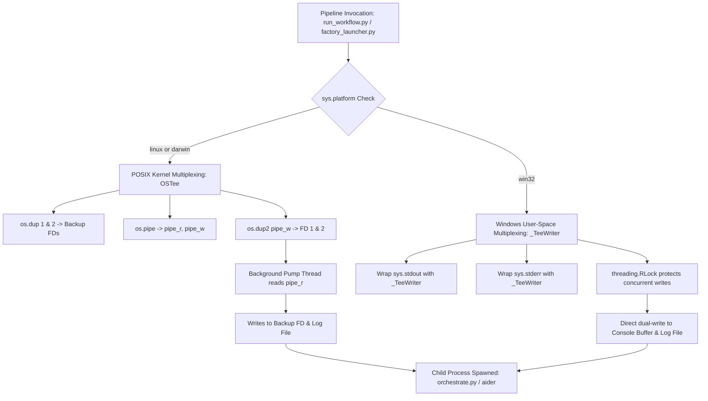
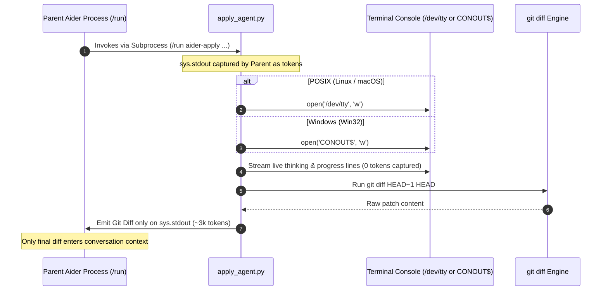

# Cross-Platform Architecture & OS Support Guide

## 1. Executive Overview & Foundational Invariants

The `aider-factory` framework coordinates multi-agent autonomous software engineering pipelines across Linux (Ubuntu/Debian), macOS (Darwin), and Windows (native Win32 and WSL 2). Autonomous pipeline coordination requires interfacing directly with operating system primitives—including pseudo-terminals (PTYs), file descriptor duplication, process tree signal propagation, memory-mapped files, and console character encodings. Rather than relying on fragile shell scripts or leaky platform abstractions, `aider-factory` implements deterministic, platform-specific branches in pure Python.

### Core Architectural Invariants

1. **Native Python Entrypoint Parity**: All pipeline capabilities are packaged as cross-platform Python console scripts in `pyproject.toml` (`aider-factory`, `aider-launcher`, `aider-oracle`, `aider-validate`, `aider-helper`, `aider-apply`, `aider-clean-lancedb`). On Windows, package managers (`uv`, `pip`) compile native `.exe` binary trampolines into the Python `Scripts\` directory, eliminating any requirement for Bash or WSL for standard execution.
2. **Deterministic Stream Multiplexing**: Kernel-level file descriptor duplication (`os.dup2` on file descriptors 1 and 2) is used exclusively on POSIX kernels (Linux, macOS). On Win32, where `os.dup2` on standard descriptors corrupts Python's buffered C-runtime I/O, output multiplexing branches cleanly to a thread-safe user-space proxy (`_TeeWriter`).
3. **Universal Forward-Slash Path Canonicalization**: All path handling—including configuration keys (`.env.yml`), LanceDB collection namespaces, template resolvers, and active target exclusions—normalizes path separators to forward slashes (`/`). Windows backslashes (`\`) are stripped or substituted at system boundaries to prevent regex escaping and YAML syntax corruption.
4. **Hierarchical Process Tree Termination**: Process group signaling (`os.killpg(os.getpgid(p.pid), signal.SIGKILL)`) is used on POSIX platforms. On Windows, child process termination uses `taskkill.exe /F /T /PID <pid>` to guarantee that compiler daemons, test harnesses, and model runtime servers are killed without leaving orphaned zombie processes.
5. **Headless Console Isolation (`/dev/tty` vs. `CONOUT$`)**: When headless sub-agents (such as `apply_agent.py`) execute within an outer Aider session, child stdout is isolated from parent context capture. Interactive terminal output streams directly to the physical controlling terminal (`/dev/tty` on POSIX, `CONOUT$` on Windows), gracefully falling back to silent buffering in non-interactive CI environments.
6. **Non-Blocking File Handle Lifecycle**: Arrow and LanceDB memory-mapped files on Windows NTFS enforce mandatory byte-range locking. Database and file manipulation routines explicitly close table handles and trigger Python garbage collection (`gc.collect()`) prior to directory teardown to prevent `[WinError 32]` sharing violations.

---

## 2. System Topology & Lifecycle Flowcharts

### 2.1 Cross-Platform Stream Multiplexing & Process Dispatch



### 2.2 PTY Emulation & Pair-Programming Tri-Branch

```text
                           [Interactive Task Dispatched]
                                         │
                                 sys.platform?
                 ┌───────────────────────┼───────────────────────┐
                 ▼                       ▼                       ▼
            sys.platform ==         sys.platform ==         sys.platform ==
               "linux"                  "darwin"                "win32"
                 │                       │                       │
      ┌──────────────────────┐ ┌──────────────────────┐ ┌──────────────────────┐
      │  GNU script Utility  │ │  BSD script Utility  │ │  Direct Popen Stream │
      │  script -qfe -c      │ │  script -q <log>     │ │  stdout=PIPE         │
      │  "<cmd>" <capture>   │ │  $SHELL -c "<cmd>"   │ │  stderr=STDOUT       │
      └──────────────────────┘ └──────────────────────┘ └──────────────────────┘
                 │                       │                       │
                 └───────────────────────┼───────────────────────┘
                                         ▼
                            [PTY Allocates Real Terminal]
                                         │
                         [Prompt Toolkit Renders UI]
                                         │
                         [Stream Tees to .pair_capture.log]
```

### 2.3 Headless Sub-Agent Output Isolation Lifecycle



### 2.4 Path Canonicalization & Resolution Topology

```text
                      [Raw Path Input: CLI / YAML / Glob]
                                         │
                                         ▼
                     p.replace("\\", "/").strip().lstrip("./")
                                         │
                       ┌─────────────────┴─────────────────┐
                       ▼                                   ▼
             Is Absolute Path?                    Is Relative Path?
                       │                                   │
             os.path.normpath()                   os.path.join(CWD, p)
                       │                                   │
                       └─────────────────┬─────────────────┘
                                         ▼
                        Normalized Forward-Slash Path
                       (e.g., tests/testthat/test-core.R)
                                         │
             ┌───────────────────────────┼───────────────────────────┐
             ▼                           ▼                           ▼
    [LanceDB Collection]        [Template Resolver]         [Exclude Matcher]
   table_name_for(p)          resolve_template_path()       is_test_path()
```

---

## 3. Technical Mechanics & Deep-Dive Logic

### 3.1 Mathematical Formulations

#### 3.1.1 Normalized Character Error Rate (CER) for Cross-Platform OCR
During RAG document ingestion, multi-platform OCR extracts text from binary documents. Across Linux, macOS, and Windows, newline representations (`\n` vs. `\r\n`) and Unicode normalization forms (NFC on Linux/Windows vs. NFD on macOS HFS+/APFS) can introduce synthetic discrepancies. The framework validates OCR fidelity against embedded PDF text layers using alphanumeric-normalized Levenshtein distance:

$$\text{CER}(s_{\text{ref}}, s_{\text{hyp}}) = \frac{d_{\text{Lev}}(\phi(s_{\text{ref}}), \phi(s_{\text{hyp}}))}{\max(1, |\phi(s_{\text{ref}})|)}$$

where the normalization projection $\phi(s)$ strips all non-alphanumeric characters and converts text to lowercase:

$$\phi(s) = \text{regex\_replace}(s.\text{lower}(), \text{"[^a-z0-9]"}, \text{""})$$

If $\phi(s_{\text{ref}}) = \emptyset$ (e.g., pure bitmap scans without text layers), $\text{CER} = 0.0$. OCR validation passes deterministically when:

$$\text{CER}(s_{\text{ref}}, s_{\text{hyp}}) \le \theta_{\text{CER}} \quad (\text{default: } \theta_{\text{CER}} = 0.05)$$

#### 3.1.2 Deterministic Reciprocal Rank Fusion (RRF) Across File Systems
Directory traversal order differs fundamentally between POSIX file systems (ext4/APFS inode ordering) and Windows NTFS (Master File Table B-tree ordering). When vector search hits are fused across multi-table collections, rank scores must not vary based on OS iteration sequence. Reciprocal Rank Fusion assigns scores with deterministic multi-key tie breaking:

$$\text{Score}_{\text{RRF}}(d) = \sum_{m \in M} \frac{1}{c + r_m(d)}, \quad c = 60$$

where $r_m(d)$ is the 0-indexed retrieval rank of candidate chunk $d$ in result set $m$. To guarantee identical ordering across operating systems, sorting applies a deterministic composite key tuple:

$$\mathbf{K}(d) = \left( -\text{Score}_{\text{RRF}}(d), \; \text{source\_file}(d), \; \text{prefix}_{64}(\text{text}(d)) \right)$$

#### 3.1.3 Token and Cost Aggregation Invariance
Log files generated on Windows may contain carriage returns (`\r\n`), whereas POSIX platforms generate line feeds (`\n`). The cost aggregation engine (`aggregate_costs.py`) parses token metrics and monetary costs using regex patterns invariant to line endings:

$$C_{\text{run}} = \sum_{i=1}^{N} c_{\text{msg}}^{(i)}, \quad c_{\text{msg}}^{(i)} \in \mathbb{R}_{\ge 0}$$

$$T_{\text{sent}} = \sum_{i=1}^{N} t_{\text{sent}}^{(i)}, \quad T_{\text{recv}} = \sum_{i=1}^{N} t_{\text{recv}}^{(i)}$$

Metric token multipliers are parsed with metric suffix evaluation:
$$\psi(\tau) = \begin{cases} 
\lfloor v \cdot 10^3 \rfloor & \text{if } \tau \text{ ends with 'k'} \\
\lfloor v \cdot 10^6 \rfloor & \text{if } \tau \text{ ends with 'm'} \\
\lfloor v \rfloor & \text{otherwise}
\end{cases}$$

#### 3.1.4 Process Timeout Watchdog Bounds
To prevent hung child processes across all platforms, streaming loops enforce timeout bounds:

$$T_{\text{stream}} = \max\left(300.0, \; \text{float}\left(\text{os.environ.get}(\text{"AIDER\_STREAM\_TIMEOUT"}, 300)\right)\right)$$

### 3.2 Win32 Binary Resolution & COMSPEC Dispatch

On Windows, executables installed via `pip`, `npm`, or package wrappers are frequently generated as `.cmd` or `.bat` batch shims (e.g., `aider.cmd`, `git.cmd`). Executing these directly via `subprocess.Popen(..., shell=False)` results in `[WinError 193] %1 is not a valid Win32 application`.

`orchestrate.py` and `apply_agent.py` resolve binaries using a two-stage dispatch pattern:
1. `shutil.which("aider")` resolves the absolute path on `%PATH%`.
2. If the file ends with `.cmd` or `.bat`, the command array is prepended with `%COMSPEC% /c`:

```python
if sys.platform == "win32":
    try:
        aider_bin = shutil.which("aider") or "aider"
    except Exception:
        aider_bin = "aider"
    cmd[0] = aider_bin
    if aider_bin.lower().endswith((".cmd", ".bat")):
        comspec = os.environ.get("COMSPEC", "cmd.exe")
        cmd = [comspec, "/c"] + cmd
```

### 3.3 Kernel File Descriptor Duplication vs. User-Space Stream Proxy

`run_workflow.py` multiplexes live console logs to disk via `OSTee`:

```python
class OSTee:
    def __init__(self, log_path: str):
        self.log_path = log_path
        self.log_file = open(self.log_path, "a", encoding="utf-8", errors="replace")
        self._lock = threading.Lock()
        self.running = True

        if sys.platform == "win32":
            self._orig_stdout = sys.stdout
            self._orig_stderr = sys.stderr
            sys.stdout = _TeeWriter(self._orig_stdout, self.log_file)
            sys.stderr = _TeeWriter(self._orig_stderr, self.log_file)
        else:
            self.orig_stdout_fd = os.dup(1)
            self.orig_stderr_fd = os.dup(2)
            self.pipe_r, self.pipe_w = os.pipe()
            os.dup2(self.pipe_w, 1)
            os.dup2(self.pipe_w, 2)
            self.thread = threading.Thread(target=self._pump, daemon=True)
            self.thread.start()
```

- **POSIX Pipeline**: Operating system descriptors `1` (stdout) and `2` (stderr) point directly to `pipe_w`. All C extensions, child processes, and native libraries flush directly into `pipe_w`. The background thread pumps 4096-byte buffers to both the original descriptor and the log file.
- **Win32 Pipeline**: `_TeeWriter` proxies `write()` and `flush()` methods behind an `RLock`. File descriptor replacement is bypassed, avoiding MSVCRT buffer deadlocks.

### 3.4 Cross-Platform Process Tree Termination (`kill_proc_tree`)

When sub-processes time out or receive a cancellation interrupt, killing only the root PID leaves spawned compilers, test runners, or local LLM servers running. `env_utils.kill_proc_tree(p)` implements platform-specific teardown:

```python
def kill_proc_tree(p) -> None:
    if not p:
        return
    try:
        if sys.platform == "win32":
            subprocess.run(
                ["taskkill", "/F", "/T", "/PID", str(p.pid)],
                stdout=subprocess.DEVNULL,
                stderr=subprocess.DEVNULL,
                check=False,
            )
        else:
            import signal
            try:
                pgrp = os.getpgid(p.pid)
                if pgrp > 1 and pgrp != os.getpgrp():
                    os.killpg(pgrp, signal.SIGKILL)
                else:
                    p.kill()
            except (ProcessLookupError, OSError):
                try:
                    os.killpg(p.pid, signal.SIGKILL)
                except Exception:
                    p.kill()
            except Exception:
                p.kill()
    except Exception:
        try:
            p.kill()
        except OSError:
            pass
```

### 3.5 Headless Terminal Isolation (`/dev/tty` vs. `CONOUT$`)

To stream inner Aider output to the user's display without allowing the outer Aider agent to capture it on `stdout`:

```python
tty_path = "CONOUT$" if sys.platform == "win32" else "/dev/tty"
try:
    tty_fh = open(tty_path, "w", encoding="utf-8", errors="replace")
except OSError:
    tty_fh = None
```

If the execution environment is non-interactive (e.g., automated test runners or GitHub Actions), `open()` raises `OSError`. The exception is caught cleanly, setting `tty_fh = None` so execution continues without logging errors.

### 3.6 LanceDB Table Name Normalization (`table_name_for`)

LanceDB restricts table names to alphanumeric characters, periods, dashes, and underscores `[0-9A-Za-z._-]`. On Windows, document filenames often contain spaces, parentheses, or Windows path separators. `rag_manager.py` enforces deterministic table names:

```python
def table_name_for(doc_or_stem):
    stem = os.path.splitext(os.path.basename(str(doc_or_stem)))[0]
    name = re.sub(r"[^0-9A-Za-z._-]+", "_", stem).strip("_")
    return name or "doc"
```

---

## 4. Exhaustive CLI & Parameter Reference

### 4.1 Native Console Scripts Command Matrix

The following executable console scripts are registered in `pyproject.toml` and installed into the Python binary search path across all operating systems:

| Console Script | Underlying Module | Description | POSIX Wrapper Equivalent | Win32 Behavior | Exit Codes |
| :--- | :--- | :--- | :--- | :--- | :--- |
| `aider-factory` | `run_workflow.py` | Primary multi-phase DAG workflow runner. | `.aider_factory/bash/factory` | Executes directly via Python `.exe` shim | `0`: Success<br>`1`: General error / failure |
| `aider-launcher` | `factory_launcher.py` | Wrapper launcher: tees run logs and triggers cost aggregation. | `.aider_factory/bash/factory` | Runs pipeline, captures UTF-8 log, runs cost summary | `0`: Success<br>`1`: Workflow error |
| `aider-oracle` | `oracle_agent.py` | Knowledge Oracle side-agent and RAG interface. | `.aider_factory/bash/oracle` | Native CLI argument parsing and LanceDB query | `0`: Answer returned<br>`1`: Model/DB failure |
| `aider-validate` | `validator.py` | Evidence grounding auditor and claim verification engine. | `.aider_factory/bash/validate` | Native exact-substring audit and entailment checking | `0`: All claims grounded<br>`1`: Grounding failed |
| `aider-helper` | `bootstrap.py` | Interactive configuration assistant and project bootstrapper. | `.aider_factory/bash/helper` | Inspects environment, scaffolds `.env_<repo>.yml` | `0`: Config generated<br>`1`: Missing keys/error |
| `aider-apply` | `apply_agent.py` | Headless code editing pass from specifications. | N/A (Internal tool) | Opens `CONOUT$` for console output | `0`: Edit applied<br>`1`: Edit failure |
| `aider-clean-lancedb` | `clean_lancedb.py` | Artifact cleanup utility (removes images/logs, keeps vector tables). | `.aider_factory/bash/clean_lancedb_runs.sh` | Safely clears collection images and validation logs | `0`: Complete<br>`1`: Path error |

### 4.2 Cross-Platform Command Invocations

#### Linux & macOS (Bash / Zsh)
```bash
# Initialize workspace configuration
aider-helper bootstrap

# Launch pipeline with session naming and custom config
aider-launcher -s experiment_01 .aider_factory/.env.yml

# Query knowledge base with reranking and collection override
aider-oracle --collection research_corpus "What is the primary loss function?"

# Run claims verification across document paragraphs
aider-validate --file docs/system_review.md --claims-only

# Surgically clean ephemeral cache images
aider-clean-lancedb research_corpus
```

#### Windows Native (PowerShell)
```powershell
# Set UTF-8 encoding environment flags
$env:PYTHONUTF8 = "1"
$env:PYTHONIOENCODING = "utf-8"

# Initialize workspace configuration
aider-helper bootstrap

# Launch pipeline via Python console script
aider-launcher -s win_session_01 .aider_factory\.env.yml

# Query knowledge base
aider-oracle --collection research_corpus "What is the primary loss function?"

# Clean ephemeral OCR images
aider-clean-lancedb research_corpus
```

#### Windows Native (Command Prompt / CMD)
```cmd
set PYTHONUTF8=1
set PYTHONIOENCODING=utf-8

aider-helper bootstrap
aider-launcher -s win_cmd_session .aider_factory\.env.yml
aider-oracle --collection research_corpus "What is the primary loss function?"
aider-clean-lancedb research_corpus
```

---

## 5. Configuration Schema & YAML Knobs

The pipeline configuration file (`.aider_factory/.env.yml` or session-specific `session.yml`) exposes platform-aware keys and execution toggles.

```yaml
# ==============================================================================
# AI Factory Multi-Phase Configuration Schema (Cross-Platform Specification)
# ==============================================================================

name: "Production Cross-Platform Pipeline"
# Project Root: Always use forward slashes, even on Windows
working_directory: "C:/Projects/ai_factory_workspace"

# Global Test Runner Settings
test_command_prefix: ""                     # Shell prefix (e.g., "uv run", "poetry run")
test_runner: "pytest {file}"                # Test command; {file} or {stem} replaced dynamically
test_naming_and_path: "tests/test_{stem}.py"# Test path convention for target files
loop_aider_test: 3                          # Outer attempt loops when iterate_test is enabled

# Global Linter & Shell Controls
auto_lint: true                             # Enable/disable automatic linter invocation
lint_cmd: "flake8"                          # Linter command (None defaults to language standard)

# ANSI Terminal Colors (Hex string converted to 24-bit Truecolor ANSI escapes)
colors:
  architect_debate: "#38bdf8"               # Architect terminal border color (Sky blue)
  oracle_debate: "#d3869b"                  # Oracle terminal border color (Rose)

# Global Endpoint Routing
endpoints:
  architect_api_base: "http://127.0.0.1:4000/v1"
  editor_api: "http://127.0.0.1:4000/v1"
  editor_api_fallback: "http://127.0.0.1:4000/v1"
  weak_model_api_base: "http://127.0.0.1:4000/v1"
  rag_agent_api: "http://127.0.0.1:4000/v1"
  ranking_api_base: "http://127.0.0.1:8001"
  grounding_agent_api: "http://127.0.0.1:8090/v1"
  ocr_api_base: "http://127.0.0.1:8080"

# Model Router Selection
models:
  architect_agent: "gemini/gemini-3.6-flash"
  editor_agent: "gemini/gemini-2.5-flash"
  editor_agent_test: "gemini/gemini-2.5-flash"
  weak_model: "openai/qwen2.5-coder-7b"
  rag_agent: "gemini/gemini-2.5-flash"
  ranking_agent: "jinaai/jina-reranker-v3.5"
  grounding_agent: "minicheck-flan-t5-large"
  embed_model: "BAAI/bge-m3"

phases:
  - name: "Implementation and Verification Phase"
    enabled: true

    # Execution Toggles
    toggles:
      run_job_one: true                     # Phase Job 1: Initial implementation
      run_job_two: false                    # Phase Job 2: Specification audit
      run_job_three: false                  # Phase Job 3: Write tests
      iterate_test: true                    # Iterative repair loop driven by test suite
      auto_test: false                      # Aider internal 3-loop test batching
      pair_programming: false               # Interactive mode (branches PTY by OS)
      shared_history: false                 # Share chat history across target files
      sticky_context: false                 # Pass completed phase files as context

      # Aider Runtime & Cache Controls
      map_tokens: 0                         # Set to 0 to disable repo-map overhead
      map_refresh: "manual"                 # Repo-map refresh cadence (auto | manual)
      map_multiplier_no_files: 0.0          # Multiplier when no files are loaded
      max_chat_history_tokens: 1000000      # Token window ceiling for history replay
      yes_always: true                      # Auto-confirm tool and command executions
      auto_accept_architect: true           # Auto-accept architect proposals in Ask mode
      auto_commits: true                    # Auto-commit git changes on task success
      suggest_shell_commands: false         # Allow model shell command proposals
      detect_urls: false                    # Automatically scrape detected URLs
      disable_playwright: true              # Bypass Playwright web scraping dependencies

    # Target Files Manifest
    files:
      target_files:
        - "src/module/calculator.py"
      extra_editable_files: []
      test_files:
        - "tests/test_calculator.py"
      context_files_job:
        - "README.md"
        - ".aider_factory/CONVENTIONS.md"
      context_files_test:
        - ".aider_factory/CONVENTIONS.md"

    # Vector Storage & Retrieval
    rag:
      run_ocr_rag: true                     # Ingest documents before phase starts
      collection_name: "knowledge"          # Subdirectory in .aider_factory/markdown/lanceDB/
      retrieval_mode: "top_k"               # Retrieval strategy: top_k | no_retrieve | full_document
      top_k: 20                             # Top chunks returned after reranking
      recall_k: 75                          # Stage-1 recall pool size before cross-encoder
      use_docling: true                     # Native Docling multi-format parser via uv
      docling_do_ocr: true                  # Fallback to OCR inside Docling
      docling_timeout: 300                  # Subprocess execution timeout in seconds
      batch: true                           # Build single collection table vs per-doc tables
      vectordb_overwrite: false             # Rebuild database tables from scratch
```

---

## 6. Telemetry, Diagnostics & Operational Edge Cases

### 6.1 Diagnostic Triage Matrix

| Error Signature | Operating System | Underlying Mechanism | Recovery Procedure |
| :--- | :--- | :--- | :--- |
| `[WinError 193] %1 is not a valid Win32 application` | Windows Native | `subprocess.Popen` attempted to execute a batch file (`.cmd` / `.bat`) directly without `cmd.exe`. | Handled automatically in `orchestrate.py` and `apply_agent.py` by prepending `COMSPEC /c`. For custom `test_runner` configs, prefix with `cmd /c <cmd>`. |
| `[WinError 32] The process cannot access the file because it is being used by another process` | Windows Native | NTFS byte-range lock held on memory-mapped `.lance` or SQLite files during directory deletion. | Call `del table, db` and execute `import gc; gc.collect()` before invoking `shutil.rmtree()`. |
| `script: invalid option -- 'e'` | macOS (Darwin) | macOS provides BSD `script`, which uses positional arguments and rejects GNU `-qfe` flags. | `orchestrate.py` detects `sys.platform == "darwin"` and executes `script -q <log> <shell> -c <cmd>`. |
| `UnicodeEncodeError: 'charmap' codec can't encode character` | Windows Native | Windows console defaults to legacy code page (cp1252/cp437) when rendering UTF-8 status emojis or ANSI escapes. | Set `PYTHONUTF8=1` and `PYTHONIOENCODING=utf-8` in environment or call `sys.stdout.reconfigure(encoding='utf-8')`. |
| `FileNotFoundError: [Errno 2] No such file or directory: '/dev/tty'` | Windows Native | Headless apply script attempted to open Unix controlling terminal `/dev/tty`. | `apply_agent.py` branches to `CONOUT$` on Win32, falling back to silent buffering if no console is attached. |
| Subprocess hangs indefinitely on timeout expiration | Linux / macOS / Windows | Killing parent PID left child daemon alive (e.g., test runner child process). | `kill_proc_tree(p)` issues process group SIGKILL on POSIX or `taskkill /F /T /PID` on Win32. |
| 5x–10x slowdown during Git operations or vector indexing | WSL 2 | Project directory is located on the Windows host filesystem (`/mnt/c/...`) crossing 9P protocol boundary. | Move project repository into the native Linux ext4 root filesystem (e.g., `~/projects/...`). |

### 6.2 Windows Subsystem for Linux (WSL 2) Best Practices

When operating on Windows, **WSL 2 is the recommended environment for end-to-end execution**.

1. **Filesystem Boundary Invariant**:
   Never execute pipelines on the `/mnt/c/` mount. The Windows 9P filesystem bridge introduces file access latency that degrades LanceDB queries, Git diff generation, and Tree-sitter parsing:
   ```bash
   # BAD: Severe 9P bridge latency
   cd /mnt/c/Users/Developer/repos/my_project

   # GOOD: Native Linux ext4 performance
   cd /home/developer/repos/my_project
   ```
2. **SearXNG and Service Management**:
   WSL 2 supports systemd. When initialized on WSL 2, `cli.py` automatically sets up rootless container services via user systemd units:
   ```bash
   # Check service status under WSL 2
   systemctl --user status searxng
   ```
3. **Environment Setup Protocol**:
   ```bash
   # Launch WSL 2 Ubuntu distribution
   wsl

   # Install uv and core tools
   curl -LsSf https://astral.sh/uv/install.sh | sh
   source ~/.bashrc

   sudo apt update && sudo apt install -y build-essential curl git universal-ctags podman
   ```
