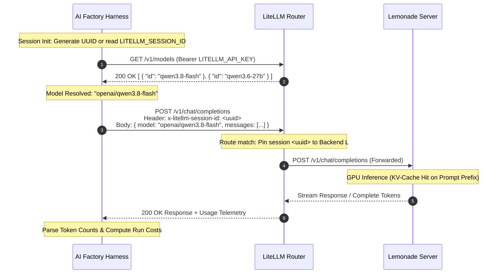

# LiteLLM Router & Lemonade Server Integration Specification

> **Authoritative Technical Specification**: Architecture, protocol mechanics, configuration schemas, CLI interfaces, and operational telemetry for deploying LiteLLM Router and Lemonade Server within the AI Factory pipeline.

---

## 1. Executive Overview & Foundational Invariants

### 1.1 Architectural Purpose

The AI Factory pipeline employs a decoupled, multi-tier inference architecture designed for high-throughput autonomous software engineering. Rather than coupling coding agents directly to disparate cloud providers or raw local weights, the system establishes a unified gateway topology:
1. **Lemonade Server**: Operates as the underlying bare-metal model execution platform, managing GGUF and Safetensors weights, GPU/CPU memory allocation, context window sizing, and inference engines (e.g., `llama.cpp`, `vLLM`).
2. **LiteLLM Router**: Sits between the execution engines and client harnesses as an intelligent OpenAI-compatible proxy, managing model alias routing, dynamic load-balancing, connection pooling, and session affinity.
3. **AI Factory Harnesses**: Command-line tools and DAG orchestrators (`aider-factory`, `aider-helper`, `aider-oracle`, `aider-apply`) communicate exclusively via standard OpenAI HTTP wire formats.

### 1.2 Foundational Invariants

Every subsystem integrating with the LiteLLM Router and Lemonade Server must strictly adhere to four foundational invariants:

1. **The `openai/` Wire Protocol Invariant**:
   All model identifiers consumed by the pipeline's Python SDK layers must carry the explicit prefix `openai/` (e.g., `openai/qwen3.8-flash`, `openai/Qwen3.8-27B-GGUF-UD-Q4_K_XL:latest`). Under no circumstances may client configurations specify `litellm/`, `lm_studio/`, `ollama/`, or `opencode/` prefixes. The Python `litellm` library relies on `openai/` to serialize payloads into standard OpenAI `/v1/chat/completions` REST contracts.

2. **Routing Boundary Isolation**:
   The LiteLLM Router manages conversational, reasoning, and code generation models. Dedicated in-process or local specialized engines—specifically dense embeddings (`sentence-transformers`, BAAI/bge-m3), tabular rerankers (`JinaForRanking`, CrossEncoder), and MiniCheck entailment classifiers—maintain dedicated endpoints (`embed_api_base`, `ranking_api_base`, `grounding_agent_api`) or execute in-process. The bootstrapper and orchestrator never overwrite specialized RAG slots with general router endpoints unless explicitly configured.

3. **Deterministic Session Affinity (`x-litellm-session-id`)**:
   Every HTTP request generated across an execution turn injects the custom header `x-litellm-session-id`. This binds iterative multi-turn dialogues (architect-oracle debates, aider apply passes) to the same physical inference backend instance, maximizing hardware KV-cache hit rates and eliminating cache thrashing.

4. **Zero-Leak Auth Fallback**:
   When communicating with authenticated LiteLLM proxies, client tools resolve valid bearer tokens via `LITELLM_API_KEY`. For local unauthenticated endpoints (e.g., direct llama.cpp servers), the credential safely falls back to `"sk-dummy"` to fulfill client header validation without security leakage.

---

## 2. System Topology & Lifecycle Flowcharts

### 2.1 Multi-Tier Topology

```
┌────────────────────────────────────────────────────────────────────────┐
│                        AI FACTORY HARNESS LAYER                        │
│                                                                        │
│   aider-factory          aider-helper          aider-oracle            │
│  (DAG Orchestrator)    (Terminal Assistant)   (Knowledge Agent)        │
│          │                      │                    │                 │
│          ▼                      ▼                    ▼                 │
│   litellm.completion(model="openai/<id>", api_base="http://...:4000/v1")│
│   Headers: { Authorization: "Bearer ...", x-litellm-session-id: ... }  │
└───────────────────────────────────┬────────────────────────────────────┘
                                    │ HTTP POST /v1/chat/completions
                                    │ HTTP GET  /v1/models
                                    ▼
┌────────────────────────────────────────────────────────────────────────┐
│                       LITELLM ROUTER PROXY TIER                        │
│                         (Port 4000 / Custom)                           │
│                                                                        │
│   • Request Authentication & Token Validation (LITELLM_API_KEY)        │
│   • Model Catalog Mapping & Alias Translation (/v1/models)             │
│   • Session Affinity Routing Table (keyed on x-litellm-session-id)     │
│   • Load Balancing & Failure Circuit Breaking                          │
└───────────────┬───────────────────────────────┬────────────────────────┘
                │ Proxy Forward                 │ Proxy Forward
                ▼ (OpenAI Format)               ▼ (Direct / Cloud)
┌───────────────────────────────┐   ┌────────────────────────────────────┐
│    LEMONADE SERVER INSTANCE   │   │     UPSTREAM CLOUD PROVIDERS       │
│     (Local / Network Host)    │   │                                    │
│  • Engine: llama.cpp / vLLM   │   │  • Anthropic Claude                │
│  • Models: Qwen, DeepSeek     │   │  • Google Gemini                   │
│  • GPU/CPU Context & Weights  │   │  • OpenAI GPT-4o / o1 / o3         │
└───────────────────────────────┘   └────────────────────────────────────┘
```

### 2.2 Component Interaction Matrix

| Subsystem | Network Address | Primary Protocol | Role & Responsibilities |
| :--- | :--- | :--- | :--- |
| **Harness Client** | Localhost / Subprocess | HTTP / Python SDK | Emits structured prompts, manages state ledgers, runs verification gates. |
| **LiteLLM Router** | `http://<host>:4000/v1` | OpenAI REST API | Normalizes authentication, enforces session stickiness, tracks token telemetry. |
| **Lemonade Server** | `http://<host>:11434/v1` | OpenAI / Engine REST | Hosts local weight caches, coordinates CUDA/ROCm execution, streams tokens. |
| **Rerank Server** | `http://<host>:8080/v1` | Custom Rerank REST | Implements listwise or pairwise candidate reranking via `/v1/rerank`. |
| **MiniCheck Server** | `http://<host>:8090/v1` | OpenAI Chat REST | Specialized classification shim scoring claim-to-evidence support probabilities. |

### 2.3 Session Lifecycle & Execution Sequence



### 2.4 Dynamic Router Key Resolution Flowchart

```
                 resolve_api_key(model, api_base, explicit_key)
                                      │
                         Is explicit_key provided and
                           not in DUMMY_KEYS?
                                 /          \
                             Yes/            \No
                               /              \
                    Return explicit_key     Is api_base present?
                                            /                  \
                                        Yes/                    \No
                                          /                      \
                         Check env vars:                     Scan provider keys
                    LITELLM_API_KEY,                    (GEMINI_API_KEY,
                    ORACLE_AGENT_API_KEY,               ANTHROPIC_API_KEY,
                    OPENAI_API_KEY.                     OPENAI_API_KEY, etc.)
                         Found valid key?                    Found valid key?
                            /        \                          /        \
                        Yes/          \No                   Yes/          \No
                          /            \                      /            \
                     Return key   Return "sk-dummy"      Return key    Return None
```

---

## 3. Technical Mechanics & Deep-Dive Logic

### 3.1 Prefix Resolution & Model Normalization

The pipeline mandates that all OpenAI-compatible endpoints pass model strings formatted as `openai/<model_id>`. When interacting with LiteLLM Router, the routing logic processes model names according to the following normalization function:

$$\text{Model}_{\text{normalized}}(m) = \begin{cases} 
m & \text{if } m \text{ starts with } \text{"openai/"} \\
\text{"openai/"} + m & \text{otherwise}
\end{cases}$$

In `env_utils.py`, `probe_router()` queries `/v1/models` and ensures every returned model identifier conforms to this schema:

```python
def probe_router(base_url: str, api_key: Optional[str] = None, timeout: int = 2) -> Optional[list]:
    """Query LiteLLM Router GET /v1/models. Returns sorted list of model ID strings or None on failure.

    Prepends 'openai/' to any bare model ID. Never raises.
    """
    if not is_valid_endpoint(base_url):
        return None
    import requests

    try:
        headers = {}
        if api_key and not is_dummy_key(api_key):
            headers["Authorization"] = f"Bearer {api_key}"
        resp = requests.get(
            f"{base_url.rstrip('/')}/models", headers=headers, timeout=timeout
        )
        if resp.status_code != 200:
            return None
        data = resp.json().get("data", [])
        return sorted(
            m["id"] if "/" in m["id"] else f"openai/{m['id']}"
            for m in data
            if isinstance(m, dict) and "id" in m
        )
    except Exception:
        return None
```

### 3.2 KV-Cache Optimization & Session Affinity Mathematics

Hardware inference engines running behind the Lemonade Server (such as `llama.cpp` server slots or `vLLM`) rely on persistent key-value (KV) attention caches. If subsequent requests land on different physical instances or reorder prompt tokens, the server must recompute attention matrices across the prompt tokens, creating latency spikes.

Let $T_{\text{prompt}}$ denote total prompt tokens, partitioned into an immutable prefix $T_{\text{prefix}}$ and a mutable delta $T_{\text{delta}}$:

$$T_{\text{prompt}} = T_{\text{prefix}} + T_{\text{delta}}$$

The theoretical KV-cache reuse ratio $R_{\text{cache}} \in [0, 1]$ is defined as:

$$R_{\text{cache}} = \frac{T_{\text{prefix}}}{T_{\text{prefix}} + T_{\text{delta}}}$$

When the LiteLLM Router receives requests tagged with `x-litellm-session-id: <session_uuid>`, it maps $\text{Hash}(\text{session\_uuid})$ to a dedicated Lemonade worker slot. Prompt tokens matching the cached prefix evaluate in $O(1)$ lookup time relative to generation:

$$t_{\text{inference}} = t_{\text{prefill}} \cdot (1 - R_{\text{cache}}) + t_{\text{decode}} \cdot T_{\text{completion}}$$

Where $t_{\text{prefill}}$ represents time-to-first-token per prompt token, and $t_{\text{decode}}$ represents per-token generation latency.

### 3.3 Token Cost & Budgeting Formulations

The AI Factory aggregates real-time usage metrics across both direct API responses and LiteLLM streaming deltas via `cost_tracker.py`. The financial cost of a single completion turn $C_{\text{msg}}$ is given by:

$$C_{\text{msg}} = \left( T_{\text{sent}} \cdot P_{\text{prompt}} \right) + \left( T_{\text{recv}} \cdot P_{\text{completion}} \right)$$

Where $P_{\text{prompt}}$ and $P_{\text{completion}}$ represent pricing per token (USD). The cumulative session cost $C_{\text{session}}$ across $N$ execution turns is formulated as:

$$C_{\text{session}} = \sum_{i=1}^{N} C_{\text{msg}, i}$$

The formatted output follows strict token and dollar rounding rules:
- Token counts: $\ge 1{,}000{,}000 \to \text{"1.2M"}$, $\ge 10{,}000 \to \text{"12k"}$, $\ge 1{,}000 \to \text{"1.2k"}$.
- USD costs: $< \$0.01 \to 4 \text{ decimal places } (\$0.0042)$, $\ge \$0.01 \to 2 \text{ decimal places } (\$0.15)$.

### 3.4 Automated Model Selection Heuristics

During workspace scaffolding (`aider-helper bootstrap`), `_select_models()` parses the list of active models exposed by the LiteLLM Router and assigns agent roles deterministically:

```python
def _select_models(available: list) -> dict:
    """Pick architect, editor, weak, embed, and reranker from a router model list.

    Returns dict with keys: architect, editor, weak, embed, reranker (values may be None).
    """
    if not available:
        return {}
    arch = next((m for m in available if "27b" in m.lower()), available[0])
    weak = next(
        (m for m in available if any(k in m.lower() for k in ("1.5b", "7b", "8b", "mini", "flash", "lite"))),
        arch,
    )
    embed = next((m for m in available if "embed" in m.lower()), None)
    rerank = next((m for m in available if "rerank" in m.lower()), None)
    return {"architect": arch, "editor": arch, "weak": weak, "embed": embed, "reranker": rerank}
```

### 3.5 Retrieval Ranking & Reciprocal Rank Fusion (RRF)

When querying LanceDB collections across multi-table literature or codebases, `oracle_agent.py` retrieves candidates per table and fuses them using Reciprocal Rank Fusion ($k=60$):

$$S_{\text{RRF}}(d) = \sum_{t \in \text{Tables}} \frac{1}{60 + \text{rank}_t(d)}$$

Where $\text{rank}_t(d)$ is the 0-indexed ranking of candidate document $d$ within table $t$. To break ties deterministically across heterogeneous filesystems, secondary and tertiary sort keys evaluate file path and text prefix:

$$\text{SortKey}(d) = \left( -S_{\text{RRF}}(d), \; \text{source\_file}, \; \text{text}[:64] \right)$$

#### Remote vs. Local Cross-Encoder Reranking

Following Stage 1 vector recall ($\text{recall\_k} = 30 \text{ to } 150$), Stage 2 reranking evaluates top candidates:
1. **Remote HTTP Reranker**: Dispatches POST to `f"{ranking_api_base}/v1/rerank"` with `{model, query, documents, top_n}`. If status $\ne 200$, control falls through to local in-process ranking without error.
2. **Local Listwise Reranker (`JinaForRanking`)**: Uses native HuggingFace `.rerank(query, documents)` joints across candidates.
3. **Local Pairwise Cross-Encoder (`CrossEncoder`)**: Evaluates sentence pair sequences $[q, d]$ via `predict()`.

### 3.6 Normalized Edit Distance / CER Formulation

For OCR ingestion verification in `rag_manager.py`, Character Error Rate ($\text{CER}$) between reference text $s_{\text{ref}}$ and hypothesis text $s_{\text{hyp}}$ is evaluated over alphanumeric projections:

$$\text{CER}(s_{\text{ref}}, s_{\text{hyp}}) = \frac{\text{Levenshtein}\left(\text{clean}(s_{\text{ref}}), \text{clean}(s_{\text{hyp}})\right)}{\max\left(1, \; \text{len}\left(\text{clean}(s_{\text{ref}})\right)\right)}$$

Where $\text{clean}(s) = \text{regex\_replace}(s, \text{"[^a-z0-9]"}, \text{""})$. If $\text{CER} \le 0.05$ (configurable via `cer_threshold`), hypothesis OCR text is accepted. If $\text{CER} > 0.40$ on embedded digital PDFs, the engine falls back to native PyMuPDF text layers.

### 3.7 Process Tree Termination Protocol (`kill_proc_tree`)

Autonomous execution loops in `orchestrate.py` and `apply_agent.py` enforce strict execution timeouts (default: 300s via `AIDER_STREAM_TIMEOUT`). Because child processes (`aider`, `Rscript`, `pytest`) spawn descendant processes, simple process termination leaks background workers. The system enforces complete process tree eradication:

```python
def kill_proc_tree(p) -> None:
    """Terminate a process and all spawned descendants across POSIX and Windows."""
    if not p:
        return
    try:
        if sys.platform == "win32":
            subprocess.run(
                ["taskkill", "/F", "/T", "/PID", str(p.pid)],
                stdout=subprocess.DEVNULL,
                stderr=subprocess.DEVNULL,
                check=False,
            )
        else:
            import signal
            try:
                pgrp = os.getpgid(p.pid)
                if pgrp > 1 and pgrp != os.getpgrp():
                    os.killpg(pgrp, signal.SIGKILL)
                else:
                    p.kill()
            except (ProcessLookupError, OSError):
                try:
                    os.killpg(p.pid, signal.SIGKILL)
                except Exception:
                    p.kill()
            except Exception:
                p.kill()
    except Exception:
        try:
            p.kill()
        except OSError:
            pass
    try:
        p.wait(timeout=5)
    except Exception:
        pass

    for stream_name in ("stdin", "stdout", "stderr"):
        s = getattr(p, stream_name, None)
        if s:
            try:
                s.close()
            except Exception:
                pass
```

---

## 4. Exhaustive CLI & Parameter Reference

### 4.1 CLI Command Matrix

| Command | Primary Subcommand / Flag | Argument Syntax | Exit Codes | Runtime Description & Behavior |
| :--- | :--- | :--- | :--- | :--- |
| `aider-helper` | `bootstrap` | `[--repo <dir>]` | `0` (Success), `1` (Fatal) | Deterministic workspace scaffolder. Scans environment keys, detects language framework, queries router `/v1/models`, and writes `.env_<repo>.yml`. |
| `aider-helper` | `query` | `-a "<prompt>"` | `0` (Success), `1` (Fatal) | Asks active configuration assistant. Ingests `.env.yml` into `<active_configuration>` and streams response. |
| `aider-helper` | `query` | `-at "<prompt>"` | `0` (Success), `1` (Fatal) | Interactive terminal assistant mode. Bypasses configuration search; streams general software engineering guidance. |
| `aider-helper` | `query` | `-am "<prompt>"` | `0` (Success), `1` (Fatal) | Master mode assistant. Injects master schema documentation, skills reference, and active configuration into prompt. |
| `aider-helper` | `query` | `-ae "<prompt>"` | `0` (Success), `1` (Fatal) | Expert mode assistant. Injects the factory service manual alongside schema and configuration context. |
| `aider-helper` | `query` | `--clear` | `0` (Success) | Flushes `.helper_session.json` and `.helper_terminal_session.json` state files. |
| `aider-oracle` | (Default Query) | `"<question>"` | `0` (Success), `1` (Fatal) | Queries LanceDB vector store and passes retrieved context + question to `ORACLE_AGENT_MODEL`. |
| `aider-oracle` | `--no-rag` | `"<question>"` | `0` (Success), `1` (Fatal) | Bypasses vector database retrieval; queries model directly through the router proxy. |
| `aider-oracle` | `--debate` | `[code\|review] [--loops N]` | `0` (Success), `1` (Fatal) | Initiates multi-turn Architect-Oracle deliberation loop arbitrated by deterministic state ledgers. |
| `aider-oracle` | `--list` | (None) | `0` (Success) | Enumerates all active tables registered in the target LanceDB directory. |
| `aider-oracle` | `--clear` | `[oracle]` | `0` (Success) | Wipes `.oracle_session.json`, costs sidecar, and transcript markdown. |
| `aider-factory` | (Workflow Execution)| `[<session>] [<config.yml>]` | `0` (Pass), `1` (Failure) | Orchestrates multi-phase DAG execution. Manages state isolation, testing gates, and Aider subprocesses. |
| `aider-apply` | (Headless Edit) | `<files...> [--spec <path>]` | `0` (Pass), `1` (Failure) | Parses recent chat specifications and executes a headless edit pass via `editor-diff` mode. |

### 4.2 Practical Terminal Recipes

```bash
# 1. Scaffolding a new repository using a LiteLLM Router
export LITELLM_BASE_URL="http://192.168.1.100:4000/v1"
export LITELLM_API_KEY="sk-prod-router-token-99"
aider-helper bootstrap

# 2. Querying the interactive assistant with context files
export AIDER_HELPER_API_BASE="$LITELLM_BASE_URL"
export AIDER_HELPER_MODEL="openai/qwen3.8-flash"
aider-helper query -at "How should we structure unit tests for the ingestion worker?" \
  --context "src/worker.py,tests/test_worker.py"

# 3. Direct Oracle query bypassing vector store
ORACLE_AGENT_MODEL="openai/qwen3.8-flash" \
ORACLE_AGENT_API_BASE="$LITELLM_BASE_URL" \
aider-oracle --no-rag "What are the core invariants of the LiteLLM Router integration?"

# 4. Multi-turn debate verification on code implementation
aider-oracle --debate code --loops 3 "Review PR #42 for concurrency safety"

# 5. Executing the full factory pipeline
aider-factory my_session_001 .aider_factory/.env_myrepo.yml
```

---

## 5. Configuration Schema & YAML Knobs

### 5.1 Complete Production Schema (`.env_<repo>.yml`)

```yaml
name: "Production Pipeline"
working_directory: "/home/user/workspace/my_project"
test_command_prefix: ""
test_runner: "uv run --with pytest pytest {file}"
test_naming_and_path: "tests/test_{stem}.py"
auto_lint: true
lint_cmd: "ruff check --fix ."

# ─────────────────────────────────────────────────────────────────────────────
# ENDPOINT GATEWAY ROUTING
# ─────────────────────────────────────────────────────────────────────────────
endpoints:
    # Primary conversational routing through LiteLLM Router
    architect_api_base: "http://192.168.1.100:4000/v1"
    editor_api: "http://192.168.1.100:4000/v1"
    editor_api_fallback: "http://192.168.1.100:4000/v1"
    weak_model_api_base: "http://192.168.1.100:4000/v1"

    # Dedicated RAG, Embedding, and Ranking Endpoints (Isolated Boundaries)
    rag_agent_api: "http://192.168.1.100:4000/v1"
    embed_api_base: ""                              # Empty: use local sentence-transformers
    ranking_api_base: "http://192.168.1.105:8080/v1" # Dedicated Jina/BGE reranker server
    ocr_api_base: ""                                # Empty: use cloud vision or local Docling
    grounding_agent_api: "http://127.0.0.1:8090/v1" # Dedicated MiniCheck server

# ─────────────────────────────────────────────────────────────────────────────
# GLOBAL MODEL CATALOG (All OpenAI-Compatible Models Require 'openai/' Prefix)
# ─────────────────────────────────────────────────────────────────────────────
models:
    architect_agent: "openai/qwen3.8-flash"
    editor_agent: "openai/Qwen3.8-27B-GGUF-UD-Q4_K_XL:latest"
    editor_agent_test: "openai/qwen3.6-27B-MTP-GGUF-Q4_K_M:latest"
    editor_agent_test_fallback: "openai/qwen3.6-27B-MTP-GGUF-Q4_K_M:latest"
    weak_model: "openai/qwen3-7b-instruct:latest"
    rag_agent: "openai/qwen3.8-flash"
    ranking_agent: "jinaai/jina-reranker-v3.5"
    embed_model: "BAAI/bge-m3"
    ocr_agent: "gemini/gemini-2.5-flash"
    grounding_agent: "openai/minicheck-flan-t5-large"
    reasoning_effort: "high"
    temperature: 0.2

# ─────────────────────────────────────────────────────────────────────────────
# PIPELINE PHASES
# ─────────────────────────────────────────────────────────────────────────────
phases:
  - name: "Implementation & Verification Phase"
    enabled: true

    toggles:
        run_job_one: true
        run_job_two: false
        run_job_three: true
        iterate_test: true
        auto_test: false
        yes_always: true
        auto_accept_architect: true
        auto_commits: true
        map_tokens: 0
        map_refresh: "manual"
        map_multiplier_no_files: 0.0
        max_chat_history_tokens: 1000000

    files:
        target_files:
            - "src/core/router.py"
        extra_editable_files: []
        test_files:
            - "tests/test_router.py"
        context_files_job:
            - "README.md"
        context_files_test: []

    rag:
        run_ocr_rag: false
        collection_name: "knowledge"
        retrieval_mode: "top_k"
        top_k: 5
        recall_k: 30
        use_docling: true
        docling_do_ocr: false
```

### 5.2 Configuration Knobs Reference Table

| Key Path | Type | Default Value | Scope | Description & Runtime Behavior |
| :--- | :--- | :--- | :--- | :--- |
| `endpoints.architect_api_base` | string | `""` | Global | Base URL for architect models. Injected into `OPENAI_API_BASE`. |
| `endpoints.editor_api` | string | `""` | Global | Base URL for primary editor models. Injected into `OLLAMA_API_BASE` / `LM_STUDIO_API_BASE`. |
| `endpoints.editor_api_fallback`| string | `""` | Global | Fallback base URL for escalated test iteration passes. |
| `endpoints.weak_model_api_base`| string | `""` | Global | Base URL for weak assistance models. Injected into `WEAK_MODEL_API_BASE`. |
| `endpoints.ranking_api_base`   | string | `""` | Global | Remote reranker endpoint hosting `/v1/rerank` services. |
| `models.architect_agent`       | string | (Required) | Global / Phase | Model used for high-level technical planning and ask-turns. |
| `models.editor_agent`          | string | (Required) | Global / Phase | Model executing surgical code modifications via Aider. |
| `models.weak_model`            | string | `""` | Global / Phase | Small model handling commit messages and repo summarization. |
| `models.reasoning_effort`      | string | `"high"` | Global / Phase | Reasoning intensity passed to thinking models (`low`, `medium`, `high`). |
| `models.temperature`           | float | `0.2` | Global / Phase | Sampling temperature for completion calls. |
| `toggles.map_tokens`           | integer| `0` | Phase | Token budget for Aider repo-map. Set to `0` for strict context isolation. |
| `toggles.auto_commits`         | boolean| `true` | Phase | Automatically commits Git changes on successful turns. |

---

## 6. Telemetry, Diagnostics & Operational Edge Cases

### 6.1 Failure Modes and Recovery Procedures

| Error Signature | Mechanism & Root Cause | Recovery Procedure |
| :--- | :--- | :--- |
| `AuthenticationError: Invalid proxy server token` | The client passed `"sk-dummy"` or an empty string to an authenticated LiteLLM Router. | Export valid token: `export LITELLM_API_KEY="sk-valid-token"`. Ensure token is loaded in active shell. |
| `litellm.NotFoundError: 404 Model Not Found` | Model name mismatch or missing `openai/` prefix in configuration. | Run `curl $LITELLM_BASE_URL/models` to discover active names. Prepend `openai/` (e.g., `openai/qwen3.8-flash`). |
| `OSError: [Errno 7] Argument list too long (E2BIG)` | Passing large source files directly as CLI parameters in subprocess execution. | The pipeline writes prompts to `.oracle_prompt_*.txt` temporary files. Verify `tempfile` permissions in `.aider_factory/temp/`. |
| `ProcessTimeoutExpired: Subprocess exceeded 300s` | Inference engine hung or large model cold-start compilation exceeded timeout. | Adjust timeout via `export AIDER_STREAM_TIMEOUT=600`. Check Lemonade GPU VRAM allocation. |
| `ConnectionRefusedError: Port 4000 unreachable` | LiteLLM Router service is stopped or firewall is blocking traffic. | Check router status: `systemctl status litellm` or inspect local Docker container logs. |

### 6.2 Health-Check & Diagnostic Verification Suite

Execute this sequence to verify end-to-end connectivity across all tiers:

```bash
# Step 1: Verify Router Connectivity and Authentication
curl -f -s -H "Authorization: Bearer $LITELLM_API_KEY" \
  "$LITELLM_BASE_URL/models" | python3 -m json.tool | head -n 25

# Step 2: Validate Interactive Helper Connectivity
aider-helper query -at "Respond with 'PONG' only"

# Step 3: Validate Direct Model Invocation via LiteLLM SDK
python3 -c "
import litellm, os
resp = litellm.completion(
    model='openai/qwen3.8-flash',
    messages=[{'role': 'user', 'content': 'ping'}],
    api_base=os.environ['LITELLM_BASE_URL'],
    api_key=os.environ.get('LITELLM_API_KEY', 'sk-dummy')
)
print('Response:', resp.choices[0].message.content)
"

# Step 4: Validate Knowledge Oracle Retrieval Pipeline
ORACLE_AGENT_MODEL="openai/qwen3.8-flash" \
ORACLE_AGENT_API_BASE="$LITELLM_BASE_URL" \
aider-oracle --no-rag "Confirm communication channel operational"
```
