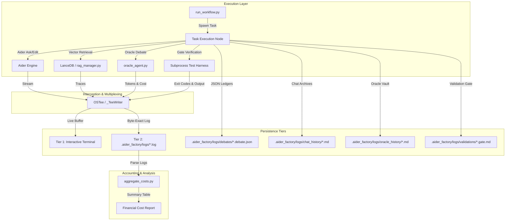

# Full-Stack Observability, Master Logging & Cost Accounting

## 1. Executive Overview & Foundational Invariants

The AI Factory guarantees **100% full-stack deterministic observability** across every layer of the multi-agent DAG pipeline. Execution telemetry, vector database operations, agent deliberations, child subprocess runs, and financial expenditures are captured with zero loss. Nothing executes within an untracked black box.

Standard user-space stream redirection (such as monkey-patching `sys.stdout` or wrapping Python file handles) silently fails in modern AI development environments. Compiled C-extensions (`pyarrow`, `levenshtein`), Rust-based vector database engines (`lancedb`), and child processes (`aider`, `git`, `pytest`, `Rscript`) communicate directly with operating system file descriptors 1 (`stdout`) and 2 (`stderr`). To guarantee byte-for-byte telemetry fidelity, the AI Factory implements kernel-level file descriptor duplication and cross-platform stream multiplexing.

### The Six Foundational Invariants

1. **Kernel-Level Stream Multiplexing (`OSTee`)**: User-space stream redirection drops low-level writes and child subprocess streams. All standard output and error descriptors are wired at the OS kernel level (`os.dup2` on POSIX, synchronized `_TeeWriter` stream wrappers on Windows). Every byte emitted by the Python runtime, compiled shared libraries, or child processes is captured simultaneously in real time.
2. **Strict Stream Functional Separation**: Sub-agents, such as the Knowledge Oracle (`oracle_agent.py`), enforce strict channel segregation: pure synthesis answers are directed to `stdout` for downstream machine consumption (e.g., Aider tool ingestion), while all diagnostic headers, chunk counts, retrieval metadata, RRF attributions, and cost receipts are routed to `stderr`.
3. **Three-Tier Durable Telemetry**: Every execution turn is captured simultaneously across three synchronized tiers:
   - *Tier 1: Live Interactive ANSI Streaming*: Real-time 24-bit Truecolor terminal rendering for human operators.
   - *Tier 2: Master Execution Replay Log*: Monolithic byte-for-byte execution log stored at `.aider_factory/logs/<config_stem>_run_<timestamp>.log`.
   - *Tier 3: Structured State Artifacts*: Isolated JSON debate ledgers, markdown transcripts, validation audit reports, and chat session vaults.
4. **Deterministic Additive Financial Accounting**: Every completion call emits an Aider-compatible token and USD cost line. Expenditures are aggregated into an additive financial ledger where the total run cost is the exact sum of all message expenditures:
   $$\text{Cost}_{\text{total}} = \sum_{m=1}^{|\mathcal{M}|} \text{Cost}_{\text{msg}}(m)$$
5. **Zero-Loss Interactive PTY Emulation**: Interactive pair-programming modes (`pair_programming: true`) wrap subprocesses in pseudo-terminal harnesses (`script -qfe` on Linux, `script -q` on macOS) to capture `prompt_toolkit` rich-text streams into `.pair_capture.log` without breaking terminal emulation or corrupting shell attributes.
6. **Context Window Anti-Pollution (`/dev/tty`)**: Headless tool invocations (`apply_agent.py`) write internal progress telemetry, compiler checks, and AST status directly to the physical controlling terminal (`/dev/tty` or `CONOUT$`) rather than standard `stdout`. This prevents conversational context window bloat in caller agents while preserving operator visibility.

---

## 2. System Topology & Lifecycle Flowcharts

### 2.1 Process Execution & Multiplexing Architecture

The process hierarchy isolates child execution while funneling all output through the kernel-level multiplexing harness:

```text
+---------------------------------------------------------------------------------+
|                              AI Factory Launcher                                |
|                   (factory_launcher.py / aider-launcher)                       |
+---------------------------------------------------------------------------------+
                                       |
                                       v
+---------------------------------------------------------------------------------+
|                       Master Workflow Runner (run_workflow.py)                  |
|  +---------------------------------------------------------------------------+  |
|  |                 OSTee / _TeeWriter Kernel Interception                    |  |
|  |         POSIX: os.dup(1/2) -> os.pipe() -> _pump() thread                 |  |
|  |         Windows: _TeeWriter(sys.stdout, sys.stderr) + RLock               |  |
|  +---------------------------------------------------------------------------+  |
+---------------------------------------------------------------------------------+
          |                                      |                        |
          v                                      v                        v
+--------------------+                +--------------------+    +-----------------+
|  Aider Architect   |                |  Knowledge Oracle  |    | Test Subprocess |
|    & Editor Core   |                | (oracle_agent.py)  |    | (pytest/Rscript)|
+--------------------+                +--------------------+    +-----------------+
          |                                      |                        |
          | [stdout/stderr]                      | [stderr]               | [stdout/err]
          v                                      v                        v
+---------------------------------------------------------------------------------+
|                           OSTee Pipe Multiplexer                                |
+---------------------------------------------------------------------------------+
         /                                                               \
        v                                                                 v
+-----------------------------------+             +-------------------------------+
|  Live Terminal Buffer (Raw ANSI)  |             |  Master Run Replay Log        |
|  sys.stdout.buffer.write()        |             |  .aider_factory/logs/*.log    |
+-----------------------------------+             +-------------------------------+
                                                                  |
                                                                  v
                                                  +-------------------------------+
                                                  | Financial Ledger Aggregation  |
                                                  | (aggregate_costs.py)          |
                                                  +-------------------------------+
```

### 2.2 Telemetry Lifecycle Flowchart

The lifecycle diagram illustrates how telemetry moves from DAG execution nodes through the multiplexer into durable storage and cost accounting:



---

## 3. Technical Mechanics & Deep-Dive Logic

### 3.1 Kernel-Level File Descriptor Multiplexing (`OSTee`)

Standard Python I/O redirection using `sys.stdout` only captures pure Python writes. Child processes spawned via `subprocess.Popen` or native C/Rust shared libraries bypass user-space stream redirection and write directly to file descriptors 1 (`stdout`) and 2 (`stderr`).

`OSTee` intercepts output at the kernel level across operating systems:

```text
POSIX Workflow:
[Process Writes (FD 1/2)] ──> [os.dup2(pipe_w, 1/2)] ──> [OS Kernel Pipe]
                                                               │
                                                               v
                                                      [_pump() Thread]
                                                        │           │
                     ┌──────────────────────────────────┘           └──────────────────────────┐
                     v                                                                         v
       [os.write(orig_stdout_fd)]                                                      [log_file.write()]
                     │                                                                         │
                     v                                                                         v
             [Physical Console]                                                        [Master Log File]
```

- **POSIX Systems (`linux`, `darwin`)**:
  1. The original OS file descriptors 1 and 2 are cloned using `os.dup(1)` and `os.dup(2)`.
  2. An OS pipe is allocated via `pipe_r, pipe_w = os.pipe()`.
  3. `os.dup2(pipe_w, 1)` and `os.dup2(pipe_w, 2)` redirect file descriptors 1 and 2 to the pipe write-end.
  4. A background daemon thread drains `pipe_r` in 4096-byte buffers, simultaneously writing raw bytes to `orig_stdout_fd` and decoding text into the master log file handle.
- **Windows (`win32`)**:
  1. Direct `os.dup2` replacement of file descriptors 1 and 2 causes deadlocks with MSVCRT buffered handles.
  2. Windows uses `_TeeWriter`, an atomic wrapper around `sys.stdout` and `sys.stderr` synchronized with a `threading.RLock()`.
  3. Concurrently, child processes spawned via `factory_launcher.py` or `orchestrate.py` have their stdout piped directly to streaming reader threads.

```python
class OSTee:
    """Redirects OS file descriptors 1 (stdout) and 2 (stderr) so that ALL output from
    Python AND child subprocesses (script, aider, Rscript) is captured to log_file
    while streaming live to the terminal.
    """

    def __init__(self, log_path: str):
        self.log_path = log_path
        self.log_file = open(self.log_path, "a", encoding="utf-8", errors="replace")
        self._lock = threading.Lock()
        self.running = True
        self._stopped = False

        if sys.platform == "win32":
            self._orig_stdout = sys.stdout
            self._orig_stderr = sys.stderr
            sys.stdout = _TeeWriter(self._orig_stdout, self.log_file)
            sys.stderr = _TeeWriter(self._orig_stderr, self.log_file)
            self.orig_stdout_fd = None
            self.orig_stderr_fd = None
            self.pipe_r = None
            self.pipe_w = None
            self.thread = None
        else:
            self._orig_stdout = None
            self.orig_stdout_fd = os.dup(1)
            self.orig_stderr_fd = os.dup(2)
            self.pipe_r, self.pipe_w = os.pipe()
            os.dup2(self.pipe_w, 1)
            os.dup2(self.pipe_w, 2)
            self.thread = threading.Thread(target=self._pump, daemon=True)
            self.thread.start()

    def _pump(self):
        while True:
            try:
                if self.pipe_r is None:
                    break
                data = os.read(self.pipe_r, 4096)
                if not data:
                    break
                if self.orig_stdout_fd is not None:
                    os.write(self.orig_stdout_fd, data)
                text = data.decode("utf-8", errors="replace")
                try:
                    self.log_file.write(text)
                    self.log_file.flush()
                except (ValueError, OSError):
                    break
            except Exception:
                break
```

### 3.2 Token Normalization & Cost Accounting Mathematics

#### Token Normalization Formula
Token counts emitted by LiteLLM and Aider utilize metric suffixes (`k`, `M`). The function `parse_tokens(s)` normalizes token strings to discrete integers:

$$T_{\text{norm}}(s) = \begin{cases} \left\lfloor v \cdot 10^3 \right\rfloor & \text{if } s \text{ matches } /[\d\.]+k/i \\ \left\lfloor v \cdot 10^6 \right\rfloor & \text{if } s \text{ matches } /[\d\.]+M/i \\ \lfloor v \rfloor & \text{otherwise} \end{cases}$$

Where $v = \text{float}(\text{strip\_commas}(s[:-1]))$.

#### Cost Aggregation Formula
Given a set of regex matches $\mathcal{M}$ extracted from a master log file via `COST_PATTERN`:

```python
COST_PATTERN = re.compile(
    r"Tokens:\s*(?P<sent>[0-9.,]+[kM]?)\s*sent,\s*(?P<recv>[0-9.,]+[kM]?)\s*received(?:[.\s]*"
    r"Cost:\s*\$\s*(?P<msg>[0-9.,]+)\s*message,\s*\$\s*(?P<sess>[0-9.,]+)(?:\s*session)?)?",
    re.IGNORECASE,
)
```

The run totals are computed as exact sums across all extracted message blocks:

$$\text{Tokens}_{\text{sent}} = \sum_{m \in \mathcal{M}} T_{\text{norm}}(m_{\text{sent}})$$

$$\text{Tokens}_{\text{recv}} = \sum_{m \in \mathcal{M}} T_{\text{norm}}(m_{\text{recv}})$$

$$\text{Cost}_{\text{total}} = \sum_{m \in \mathcal{M}} \text{Cost}_{\text{msg}}(m)$$

The cumulative session cost for multi-turn side-agents (`cost_tracker.py`) is updated recursively:

$$\text{Cost}_{\text{session}}(t) = \text{Cost}_{\text{session}}(t-1) + \text{Cost}_{\text{msg}}(t)$$

Formatting precision adapts dynamically based on magnitude:
$$\text{fmt\_cost\_usd}(C) = \begin{cases} \text{sprintf}("\%.4f", C) & \text{if } 0 < C < 0.01 \\ \text{sprintf}("\%.2f", C) & \text{if } C \ge 0.01 \\ "0.00" & \text{if } C \le 0 \end{cases}$$

### 3.3 Truecolor ANSI Projection

Pipeline configurations define debate agent colors in standard 6-digit hex format (`#RRGGBB`). `run_workflow.py` converts these values into 24-bit Truecolor ANSI escape sequences via `_hex_to_ansi`:

$$(R, G, B) = \left( \text{hex}[0:2]_{16}, \text{hex}[2:4]_{16}, \text{hex}[4:6]_{16} \right)$$

$$\text{Sequence} = \texttt{"\textbackslash 033[38;2;"} + \text{str}(R) + \texttt{";"} + \text{str}(G) + \texttt{";"} + \text{str}(B) + \texttt{"m"}$$

Defaults:
- **Architect Turn**: `#38bdf8` $\rightarrow \texttt{\textbackslash 033[38;2;56;189;248m}$ (Sky Blue)
- **Oracle Turn**: `#d3869b` $\rightarrow \texttt{\textbackslash 033[38;2;211;134;155m}$ (Soft Rose)

Setting `FORCE_COLOR=1` ensures that terminal libraries (such as Rich) emit full ANSI sequences even when standard output is captured via a pipe.

### 3.4 Interactive PTY Emulation (`script`)

Aider relies on `prompt_toolkit` for interactive terminal formatting. Standard subprocess piping destroys terminal attributes, resulting in raw escape code errors or immediate application termination. When `pair_programming: true` is configured, `orchestrate.py` wraps execution in OS-specific PTY harnesses:

- **Linux**: `script -qfe -c "<cmd>" <capture_log>`
  - `-q`: Quiet mode (suppresses start/done banners).
  - `-f`: Flushes writes immediately after each write event.
  - `-e`: Returns the exit status of the child process.
- **macOS (BSD)**: `script -q <capture_log> <shell> -c "<cmd>"`
  - Positional argument syntax compatible with BSD `script`.
- **Windows**: Direct execution piping stdout line-by-line to `.pair_capture.log` while writing to the console.

### 3.5 Context Protection via `/dev/tty` Streaming

When `apply_agent.py` executes inside an Aider chat session via the `/run` directive, standard `stdout` is captured by Aider and injected directly into the LLM context window. Raw agent execution produces 40,000–120,000 tokens of diffs, linting checks, and AST output.

To prevent context window bloat:
1. `apply_agent.py` redirects live progress streams directly to the physical controlling terminal device (`/dev/tty` on POSIX, `CONOUT$` on Windows).
2. The user observes the live build and diff progress on their physical screen.
3. Only the concise summary and git diff (3,000–4,000 tokens) are emitted to `stdout`, keeping the LLM context window lean.

```python
tty_path = "CONOUT$" if sys.platform == "win32" else "/dev/tty"
tty_fh = open(tty_path, "w", encoding="utf-8", errors="replace")
```

### 3.6 Vector Database, Tree-Sitter AST & Chunking Telemetry

During document and codebase ingestion, `rag_manager.py` emits continuous diagnostic traces captured by the master log:
- **Tree-Sitter AST Symbol Resolution**: Logs language parsing, structural boundary detection, and oversized leaf fallback splitting. When an AST node exceeds `code_chunk_size`, line-level splitting preserves syntax integrity:
  $$\text{Leaf Chunk Size} \le \text{max\_chars}$$
- **Docling Subprocess Ingestion**: Isolated conversion via `docling_runner.py` logs document metadata headers (`# Document Metadata`), table structure conversion, and fallbacks to OCR.
- **LanceDB Table Construction & Indexing**: Emits chunk insertion counts and automatically builds an Approximate Nearest Neighbor (ANN) index when table rows exceed `IVF_PQ_MIN_ROWS = 50000`:
  $$N_{\text{rows}} > 50{,}000 \implies \text{table.create\_index(metric="cosine")}$$
- **Reciprocal Rank Fusion (RRF) Retrieval Scoring**: Cross-table retrieval fuses rank lists into a single candidate set:
  $$\text{RRF}(d) = \sum_{t \in \mathcal{T}} \frac{1}{c + r_t(d)}, \quad c = 60$$
- **Telemetry Attribution**: All retrieval attribution (chunk counts, file origins, and cosine similarities) is emitted to `stderr` to ensure `stdout` remains clean for agent tool consumption.

---

## 4. Exhaustive CLI & Parameter Reference

### 4.1 Master Command Execution Matrix

| Command | Subsystem Alias | Exit Code | Runtime Behavior & Invariants |
| :--- | :--- | :--- | :--- |
| `aider-launcher [opts] [session] [config.yml]` | Pipeline Launcher | Matches Workflow | Universal cross-platform runner (`factory_launcher.py`). Spawns `run_workflow.py`, sets `FORCE_COLOR=1`, streams live ANSI to terminal, tees raw bytes to timestamped master log, and automatically triggers `aggregate_costs.py` on exit. |
| `python factory_launcher.py [opts] [session] [config.yml]` | Direct Python Launcher | Matches Workflow | Direct interpreter execution equivalent to `aider-launcher`. Resolves `.env.yml`, configures unbuffered log stream, and invokes workflow runner. |
| `aider-clean-lancedb <collection> [--project-dir <path>]` | LanceDB Sanitizer | `0` (Success), `1` (Error) | Cross-platform cleanup utility (`clean_lancedb.py`). Empties OCR images (`images/`), validation logs (`logs/validations/`), and debate logs (`logs/debates/`). Leaves LanceDB tables, markdown sources, and chat vaults untouched. |
| `python clean_lancedb.py <collection> [--project-dir <path>]` | Direct Python Cleaner | `0` (Success), `1` (Error) | Direct script entrypoint for `clean_lancedb.py`. |
| `python aggregate_costs.py <log_file>` | Cost Ledger Auditor | `0` (Success), `1` (Missing File) | Single-pass regex parser. Extracts all token counts and USD costs matching `COST_PATTERN`, aggregates totals, and renders formatted analysis report. |
| `less -R <log_file>` | ANSI Replay Viewer | `0` | Terminal log viewer preserving 24-bit Truecolor formatting (`-R` flag preserves ANSI color codes). |
| `bash watch_loops.sh <log> <pid>` | Redundancy Watchdog | `0` | POSIX background monitor. Scans master log file; if rolling output exceeds 75% line redundancy across iterations, terminates runaway process tree. |
| `bash clean_lancedb_runs.sh <collection>` | Legacy POSIX Cleaner | `0` | Bash wrapper delegating to artifact removal routines on POSIX environments. |

### 4.2 Structured Artifact Matrix

All runtime artifacts are organized under the project `.aider_factory/` directory:

| Artifact Path | Generation Trigger | Retention Policy | Diagnostic Purpose |
| :--- | :--- | :--- | :--- |
| `logs/<stem>_run_<timestamp>.log` | Pipeline startup | Permanent | Byte-for-byte terminal execution replay log. Primary source for cost accounting. |
| `logs/chat_history/<timestamp>_<task_id>.md` | Task completion | Permanent | Archival transcript of the Aider Architect/Editor conversation turns. |
| `logs/llm_history/<timestamp>_<task_id>.llm.log` | Task completion | Permanent | Raw unformatted JSON requests and responses sent to inference endpoints. |
| `logs/oracle_history/<timestamp>_<task_id>.md` | Task completion | Permanent | Oracle side-agent Q&A history, including retrieved LanceDB context blocks. |
| `logs/debates/<stem>.debate.json` | Escalation debate turn | Ephemeral (Session) | Machine-readable referee ledger tracking proposal hashes and consensus states. |
| `logs/debates/<stem>.debate.md` | Escalation debate completion | Permanent | Full markdown transcript of the multi-turn Architect-Oracle debate. |
| `logs/debates/<stem>.verdict.md` | Deliberation resolution | Phase Lifetime | Actionable verdict document gating downstream editing and code application. |
| `logs/validations/<stem>.context.md` | Validation audit | Phase Lifetime | Residual evidence grounding report listing unverified quotes and region scores. |
| `logs/validations/<stem>.gate.md` | Grounding gate check | Phase Lifetime | Output of deterministic validation gate command. |
| `sessions/<name>/.oracle_session.json.costs.json` | Oracle model completion | Session Lifetime | Sidecar ledger storing persistent cumulative USD cost across turns. |
| `sessions/<name>/.pair_capture.log` | Interactive pair session | Session Lifetime | Unprocessed PTY terminal stream captured from `script -qfe`. |

---

## 5. Configuration Schema & YAML Knobs

### 5.1 Annotated Pipeline YAML Configuration

Observability and cost accounting behaviors are controlled via `.env.yml`:

```yaml
# Master Pipeline Configuration
name: "Production Pipeline"
working_directory: "/path/to/project"

# 24-Bit Truecolor ANSI Color Settings
colors:
  architect_debate: "#38bdf8"  # Sky blue Truecolor code for Architect turns
  oracle_debate: "#d3869b"     # Soft rose Truecolor code for Oracle turns

# Global Pipeline Endpoints
endpoints:
  architect_api_base: "http://localhost:4000/v1"
  editor_api: "http://localhost:4000/v1"
  editor_api_fallback: "http://localhost:4000/v1"
  weak_model_api_base: "http://localhost:4000/v1"
  embed_api_base: "http://localhost:4000/v1"
  ranking_api_base: "http://localhost:4000/v1"

# Phase-Level Execution Knobs
phases:
  - name: "Implementation & Verification"
    enabled: true
    toggles:
      pair_programming: false        # When true, wraps execution in interactive PTY (script -qfe)
      auto_test: false               # When true, leverages Aider native 3-loop test cycles
      yes_always: true               # Auto-accept all non-interactive prompts
      auto_accept_architect: true    # Auto-accept Architect proposals without prompting
      auto_commits: true             # Commit changes automatically on success
      auto_lint: true                # Emit linter telemetry to master log
      lint_cmd: "flake8"             # Custom lint command executed in subprocess
      suggest_shell_commands: true   # Log suggested shell commands to telemetry
      detect_urls: false             # Disable ambient web scraping
      disable_playwright: false      # Enable headless browser rendering
    rag:
      collection_name: "repo_docs"
      retrieval_mode: "top_k"        # top_k | no_retrieve | full_document
      top_k: 5                       # Candidate chunks passed to Oracle context
      recall_k: 30                   # Candidate retrieval depth before reranking
      vectordb_overwrite: false      # Do not drop existing tables
      batch: true                    # Batch table ingestion
```

### 5.2 Environment Variable Reference Matrix

| Variable | Scope | Default | Description |
| :--- | :--- | :--- | :--- |
| `FORCE_COLOR` | Global | `"1"` | Forces Aider and Rich to emit ANSI escape codes when piping to `OSTee`. |
| `PIPELINE_COLOR_ARCHITECT` | Runtime | `"\033[38;2;56;189;248m"` | Truecolor ANSI sequence for Architect debate turns. |
| `PIPELINE_COLOR_ORACLE` | Runtime | `"\033[38;2;211;134;155m"` | Truecolor ANSI sequence for Oracle debate turns. |
| `AIDER_STREAM_TIMEOUT` | Subprocess | `"300"` | Max execution duration (seconds) before terminating hung subprocesses. |
| `ORACLE_SESSION_FILE` | Runtime | `.aider_factory/.oracle_session.json` | Overrides session history location for multi-turn side-agents. |
| `ORACLE_DEBATE_SESSION_FILE` | Runtime | `.aider_factory/.oracle_debate_session.json` | Cross-round debate history file path. |
| `AI_FACTORY_SESSION` | Global | Auto-generated timestamp | Active session name for workspace isolation. |
| `LITELLM_SESSION_ID` | Runtime | Auto-generated UUID | Session identifier for KV-cache prefix stickiness. |

---

## 6. Telemetry, Diagnostics & Operational Edge Cases

| Failure Mode / Diagnostic Signature | Root Cause Analysis | Detection Signature | Automated Mitigation & Recovery |
| :--- | :--- | :--- | :--- |
| **C-Extension Core Dumps / Segfaults** | Low-level C/Rust modules (`pyarrow`, `lancedb`) crash due to memory corruption. | Exit code `139` (`SIGSEGV`) or `Fatal Python error: Segmentation fault`. | `OSTee` maintains persistent OS file descriptors via `os.dup2()`. Crash dumps and backtraces are flushed directly to the master log before kernel teardown. |
| **Subprocess Stream Deadlocks** | Child process buffer saturates (typically 64KB) because pipe reader is blocked. | Pipeline stalls indefinitely with 0% CPU utilization. | `OSTee` drains buffers concurrently in an isolated daemon thread (`_pump()`) using 4096-byte reads. |
| **Linux Kernel `E2BIG` (Arg List Too Long)** | Massive context files (>2MB) passed directly as CLI string arguments. | `OSError: [Errno 7] Argument list too long`. | The Orchestrator automatically writes prompts exceeding safe thresholds to temporary files (`.oracle_prompt_*.txt`) and passes `--file <path>`. |
| **PTY Allocation Failure** | Running `pair_programming: true` in headless CI environments without `/dev/ptmx`. | `script: openpty failed: No such file or directory`. | `orchestrate.py` intercepts PTY failure, falls back to direct unbuffered subprocess execution, and logs a warning. |
| **Unmatched Cost Line Patterns** | Upstream inference engine updates token format, breaking `COST_PATTERN`. | Discrepancy between actual API bill and `aggregate_costs.py` output. | Unmatched lines default to `0.0` cost without crashing the aggregator. Log inspection reveals unparsed token lines for regex updating. |
| **Outer Aider Context Bloat** | Interactive tool pass writes complete verbose output into outer Aider `/run`. | Exponential increase in token usage during iterative repair. | `apply_agent.py` routes verbose streaming to `/dev/tty` or `CONOUT$`, preserving terminal visibility while keeping outer Aider context clean. |
| **Infinite Agent Oscillation** | Agent alternates between identical edits without progressing. | Repeating patterns in `.aider.chat.history.md`. | `watch_loops.sh` samples rolling log windows and terminates process trees exhibiting >75% line redundancy. |
| **Subprocess Hang / Timeout** | Child process freezes during test execution or generation. | Execution time exceeds threshold. | `AIDER_STREAM_TIMEOUT` triggers `kill_proc_tree()`, terminating process trees across POSIX (`os.killpg`) and Windows (`taskkill /F /T`). |
