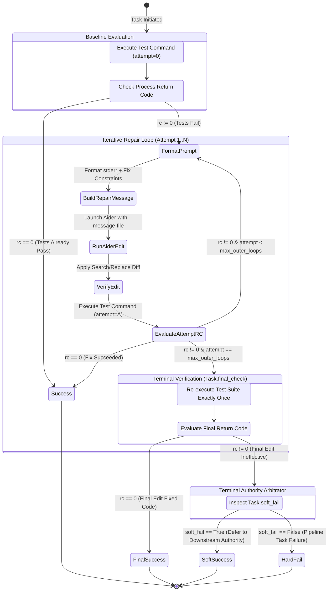

# Language-Agnostic Test Harness & Execution Engine

> **Context Anchor & Authoring Directive:**  
> This document is the authoritative master specification for language-agnostic test suite integration, containerized execution wrappers, test-fix retry loops, and deterministic final-check verification within the AI Factory pipeline.  
> **Source References:** `factory_service_manual.md` (Containerized Test Execution, Customizing the Test Runner, Combined Unit + E2E Testing Operates, Iteration Loops & Fallback Logic, The same skeleton in CODE mode).  
> **Codebase References:** `src/aider_factory/python/orchestrate.py` (`Task`, test execution loops, `Task.final_check`, `Task.soft_fail`, `_gate_run`), `src/aider_factory/python/env_utils.py` (`is_test_path`, `kill_proc_tree`), `src/aider_factory/python/run_workflow.py` (`_extract_files_from_plan`, command formatting), `src/aider_factory/tests/run_tests.R`.

---

## 1. Executive Overview & Foundational Invariants

The AI Factory pipeline decouples pipeline orchestration from language-specific runtime environments via an abstract, language-agnostic command execution contract. Test execution is modeled as a deterministic verification gate that converts operating system exit codes ($RC = 0$ for success, $RC \neq 0$ for failure) and captured process telemetry (`stdout`/`stderr`) into actionable feedback loops for autonomous code generation and repair agents.

Rather than hardcoding language assumptions into the execution graph, the engine parameterizes the execution boundary into four modular primitives: the execution environment prefix (`test_command_prefix`), the test runner command template (`test_runner`), the file naming convention (`test_naming_and_path`), and the outer retry ceiling (`loop_aider_test`). This architecture supports arbitrary toolchains—including Python (`pytest`, `unittest`), R (`testthat`), Rust (`cargo test`), Go (`go test`), JavaScript/TypeScript (`vitest`, `jest`, `npm test`), compiled C/C++ harnesses, and containerized Docker execution environments—with zero changes to the underlying orchestrator.

```
┌────────────────────────────────────────────────────────────────────────────────────────┐
│                              LANGUAGE-AGNOSTIC TEST ENGINE                             │
├────────────────────────────────────────────────────────────────────────────────────────┤
│ 1. Parameter Synthesis: {test_command_prefix} + {test_runner} -> Shell Command         │
│ 2. Subprocess Supervision: Popen with line buffering, process group & timeout watchdog │
│ 3. Stream Telemetry: Real-time terminal streaming + tee to timestamped log             │
│ 4. Verification Evaluation: Exit Code Evaluation (0 = PASS, != 0 = FAIL)               │
│ 5. Feedback Routing: Error capture -> Prompt formatting -> Iterative repair            │
│ 6. Terminal Final-Check: Post-loop verification pass to catch unverified final edits   │
└────────────────────────────────────────────────────────────────────────────────────────┘
```

### Core Architectural Invariants

1. **Deterministic Binary Exit Authority ($RC = 0 \iff \text{Success}$):** The test runner subprocess return code is the sole arbiter of software validity. No LLM generation, secondary critique, or heuristic evaluation may override an explicit non-zero exit code. A task passes if and only if the operating system process table records an exit code of `0`.
2. **Zero-Mock Physical Sandboxing:** Integration and End-to-End (E2E) tests must execute real entrypoints against temporary on-disk fixtures (`tempfile.TemporaryDirectory`) and physical operating system processes without mocking system calls, file operations, network sockets, or process boundaries.
3. **Structural Role & Path Isolation:** Test files and implementation files must remain strictly segregated across task turns. Feature implementation tasks (Job 1) are physically barred from mutating test files, preventing agents from "passing" suites by weakening assertion logic. Conversely, test-authoring tasks (Job 3) edit tests without mutating production source code.
4. **Polymorphic Execution & Cache Key Safety:** Verification gates accept both structured command sequences (`list[str]` executed with `shell=False`) and shell command strings (`str` executed with `shell=True`). Results are cached against deterministic hashable keys (`tuple` vs. `str`) to eliminate redundant test executions while guaranteeing execution safety and avoiding shell injection vulnerabilities.
5. **Clean Context Window & Token Budget Protection:** Test runners must filter uninformative warning blocks, package notices, and terminal ANSI noise. Subprocess output fed into LLM prompts is capped and formatted to prevent context window bloat, reasoning degradation, and KV-cache thrashing.

---

## 2. System Topology & Lifecycle Flowcharts

The testing engine operates across three synchronized execution planes: command synthesis, subprocess lifecycle supervision, and iterative feedback routing.

### Complete Test-Fix Retry State Machine

The following state machine details the autonomous execution and verification lifecycle when `iterate_test: true` is enabled, illustrating baseline evaluation, Aider repair passes, timeout watchdogs, and the terminal `final_check` verification:



### Multi-Phase DAG Partition Barrier Topology

The orchestrator enforces strict dependency barriers across heterogeneous pipeline phases. When a task in an upstream phase fails, the barrier halts execution, preventing cascade corruptions in downstream tasks:

```
┌────────────────────────────────────────────────────────────────────────────────────────┐
│                          PHASE 0: ARCHITECTURAL PLANNING                               │
│  [Task: p0_plan_do] ─────────────────────────────────────────────────────────────────┐ │
│  - Generates markdown/oracle_pre_plan/strategy_template.md                           │ │
│  - Emits 5-Field File Manifest (target_files, test_files, context_files)              │ │
└──────────────────────────────────────────┬─────────────────────────────────────────────┘
                                           │ Dynamic Discovery Barrier
                                           ▼ (sticky_phases: editable=true, readonly=true)
┌────────────────────────────────────────────────────────────────────────────────────────┐
│                          PHASE 1: SURGICAL IMPLEMENTATION                              │
│  [Task: p1_job1_core] ───────────────────────────────────────────────────────────────┐  │
│  - Reads: target_files, extra_editable_files, context_files_job                      │  │
│  - Modifies: target_files ONLY (test files read-only)                                │  │
│  [Task: p1_job3_test] ─────────────────────────────────────────────────────────────┐ │  │
│  - Reads: current_file, context_files_test                                          │ │  │
│  - Modifies: test_files, target_files                                               │ │  │
│  [Task: p1_verify_core] ───────────────────────────────────────────────────────────┐ │  │
│  - Executes: test_command_prefix + test_runner                                      │ │  │
│  - Iterates: 1..N attempts with VALIDATION_ATTEMPT telemetry                        │ │  │
│  - Concludes: Task.final_check re-execution                                         │ │  │
└──────────────────────────────────────────┬─────────────────────────────────────────────┘
                                           │ Strict Dependency Barrier
                                           ▼ (prior_phase_terminal_tasks)
┌────────────────────────────────────────────────────────────────────────────────────────┐
│                          PHASE 2: ESCALATION & DELIBERATION                            │
│  [Task: p2_deliberate] ──(Gate Fails)──► [Task: p2_apply] ──► [Task: p2_finalize]      │
│  - Two-Party Debate                      - Strict Verbatim   - Promotes [validated]    │
│  - Oracle vs. Architect                  - Re-tests Suite    - Demotes [unsupported]   │
└────────────────────────────────────────────────────────────────────────────────────────┘
```

---

## 3. Technical Mechanics & Deep-Dive Logic

### 3.1 Parameter Substitution & Command Construction Formulation

The orchestrator dynamically compiles the final shell execution command string $C_{\text{final}}$ for each target file $F_{\text{target}}$ by resolving execution prefixes, runner templates, and derived test file paths.

Let:
- $P_{\text{prefix}}$ be `test_command_prefix` (trimmed of whitespace)
- $R_{\text{runner}}$ be `test_runner`
- $T_{\text{convention}}$ be `test_naming_and_path`
- $E = \langle e_0, e_1, \dots, e_{m-1} \rangle$ be the sequence of paths in `files.test_files`
- $F = \langle f_0, f_1, \dots, f_{n-1} \rangle$ be the sequence of paths in `files.target_files`

The active target stem $S \in \Sigma^*$ is computed by stripping directory prefixes and terminal file extensions:

$$S = \text{stem}(F_{\text{target}}) = \text{basename}(F_{\text{target}}) \setminus \text{ext}(F_{\text{target}})$$

The specific test suite path $F_{\text{test}}$ associated with target $F_{\text{target}} = f_i$ is resolved via strict precedence:

$$F_{\text{test}}(f_i) = \begin{cases}
e_0 & \text{if } |E| = 1 \\
e_i & \text{if } |E| > 1 \land i < |E| \\
\mathcal{S}(T_{\text{convention}}, \text{"\{stem\}"}, S) & \text{if } |E| = 0 \land T_{\text{convention}} \neq \text{""} \\
\emptyset & \text{if } T_{\text{convention}} = \text{""}
\end{cases}$$

where $\mathcal{S}(T, k, v)$ denotes deterministic substring substitution replacing all occurrences of marker $k$ with value $v$ within template $T$.

The fully assembled command string $C_{\text{final}}$ is synthesized as:

$$C_{\text{final}} = \begin{cases}
P_{\text{prefix}} \parallel \text{" "} \parallel \mathcal{S}(R_{\text{runner}}, \text{"\{file\}"}, F_{\text{test}}(f_i)) & \text{if } F_{\text{test}}(f_i) \neq \emptyset \land P_{\text{prefix}} \neq \text{""} \\
\mathcal{S}(R_{\text{runner}}, \text{"\{file\}"}, F_{\text{test}}(f_i)) & \text{if } F_{\text{test}}(f_i) \neq \emptyset \land P_{\text{prefix}} = \text{""} \\
P_{\text{prefix}} \parallel \text{" "} \parallel R_{\text{runner}} & \text{if } F_{\text{test}}(f_i) = \emptyset \land P_{\text{prefix}} \neq \text{""} \\
R_{\text{runner}} & \text{if } F_{\text{test}}(f_i) = \emptyset \land P_{\text{prefix}} = \text{""}
\end{cases}$$

where $\parallel$ denotes string concatenation. If `test_naming_and_path` is explicitly empty (`""`), the placeholder substitution is bypassed entirely, enabling static multi-suite test runners (e.g., global regression commands).

---

### 3.2 Test File Discovery & Classification Mathematics (`is_test_path`)

To prevent autonomous coding agents from weakening assertion logic or creating tests in production directories, the pipeline classifies all file paths using the Boolean decision predicate $\mathcal{P}_{\text{test}}(p) \in \{0, 1\}$, implemented in `src/aider_factory/python/env_utils.py`:

$$\mathcal{P}_{\text{test}}(p) = \neg \mathcal{D}_{\text{doc}}(p) \land \left( \mathcal{D}_{\text{dir}}(p) \lor \mathcal{D}_{\text{exact}}(p) \lor \mathcal{D}_{\text{delim}}(p) \lor \mathcal{D}_{\text{camel}}(p) \right)$$

#### Predicate Component Definitions

1. **Documentation Exemption ($\mathcal{D}_{\text{doc}}$):** Ensures documentation, configuration, and data serializations are never treated as test harnesses:
   $$\mathcal{D}_{\text{doc}}(p) = \begin{cases} 1 & \text{if } \text{ext}(p) \in \{.md, .markdown, .txt, .rst, .json, .yaml, .yml, .toml\} \\ 0 & \text{otherwise} \end{cases}$$

2. **Directory Ancestry Predicate ($\mathcal{D}_{\text{dir}}$):** Checks if any directory ancestor of $p$ matches known test directories:
   $$\mathcal{D}_{\text{dir}}(p) = \begin{cases} 1 & \text{if } \exists d \in \text{ancestors}(p) : \text{lowercase}(d) \in D_{\text{test}} \\ 0 & \text{otherwise} \end{cases}$$
   where:
   $$D_{\text{test}} = \left\{ \begin{array}{l}
   \text{"test"}, \text{"tests"}, \text{"testing"}, \text{"testthat"}, \text{"\_\_tests\_\_"}, \text{"spec"}, \\
   \text{"specs"}, \text{"e2e"}, \text{"end-to-end"}, \text{"fixtures"}, \text{"testdata"}, \\
   \text{"test\_fixtures"}, \text{"benchmarks"}, \text{"benches"}
   \end{array} \right\}$$

3. **Exact Harness Match ($\mathcal{D}_{\text{exact}}$):** Detects standard framework entrypoints:
   $$\mathcal{D}_{\text{exact}}(p) = \begin{cases} 1 & \text{if } \text{basename}(p) \in \{\text{conftest.py}, \text{tests.py}, \text{tests.rs}, \text{test\_helper.rb}\} \lor \text{basename}(p) \text{ starts with } \text{"setupTests."} \\ 0 & \text{otherwise} \end{cases}$$

4. **Delimited Regex Match ($\mathcal{D}_{\text{delim}}$):** Evaluates prefix and suffix delimited naming conventions:
   $$\mathcal{D}_{\text{delim}}(p) = \text{regex\_match}(p, \text{`\verb|(^|/)((tests?|specs?|unit_?tests?)[_\-\.][^/]+|.+[_\-\.](tests?|specs?|unit_?tests?)\.[^/]+)$|`})$$

5. **CamelCase Class Match ($\mathcal{D}_{\text{camel}}$):** Evaluates object-oriented test case naming patterns:
   $$\mathcal{D}_{\text{camel}}(p) = \text{regex\_match}(p, \text{`\verb|(^|/)[a-zA-Z0-9_]*(Test|Tests|TestCase|Spec)\.[a-zA-Z0-9]+$|`})$$

#### Role Segregation During Dynamic Plan Extraction

During dynamic plan extraction (`_extract_files_from_plan` in `run_workflow.py`), every candidate file extracted from the Architect's plan is evaluated through $\mathcal{P}_{\text{test}}(p)$. Any file designated as a target file that yields $\mathcal{P}_{\text{test}}(p) = 1$ is automatically reassigned to `test_files`:

$$\text{Category}(p) = \begin{cases} \text{test\_files} & \text{if } \text{Category}_{\text{raw}}(p) = \text{target\_files} \land \mathcal{P}_{\text{test}}(p) = 1 \\ \text{Category}_{\text{raw}}(p) & \text{otherwise} \end{cases}$$

This guarantees that Job 1 receives only pure implementation files in `target_files`, preserving strict role boundaries.

---

### 3.3 Polymorphic Gate Execution, Process-Tree Watchdogs & Cache Invalidation

In `orchestrate.py`, verification gates are evaluated via `_gate_run(task, gate_cmd)`. The method dynamically adapts to command representation:
- **Command Lists (`isinstance(gate_cmd, list)`):** Used for internally-constructed verification commands (such as `[sys.executable, validator.py, ...]`). Executed with `shell=False` to prevent shell injection and platform escaping bugs.
- **Command Strings (`isinstance(gate_cmd, str)`):** Used for user-configured test commands (`test_cmd`) that may include shell operators (`&&`, pipes). Executed with `shell=True`.

```python
env = {**os.environ, **(task.rag_env or {})}
use_shell = isinstance(gate_cmd, str)
cache_key = gate_cmd if use_shell else tuple(gate_cmd)
popen_kwargs = {"start_new_session": True} if sys.platform != "win32" else {}

proc = subprocess.Popen(
    gate_cmd,
    shell=use_shell,
    cwd=self.project_dir,
    env=env,
    stdout=subprocess.PIPE,
    stderr=subprocess.STDOUT,
    text=True,
    **popen_kwargs,
)
```

#### Cache Key Formulation & Mutation Invalidation

Gate results are memoized in `self.last_test_result[cache_key]` using polymorphic cache keys:

$$K = \begin{cases} gate\_cmd & \text{if } gate\_cmd \text{ is } \text{str} \\ \text{tuple}(gate\_cmd) & \text{if } gate\_cmd \text{ is } \text{list} \end{cases}$$

Whenever a mutating task executes, cached evaluations are wiped to guarantee stale test statuses never leak:

$$\text{is\_mutating} = \text{is\_mutating\_aider} \lor \text{is\_mutating\_oracle} \lor \text{is\_mutating\_validate}$$
$$\text{is\_mutating} \implies \text{self.last\_test\_result.clear()}$$

#### Process-Tree Termination (`kill_proc_tree`)

To eliminate dangling background subprocesses on timeouts ($T \ge 300\text{s}$), `kill_proc_tree(proc)` executes operating system specific group termination:
- **POSIX:** Obtains process group ID via `os.getpgid(p.pid)` and dispatches `os.killpg(pgrp, signal.SIGKILL)`.
- **Windows:** Invokes `taskkill /F /T /PID <pid>` to terminate child and grandchild process hierarchies.

```python
def kill_proc_tree(p) -> None:
    if not p:
        return
    try:
        if sys.platform == "win32":
            subprocess.run(
                ["taskkill", "/F", "/T", "/PID", str(p.pid)],
                stdout=subprocess.DEVNULL,
                stderr=subprocess.DEVNULL,
                check=False,
            )
        else:
            import signal
            try:
                pgrp = os.getpgid(p.pid)
                if pgrp > 1 and pgrp != os.getpgrp():
                    os.killpg(pgrp, signal.SIGKILL)
                else:
                    p.kill()
            except (ProcessLookupError, OSError):
                try:
                    os.killpg(p.pid, signal.SIGKILL)
                except Exception:
                    p.kill()
    except Exception:
        pass
```

---

### 3.4 Autonomous Retry Loops, Escalation & Verification Mechanics

Let $M$ be `max_aider_loops` and $A \in \{0, 1, \dots, M-1\}$ be the active outer attempt index.
On each iteration, the orchestrator injects `VALIDATION_ATTEMPT: str(A)` into the environment.

#### The Final-Check Theorem

Because Aider verifies edit $A-1$ at the beginning of turn $A$, the final edit made during attempt $M-1$ is never validated by the loop construct itself. If $M$ iterations are reached, the task cannot determine whether the final edit succeeded or failed.

$$\text{Verdict}(A) = \begin{cases}
\text{SUCCESS} & \text{if } \text{ExitCode}(C_{\text{test}}, A) = 0 \\
\text{PROCEED} & \text{if } \text{ExitCode}(C_{\text{test}}, A) \neq 0 \land A < M - 1 \\
\mathcal{F}_{\text{final}} & \text{if } A = M - 1
\end{cases}$$

When `final_check: true`, the orchestrator re-executes $C_{\text{test}}$ exactly once upon loop exhaustion:

$$\mathcal{F}_{\text{final}} = \begin{cases}
\text{SUCCESS} & \text{if } \text{ExitCode}(C_{\text{test}}, \text{final}) = 0 \\
\text{SUCCESS (Soft)} & \text{if } \text{ExitCode}(C_{\text{test}}, \text{final}) \neq 0 \land \text{soft\_fail} = \text{true} \\
\text{FAILED} & \text{if } \text{ExitCode}(C_{\text{test}}, \text{final}) \neq 0 \land \text{soft\_fail} = \text{false}
\end{cases}$$

---

### 3.5 Bundled Test Runners & Reference Implementations

The AI Factory packages optimized reference test runners in `src/aider_factory/tests/`.

#### R / testthat Reference Runner (`src/aider_factory/tests/run_tests.R`)

The bundled R test runner provides noise reduction and precision handling:

```r
options(cli.unicode = FALSE)
args <- commandArgs(trailingOnly = TRUE)
if (length(args) == 0) {
  stop("Must provide a test filter pattern or file path")
}

input_arg <- args[1]
base_name <- basename(input_arg)
base_name <- sub("\\.R$", "", base_name, ignore.case = TRUE)
if (grepl("^test-", base_name)) {
  base_name <- sub("^test-", "", base_name)
}

test_filter <- paste0("^", base_name, "$")

Sys.setenv(TESTTHAT_MAX_FAILS = "Inf")
options(testthat.max_fails = Inf)

# Suppress global warnings to prevent context window bloat
options(warn = -1)
options(bit64.promoteInteger64ToCharacter = TRUE)

res <- testthat::test_dir("tests/testthat", filter = test_filter)

if (length(res) == 0) {
  quit(status = 1)
}

res_df <- as.data.frame(res)
fails <- sum(unlist(res_df$failed), na.rm = TRUE)
errs <- sum(unlist(res_df$error), na.rm = TRUE)

if ((fails + errs) > 0) {
  quit(status = 1)
}

quit(status = 0)
```

#### Key Features of `run_tests.R`

1. **Warning Suppression (`options(warn = -1)`):** Blocks non-fatal package warnings (e.g., `bit64` integer conversions) from cluttering LLM context windows.
2. **Precision Filter Extraction:** Strips path prefixes and `.R` extensions to convert file paths into exact `testthat` filter regexes (`^stem$`).
3. **Uncapped Failure Capture (`TESTTHAT_MAX_FAILS = Inf`):** Prevents `testthat` from aborting early so the LLM receives the full set of failures across the test suite.

---

### 3.6 Multi-Phase DAG Test Architecture & 5-Partition Validation Matrix

To verify multi-phase pipelines reliably without slow combinatorial runs, the test suite partitions the execution space across 5 structural dimensions. Each partition represents a distinct structural boundary or failure mode tested in `test_e2e_sticky_phases.py`:

| Test Dimension | Primary Path | Fallback / Adaptive Path | Fault Boundary | E2E Regression Test |
| :--- | :--- | :--- | :--- | :--- |
| **1. Phase Handoff** | **Code $\to$ Code**<br>Standard sequential task dependency. | **Plan $\to$ Code (`sticky_phases`)**<br>Phase 0 plan dynamically defines Phase 1 targets. | **Grounding $\to$ Code**<br>Cross-mode barrier where Code Job 1 waits for Grounding Finalize. | `test_e2e_live_plan_do_mutation`<br>`test_e2e_hybrid_grounding_to_code_barrier` |
| **2. Plan Manifest** | **Fenced YAML Block**<br>Standard ` ```yaml files: ... ``` ` block inside plan. | **Markdown Section Headers**<br>Fallback parsing via `### Target Files:` and bullet lists. | **Missing Manifest**<br>Plan file is missing or has no targets; pipeline cleanly exits with code `1`. | `test_e2e_markdown_header_fallback_extraction` |
| **3. Debate Injection** | **Pre-Edit Debate (`[1, 0, 0]`)**<br>Debate runs before edits; passes `.job1_verdict.md` to Job 1. | **Pre-Test Debate (`[0, 0, 1]`)**<br>Debate runs before Job 3; passes test matrix consensus to author tests. | **Multi-Round Escalation (`rounds: 2`)**<br>Debate triggers upon test failure; passes prior ledger context to Round 2. | `test_e2e_pre_edit_debate_verdict_handoff`<br>`test_e2e_escalation_multi_round_recovery` |
| **4. Execution Outcome** | **Clean Success (`exit 0`)**<br>All tasks pass on first attempt. | **Soft Failure $\to$ Recovery**<br>Tests fail $\to$ debate generates fix $\to$ re-apply succeeds $\to$ exit `0`. | **Hard Failure $\to$ Barrier Halt**<br>Task in Phase 0 fails $\to$ Phase 1 suppressed $\to$ exit `1`. | `test_e2e_live_fail_fast_halt`<br>`test_e2e_multi_target_partial_failure_halt` |
| **5. Target Topology** | **Single Target**<br>1:1 mapping between source file and test harness. | **Multi-Target Symmetry**<br>Index-matched test files (`a.py` $\to$ `test_a.py`, `b.py` $\to$ `test_b.py`). | **Dynamic Glob Expansion**<br>Wildcards (`src/*.py`) resolved dynamically against filesystem. | `test_e2e_5field_role_segregation_telemetry` |

#### Concrete Implementation Mapping (`test_e2e_sticky_phases.py`)

Each partition in the matrix is mapped to a dedicated, zero-mock end-to-end test case in the test suite:

- **`test_e2e_live_plan_do_mutation`** *(Phase Handoff Partition 2 + Target Topology Partition 1)*: Verifies that Phase 0 dynamically generates `strategy_template.md` at runtime and Phase 1 discovers, extracts, and edits those targets without pre-baked static configuration.
- **`test_e2e_markdown_header_fallback_extraction`** *(Plan Manifest Partition 2)*: Verifies the regex fallback parser (`_parse_section`) when the architect outputs plain Markdown headers (`### Target Files:`) instead of a structured YAML code block.
- **`test_e2e_pre_edit_debate_verdict_handoff`** *(Debate Injection Partition 1)*: Verifies that when `insert_debate: [1, 0, 0]` is configured, the deliberation turn executes, writes `.job1_verdict.md`, and supplies that physical verdict file to Job 1 via `--message` / `--read`.
- **`test_e2e_escalation_multi_round_recovery`** *(Debate Injection Partition 3 + Execution Outcome Partition 2)*: Verifies the multi-round escalation loop: Test attempt 1 fails $\to$ Round 1 debate creates `esc_calc_r1.verdict.md` & `esc_calc_r1.debate.json` $\to$ fix re-fails $\to$ Round 2 debate reads Round 1's ledger, deliberates, creates `esc_calc_r2.verdict.md` & `esc_calc_r2.debate.json` $\to$ fix passes $\to$ exit `0`.
- **`test_e2e_hybrid_grounding_to_code_barrier`** *(Phase Handoff Partition 3)*: Verifies that a review/grounding phase (Autofix $\to$ Deliberate $\to$ Apply $\to$ Finalize) acts as a strict dependency barrier for a subsequent code phase.
- **`test_e2e_live_fail_fast_halt` & `test_e2e_multi_target_partial_failure_halt`** *(Execution Outcome Partition 3)*: Verifies the fail-fast invariant: when any task fails in an earlier phase, all subsequent phases are suppressed, preventing cascade errors or polluted repository state.
- **`test_e2e_5field_role_segregation_telemetry`** *(State Isolation & Role Segregation)*: Verifies physical argument segregation: Job 1 (Implementation) receives only `target_files` and `extra_editable_files`; Job 3 (Testing) receives `test_files` and `context_files_test`, preventing agents from modifying tests during feature implementation.

---

## 4. Exhaustive CLI & Parameter Reference

### Command Execution Matrix

| Entrypoint / Command | Scope & Execution Mode | Subprocess Shell | Timeout Watchdog | Exit Code Contract |
| :--- | :--- | :--- | :--- | :--- |
| `aider-factory [session] [config]` | Pipeline Orchestration DAG | `shell=False` | `600s` per task | `0` = Complete, `1` = Task Failed |
| `uv run --with pytest pytest {file}` | Python Unit / E2E Sandboxed | `shell=True` (via test_cmd) | `300s` (`AIDER_STREAM_TIMEOUT`) | `0` = All Pass, `1` = Assertion Fail |
| `Rscript .aider_factory/tests/run_tests.R {file}` | R / testthat Filtered Suite | `shell=True` | `300s` | `0` = Clean, `1` = Fail/Error |
| `cargo test --test {stem}` | Rust Integration Suite | `shell=True` | `300s` | `0` = Compiled & Pass, `101` = Panic |
| `go test {file}` | Go Package Tests | `shell=True` | `300s` | `0` = Pass, `1` = Fail |
| `npm test {file}` | JavaScript / TypeScript Harness | `shell=True` | `300s` | `0` = Pass, `1` = Fail |
| `python -m aider_factory.tests.ci.uv_run` | Headless CI Unit Suite | `shell=False` | None (CI-bounded) | `0` = Pass, `1` = Fail |
| `python -m aider_factory.tests.ci.uv_run_local` | Local Live Cluster Suite | `shell=False` | None | `0` = Pass, `1` = Fail |

### Process Exit Code Registry

| Exit Code | Semantic Meaning | System Reaction & Telemetry Signature |
| :---: | :--- | :--- |
| `0` | Clean Success | Verification gate passes; task transitions to `TaskStatus.SUCCESS`. |
| `1` | Assertion Failure / Test Error | Orchestrator captures stdout/stderr; formats prompt for next repair attempt. |
| `2` | CLI Usage / Flag Syntax Error | Subprocess argument rejection; logged to stderr as unrecoverable configuration error. |
| `3` | Empty Result / Extraction Guard | Validator detects short text extraction ($< 100$ characters); halts processing. |
| `137` | Process Terminated (`SIGKILL`) | Watchdog timeout expired ($> 300\text{s}$) or OOM killer triggered; process tree terminated. |
| `143` | Graceful Termination (`SIGTERM`) | User interrupted pipeline via `Ctrl+C`; active task marked `CANCELLED`. |

### Runtime Environment Variables

| Variable | Type | Default | Description |
| :--- | :--- | :--- | :--- |
| `AIDER_STREAM_TIMEOUT` | Float | `300.0` | Timeout threshold in seconds before terminating a running test subprocess. |
| `VALIDATION_ATTEMPT` | Integer | `0` | Active outer loop index passed to test processes to track repair progress. |
| `TESTTHAT_MAX_FAILS` | String | `"Inf"` | Disables testthat failure truncation in R test runners. |
| `FORCE_COLOR` | String | `"1"` | Enforces ANSI color output across piped stdout streams. |
| `PIPELINE_SESSION_ID` | UUID | Auto-generated | Session identifier injected for sticky KV-cache routing. |
| `AIDER_AUTO_TEST` | Boolean | `false` | Enables Aider's built-in 3-loop test iteration cycle. |
| `AIDER_LINT_CMD` | String | `null` | Command executed by linter before running test suites. |

---

## 5. Configuration Schema & YAML Knobs

The test harness is configured via `.env.yml` pipeline definitions at root and phase scopes.

```yaml
# ==============================================================================
# PIPELINE CONFIGURATION SCHEMA: TEST HARNESS KNOBS
# ==============================================================================

# Global Test Defaults
test_command_prefix: "uv run --with pytest"   # (string) Execution wrapper prefix (e.g., docker, uv, bash)
test_runner: "pytest {file}"                  # (string) Command template containing {file} placeholder
test_naming_and_path: "tests/test_{stem}.py"  # (string) Pattern deriving test path from target stem ("" disables)
loop_aider_test: 3                            # (integer) Default maximum outer repair loops
auto_lint: true                               # (boolean) Execute linter before test passes
lint_cmd: "flake8"                            # (string | null) Custom linter command

phases:
  - name: "Feature_Implementation_and_Test"
    enabled: true
    
    # Per-Phase Execution Toggles
    toggles:
      run_job_one: true                       # (boolean) Implement code in target_files
      run_job_two: false                      # (boolean) Spec validation pass
      run_job_three: true                     # (boolean) Generate tests in test_files
      iterate_test: true                      # (boolean) Enter autonomous test-repair loop
      auto_test: false                        # (boolean) Enable Aider's internal 3-loop test cycle
      pair_programming: false                 # (boolean) Interactive terminal mode
      sticky_context: false                   # (boolean) Accumulate target files in read context
      
    # 5-Field Role-Segregated Files Manifest
    files:
      target_files:                           # (list[string]) Primary implementation source files
        - "src/core/calculator.py"
      extra_editable_files: []                # (list[string]) Secondary editable helper modules
      test_files:                             # (list[string]) Test suites (read-only in Job 1, editable in Job 3)
        - "tests/test_calculator.py"
      context_files_job:                      # (list[string]) Immutable context for implementation
        - "docs/specifications.md"
      context_files_test:                     # (list[string]) Immutable context for test authoring
        - "docs/specifications.md"

    # Multi-Round Escalation Debate (Triggered on Persistent Test Failure)
    escalation_debate:
      loops: 3                                # (integer) Turns per debate round (0 disables)
      rounds: 2                               # (integer) Total debate rounds before terminal halt
      pass_history: true                      # (boolean) Retain context across debate rounds
      persist: false                          # (boolean) Continue debate after agreement
      oracle_persona: ""                      # (string) Path to custom Oracle debate persona
      architect_persona: ""                   # (string) Path to custom Architect debate persona
```

### Multi-Language Configuration Presets

```yaml
# Preset: Python with Pytest and uv Sandbox
test_command_prefix: "uv run --with pytest"
test_runner: "pytest -v {file}"
test_naming_and_path: "tests/test_{stem}.py"

# Preset: R with testthat
test_command_prefix: ""
test_runner: "Rscript .aider_factory/tests/run_tests.R {file}"
test_naming_and_path: "tests/testthat/test-{stem}.R"

# Preset: Rust with Cargo Test
test_command_prefix: ""
test_runner: "cargo test --test {stem}"
test_naming_and_path: "tests/{stem}.rs"

# Preset: Go Package Testing
test_command_prefix: ""
test_runner: "go test -v {file}"
test_naming_and_path: "tests/{stem}_test.go"

# Preset: Node.js / TypeScript with Vitest
test_command_prefix: "npx vitest run"
test_runner: "{file}"
test_naming_and_path: "tests/{stem}.test.ts"

# Preset: Docker Containerized Runner
test_command_prefix: "docker exec -i --user developer -w /workspace my_dev_container"
test_runner: "pytest {file}"
test_naming_and_path: "tests/test_{stem}.py"
```

---

## 6. Telemetry, Diagnostics & Operational Edge Cases

### Diagnostic Failure Signatures & Mitigations

#### 1. Subprocess Execution Watchdog Timeout (`AIDER_STREAM_TIMEOUT`)
- **Signature:** `❌ Test baseline timed out after 300.0s for [p0_verify_calc].`
- **Mechanism:** The test runner hung due to infinite loops, blocking network sockets, or deadlocked thread locks. The `threading.Timer` watchdog fires, marking the run as timed out and invoking `kill_proc_tree(proc)`.
- **Remediation:** Verify that tests do not wait on interactive input (`stdin`). If testing slow distributed systems or heavy models, elevate timeout in environment:
  ```bash
  export AIDER_STREAM_TIMEOUT=600.0
  ```

#### 2. Windows Encoding Crash on ANSI Status Sequences (`cp1252`)
- **Signature:** `UnicodeEncodeError: 'charmap' codec can't encode characters in position ...: character maps to <undefined>`
- **Mechanism:** Windows default console encoding (`cp1252`) fails on Unicode status emojis (`🚀`, `✅`, `❌`) when stdout is piped into subprocess streams.
- **Remediation:** Enforce UTF-8 stream reconfiguration at entrypoint (`src/aider_factory/tests/ci/uv_run.py`):
  ```python
  if sys.platform == "win32":
      sys.stdout.reconfigure(encoding="utf-8")
      sys.stderr.reconfigure(encoding="utf-8")
  ```

#### 3. Orphaned Child Process Tree Leaks
- **Signature:** System runs out of memory or file descriptors after aborted test runs; zombie test servers remain bound to network ports.
- **Mechanism:** Standard `proc.kill()` terminates only the parent shell, leaving child test binaries orphaned under `init`/`launchd`.
- **Remediation:** Orchestrator deploys `kill_proc_tree(proc)` across all timeouts and interrupts:
  - POSIX: Dispatches `os.killpg(os.getpgid(p.pid), signal.SIGKILL)`.
  - Windows: Executes `taskkill /F /T /PID <pid>`.

#### 4. The Unverified Last Edit Trap
- **Signature:** Task reports failure even though the developer inspects the code and finds the fix completely functional.
- **Mechanism:** Aider's iterative loop verifies edit $N-1$ at the start of attempt $N$. When the loop exhausts its max attempts, the final edit is never tested.
- **Remediation:** Always configure `Task.final_check: true` (standard for code verification tasks in `run_workflow.py`). This forces a single deterministic test execution pass immediately following loop exhaustion.
