# Deterministic Validation, Grounding & MiniCheck Entailment

## 1. Executive Overview & Foundational Invariants

The Validation and Grounding engine is the deterministic verification authority of the AI Factory Pipeline for literature reviews, research synthesis, and fact-grounded document authoring. It enforces an uncompromising "tripwire" architecture: every key empirical claim must be anchored by a localized verbatim quote proven to be an exact substring of the ground-truth OCR/Markdown source.

Unlike heuristic or model-judged grading systems, this engine enforces physical ground truth at the operating system level. If an authoring agent synthesizes facts that cannot be directly mapped to the source material, the validation gate trips, generates diagnostic telemetry, and halts or routes the pipeline into automated healing and refereed escalation.

```
+---------------------------------------------------------------------------------------+
|                               FOUNDATIONAL INVARIANTS                                 |
+---------------------------------------------------------------------------------------+
| 1. Deterministic-First Execution: Exact substring matching and ellipsis-stitch        |
|    arithmetic run in pure Python without LLM hallucination risk. Classifiers are      |
|    reserved strictly for claim entailment scoring and agentic repair loops.           |
|                                                                                       |
| 2. Validator-Only Write Authority: Tags represent durable system state. Authors       |
|    and agents write only [evidence] anchors. Only validator.py possesses authority    |
|    to promote anchors to [validated] or [fixed], or demote them to [unsupported].     |
|                                                                                       |
| 3. Precision Over Recall (Zero Fuzzy Grounding): Grounding mandates a 100% exact      |
|    normalized substring match. Levenshtein and fuzzy distance metrics are rejected    |
|    for quote verification to eliminate false-positive factual grounding.             |
|                                                                                       |
| 4. Anchor Deletion Guard: Automated edits are strictly forbidden from deleting        |
|    anchors. If the total anchor count drops below the pre-apply baseline hash set     |
|    (|A| < |H_baseline|), the validator raises a floor violation and fails the pass.   |
|                                                                                       |
| 5. Sentinel Exemption: Quotes matching "not specified in paper" denote intentional   |
|    terminal claims of missing source data. They bypass substring audits and are       |
|    never flagged, modified, or relabeled.                                             |
+---------------------------------------------------------------------------------------+
```

---

## 2. System Topology & Lifecycle Flowcharts

The validation lifecycle coordinates deterministic parsing, vector retrieval, seq2seq entailment verification, and multi-turn agent healing into an integrated execution ladder.

### 2.1 Complete System DAG Lifecycle

```mermaid
flowchart TD
    subgraph Ingestion ["1. Knowledge Ingestion & Pre-Processing"]
        A[Raw PDF / Image Source] -->|PyMuPDF / Docling| B[OCR Markdown Source <stem>.md]
        B -->|AST / Section Splitter| C[(LanceDB Vector Tables)]
    end

    subgraph Generation ["2. Review Generation & Deterministic Stitching"]
        D[Generator / Oracle Agent] -->|Produces Initial Review| E[Review File: [evidence] anchors]
        E -->|validator.py --autofix| F{Autofix: Ellipsis Splice?}
        F -->|Gap <= 200 & Claim Entailed| G[Deterministic Stitch -> relabel [fixed]]
        F -->|Gap > 200 or Weak Claim| H[Retain Ellipsis -> Escalate to Audit]
    end

    subgraph HealLoop ["3. Grounding Audit & Agentic Heal Loop"]
        G --> I{validator.py Exact Substring Audit}
        H --> I
        I -->|All Quotes Grounded & No Floor Drop| J[Promote to [validated]/[fixed] -> EXIT 0]
        I -->|Trips Remain / Drift Detected| K[Write Diagnostic Report & Update Ledger]
        K --> L[Architect & Test Editor Repair Pass]
        L -->|Iterate Attempt N <= max_loops| I
    end

    subgraph Escalation ["4. Deliberation, Apply & Finalization"]
        I -.->|Exhausted / No Progress| M[Deliberation Debate: Oracle <-> Architect]
        M -->|Consensus: Agreed| N[Apply Agent Pass -> Strict Gate]
        M -->|Consensus: Deadlock / Exhausted| O[Hold as [evidence] for Human Review]
        N -->|Finalize Pass: --finalize-unsupported| P[Promote Grounded -> [validated]/[fixed]<br/>Demote Agreed-Ungrounded -> [unsupported]]
    end
```

### 2.2 Anchor Tag State Transition Machine

```mermaid
stateDiagram-v2
    [*] --> evidence : Author or Generator writes quote anchor

    evidence --> validated : Exact substring match confirmed (Hash in baseline)
    evidence --> fixed : Exact substring match confirmed (Hash NOT in baseline)
    evidence --> fixed : Autofix successfully stitches ellipsis span

    validated --> evidence : Text modified during edit; loses substring alignment
    fixed --> evidence : Text modified during edit; loses substring alignment

    evidence --> unsupported : Terminal finalize pass after Agreed debate
    fixed --> unsupported : Bogus tag demoted during terminal finalize pass

    validated --> [*] : Verified Ground Truth (Terminal Gate Pass)
    fixed --> [*] : Verified Healed Ground Truth (Terminal Gate Pass)
    unsupported --> [*] : Flagged for Human Audit (Gate Pass)
```



---

## 3. Technical Mechanics & Deep-Dive Logic

### 3.1 Exact Substring Grounding & Normalization
The verification authority enforces binary truth: a quote $q$ is grounded in source text $S$ if and only if the normalized string of $q$ is a strict contiguous substring of the normalized string of $S$:

$$\text{IsGrounded}(q, S) \iff \text{Normalize}(q) \subseteq \text{Normalize}(S)$$

The normalization function $\text{Normalize}(s)$ guarantees cross-platform unicode parity without semantic loss:
1. **Punctuation & Quote Unification**:
   * Right single quotation mark / apostrophe: `\u2019` (`’`) $\rightarrow$ `'`
   * Left double quotation mark: `\u201c` (`“`) $\rightarrow$ `"`
   * Right double quotation mark: `\u201d` (`”`) $\rightarrow$ `"`
   * En dash: `\u2013` (`–`) $\rightarrow$ `-`
   * Em dash: `\u2014` (`—`) $\rightarrow$ `-`
2. **Whitespace Collapsing**: Replaces all contiguous whitespace sequences (`\s+`) with a single ASCII space (`0x20`) and strips leading and trailing margins.

To guarantee deterministic tracking across edits, each normalized quote is fingerprinted via a 12-character hexadecimal SHA-1 digest:

$$H(q) = \text{SHA1}(\text{Normalize}(q))[0:12]$$

### 3.2 Anchor Extraction Grammar & Vocabulary
The extractor parses quotes using regular expressions across the tag family:

$$\text{Family}(tag) = \{ tag, \text{"validated"}, \text{"fixed"}, \text{"unsupported"} \}$$

```python
fam = "|".join(re.escape(t) for t in _family(tag))
pat = re.compile(r"`?\[(" + fam + r')\]`?\s*"([^"]+)"\s*(\(OCR-uncertain\))?')
```

* **Multi-Anchor Line Processing**: The extractor uses `finditer` across each line. If multiple anchors exist on a single line (e.g., when an author places two distinct evidentiary claims in a single paragraph), each anchor is extracted as an independent record with its line index, surrounding heading, quote text, and raw token.
* **Sentinel Exemption**: Quotes evaluating to `_SENTINEL = "not specified in paper"` (case-insensitive, normalized, trailing periods stripped) are intentionally excluded from audit extraction. They represent a verified absence of evidence in the source text.

### 3.3 Deterministic Ellipsis Autofix Engine (`--autofix`)
When generative models quote non-contiguous source phrases, they frequently splice clauses using ellipsis markers. The `--autofix` engine reconstructs the original contiguous source span deterministically without invoking an LLM:

1. **Splice Splitting**: Splits quote $q$ using `_ELLIPSIS = re.compile(r"\s*(?:\.{3,}|\u2026|\.(?:\s+\.){2,})\s*")`, yielding ordered fragments $P = \{p_1, p_2, \dots, p_k\}$ where $k \ge 2$.
2. **Ordered Span Discovery**: Scans $\text{Normalize}(S)$ sequentially for non-overlapping occurrences of fragments:
   $$\text{pos}_i = \text{find}(p_i, \text{start}=\text{pos}_{i-1}), \quad \text{span}_i = (s_i, e_i)$$
3. **Gap Constraint Verification**: Computes the total inter-fragment distance:
   $$\Delta_{\text{gap}} = (e_k - s_1) - \sum_{i=1}^k (e_i - s_i)$$
   If $\Delta_{\text{gap}} \le 200$ (`_MAX_STITCH_GAP`), fragments reside in the same local sentence or clause. If $\Delta_{\text{gap}} > 200$, the fragments span distant sections; the stitch is aborted to prevent accidental conflation.
4. **Structural Paranoia Check**: The candidate stitched text $q_{\text{stitched}} = S[s_1:e_k]$ must not contain internal quotation marks (`"`) and must re-verify as $\text{IsGrounded}(q_{\text{stitched}}, S) = \text{True}$.
5. **Claim Support Gate**: Before committing the edit to disk, the surrounding claim passage is evaluated against the vector store using `_verify(block, a)`. If the claim score falls below the threshold, the stitch is **declined** and held for debate. A verbatim quote must not be stitched if the authoring agent fabricated the surrounding prose.
6. **In-Place Mutation**: If all checks pass, the anchor is relabeled to `[fixed]` and the quote text is replaced with $q_{\text{stitched}}$ on disk.

### 3.4 3-Step Review Passage Bounding (`_claim_block`)
To score whether a claim is semantically grounded, the validator extracts the surrounding review block using a 3-step structural walk that strictly obeys document hierarchy:

```
[Markdown Heading: ## Methodology]  <-- Hard Boundary (Walk Halts)
  |
  +-- [Paragraph Body Line 1]        <-- Upper Paragraph Margin
  +-- [Paragraph Body Line 2]
  |
  +-- [Blank Line]
  |
  +-- [Anchor Paragraph Line 1]      <-- Current Anchor Paragraph (idx)
  +-- [Anchor Paragraph Line 2]
  |
  +-- [Blank Line]
  |
  +-- [Paragraph Body Line 3]        <-- Lower Paragraph Margin
  +-- [Paragraph Body Line 4]
  |
[Markdown Heading: ## Results]      <-- Hard Boundary (Walk Halts)
```

1. **Step 1 (Paragraph Isolation)**: Bounds $lo$ and $hi$ upward and downward from the anchor line index $idx$ until hitting a blank line or a markdown heading (`^#{1,6}\s`).
2. **Step 2 (Paragraph Expansion)**: Expands upward and downward across `para_margin` complete paragraphs (runs of non-blank lines). The walk terminates immediately if an index reaches the document boundaries or encounters a markdown heading (`^#{1,6}\s`).
3. **Step 3 (Line Margin Expansion)**: Adds a fixed line margin:
   $$lo_{\text{final}} = \max(0, lo - \text{margin}), \quad hi_{\text{final}} = \min(N-1, hi + \text{margin})$$

### 3.5 Two-Stage Claim Verification Mechanics
Claim verification operates via a two-stage filter balancing recall with semantic precision:

$$\text{Score}_{\text{final}} = \begin{cases} 
\text{Score}_{\text{entail}}(B, D), & \text{if } \text{grounding\_agent is configured} \\
\text{Sim}_{\text{cosine}}(B, \text{RRF}(D)), & \text{otherwise}
\end{cases}$$

#### Stage 1: Dense Retrieval & Reciprocal Rank Fusion (RRF)
The review passage $B$ is embedded and searched across all tables associated with the collection in LanceDB. Result sets from multiple tables are merged using Reciprocal Rank Fusion ($c=60$):

$$\text{RRF}(d) = \sum_{t \in \text{Tables}} \frac{1}{60 + \text{rank}_t(d)}$$

Where $d$ is uniquely identified by `(source_file, text[:64])`. Ties are broken deterministically using secondary string sort keys. Candidate passages are optionally reranked using listwise or cross-encoder rerankers (`ORACLE_RANKING_MODEL`).

#### Stage 2: Weakest-Link MiniCheck Entailment
When `grounding_agent` points to an entailment endpoint (such as `minicheck_server.py`), the validator bypasses simple cosine topicality in favor of formal natural language inference (NLI).

The passage $B$ is parsed into constituent sentences $\{s_1, s_2, \dots, s_m\}$ using punctuation boundaries (`(?<=[.!?])\s+`), discarding fragments shorter than `MIN_SENT_LEN = 8`. Each sentence is scored against the retrieved context document $D$:

$$\text{Score}_{\text{entail}}(B, D) = \min_{s_i \in \text{Sentences}(B)} P(\text{Entailed} \mid D, s_i)$$

The **minimum** probability governs. If even a single sentence in the claim block makes an unsupported factual assertion, the entire claim block is flagged as hallucinated.

### 3.6 Claim Drift Annotation (`verify_all=True`)
When `verify_all_claims: true` or `--verify-all` is specified, the validator audits the surrounding claim blocks of quotes that are **already proven grounded**.

If a quote is an exact verbatim substring but the surrounding prose misrepresents the context ($P(\text{Entailed}) < \text{entail\_threshold}$), the passage is logged to the `claim_drift` section of the validation report. This is an **annotate-only** mechanism:
* It does not change the tag (`[validated]` or `[fixed]` remains).
* It does not trip the gate (the script exits `0` if all quotes are grounded).
* It alerts human reviewers that an agent has taken a verbatim quote out of context.

### 3.7 Soft-Quotes & Mathematical Formula Isolation
Mathematical formulas and low-confidence OCR regions present unique challenges for verbatim substring matching:
* **LaTeX Formula Detection**: Quotes containing math delimiters (`$`) are classified as soft-quotes.
* **OCR-Uncertain Marking**: Quotes followed by `(OCR-uncertain)` are classified as soft-quotes.

**Operational Rule**: Soft-quotes bypass exact-substring tripwires and are recorded as `soft-warn` diagnostics. However, **soft-quotes cannot be promoted**. If an editing agent attempts to write `[fixed]` or `[validated]` on an ungrounded soft-quote, the validator deterministically demotes the tag back to `[evidence]`.

---

## 4. Exhaustive CLI & Parameter Reference

The validation engine is invoked via `validator.py` or through the wrapper script `.aider_factory/bash/validate`.

### Complete CLI Argument Matrix

| Parameter / Flag | Type | Default | Env Var Fallback | Operational Description |
| :--- | :--- | :--- | :--- | :--- |
| `--file` | `str` | **Required** | `ORACLE_REVIEW_FILE` | Target Markdown document (review or synthesized report) to audit. |
| `--source` | `str` | `None` | `ORACLE_SOURCE_FILE` | Ground-truth OCR Markdown source (`<stem>.md`). Required unless `--claims-only`. |
| `--report` | `str` | `None` | `ORACLE_VALIDATION_FILE` | Destination path for the diagnostic heal report. Defaults to `.aider_factory/temp/{stem}_claims_report.md` in claims-only mode. |
| `--claims-only` | `flag` | `False` | `ORACLE_CLAIMS_ONLY=1` | Audits raw text paragraphs for factual entailment without requiring `[evidence]` tags. |
| `--no-print` | `flag` | `False` | `ORACLE_NO_PRINT=1` | Suppresses printing the validation report to `stdout` in `--claims-only` mode. |
| `--autofix` | `flag` | `False` | `None` | Executes the deterministic ellipsis-stitching repair engine prior to auditing. |
| `--finalize-unsupported` | `flag` | `False` | `None` | Terminal DAG step: promotes grounded quotes and demotes agreed-ungrounded quotes to `[unsupported]`. |
| `--tag` | `str` | `"evidence"` | `ORACLE_VALIDATION_TAG` | Base anchor tag name to extract and verify. |
| `--region-threshold` | `float` | `0.60` | `ORACLE_REGION_THRESHOLD` | Cosine similarity threshold for regional semantic support. |
| `--region-margin` | `int` | `2` | `ORACLE_REGION_MARGIN` | Number of lines to expand beyond paragraph boundary for claim passages. |
| `--region-paragraphs` | `int` | `0` | `ORACLE_REGION_PARAGRAPHS` | Number of complete paragraphs to expand upward and downward for claim passages. |
| `--top-k` | `int` | `5` | `ORACLE_TOP_K` | Number of LanceDB context chunks retrieved per failing anchor. |
| `--db` | `str` | `None` | `ORACLE_RAG_DB_DIR` | Path to the LanceDB database directory. Auto-discovered from YAML if omitted. |
| `--collection` | `str` | `None` | `ORACLE_COLLECTION` | LanceDB collection table name. Auto-discovered from YAML if omitted. |
| `--ledger` | `str` | `None` | `ORACLE_LEDGER_FILE` | JSON ledger path tracking tripped quote hashes across iterate attempts. |
| `--baseline-ledger` | `str` | `None` | `ORACLE_BASELINE_LEDGER` | Path to pre-debate ledger containing `quote_baseline` set and debate `state`. |
| `--grounding-model` | `str` | `None` | `GROUNDING_AGENT_MODEL` | Model ID for entailment verifier (e.g., `openai/minicheck-flan-t5-large`). |
| `--grounding-api-base` | `str` | `None` | `GROUNDING_AGENT_API_BASE` | Base HTTP endpoint for the grounding verifier service. |
| `--grounding-api-key` | `str` | `None` | `GROUNDING_AGENT_API_KEY` | Authentication API key for the grounding verifier service. |
| `--entail-threshold` | `float` | `0.5` | `GROUNDING_ENTAIL_THRESHOLD` | MiniCheck entailment probability threshold ($[0.0, 1.0]$). |
| `--verify-all` | `flag` | `False` | `GROUNDING_VERIFY_ALL=1` | Evaluates claim passages of grounded quotes to detect and log prose drift. |
| `--no-rerank` | `flag` | `False` | `ORACLE_NO_RERANK=1` | Disables Stage 2 cross-encoder reranking during context retrieval. |
| `--recall-k` | `int` | `None` | `ORACLE_RECALL_K` | Number of candidate chunks retrieved before reranking (default: $4 \times \text{top\_k}$). |

*Note: Legacy arguments `--mode`, `--threshold`, `--context-lines`, and `--rescue-threshold` are accepted for backward compatibility and ignored.*

### Auto-Discovery Resolution Cascade
When `--collection`, `--db`, or `--claims-only` are omitted from the CLI invocation, `validator.py` executes an automatic resolution cascade:
1. **Workspace YAML Scan**: Scans `.aider_factory/.env.yml` then `.env.yml` in the current working directory.
2. **Phase Parameter Inspection**: Reads the first active phase; extracts `rag.collection_name`, `rag.db`, and `validation.claims_only`.
3. **Environment Fallback**: Inspects `ORACLE_COLLECTION`, `ORACLE_RAG_DB_DIR`, and `ORACLE_CLAIMS_ONLY`.
4. **Path Synthesis**: If `--collection` is known but `--db` is missing:
   * If collection contains path delimiters (`/` or `\`), resolves `db = os.path.join(collection, "lancedb")`.
   * Otherwise, checks `.aider_factory/markdown/lanceDB/<collection>/lancedb`.

### Deterministic OS Exit Code Specification

```
+-----------+-----------------------+-------------------------------------------------------------+
| Exit Code | Pipeline Status       | Concrete Trigger Condition                                  |
+-----------+-----------------------+-------------------------------------------------------------+
|     0     | SUCCESS (Clean)       | All extracted non-soft quotes are verified exact substrings |
|           |                       | and no anchor floor violation occurred.                     |
|           |                       |                                                             |
|     0     | SUCCESS (No-Progress) | The set of tripped quote hashes matches the previous        |
|           |                       | iteration in the ledger (cur == prev) with no floor drop.   |
|           |                       | Loop terminates to prevent token burn; escalates to debate. |
|           |                       |                                                             |
|     0     | SUCCESS (Claims-Only) | All non-code paragraph blocks score >= entail_threshold.   |
|           |                       |                                                             |
|     1     | TRIPWIRE ACTIVE       | One or more non-soft quotes fail exact substring matching   |
|           |                       | and progress is still occurring across attempts.            |
|           |                       |                                                             |
|     1     | FLOOR VIOLATION       | Total anchor count is less than baseline (|A| < |H_base|).  |
|           |                       | A quote was deleted or obscured. Halts loop immediately.    |
|           |                       |                                                             |
|     1     | CLAIMS-ONLY FAILURE   | One or more paragraphs fail entailment in --claims-only.   |
+-----------+-----------------------+-------------------------------------------------------------+
```

---

## 5. Configuration Schema & YAML Knobs

Validation and grounding parameters are declared under the `validation`, `endpoints`, and `models` sections of `.env.yml`.

```yaml
# ==============================================================================
# ENDPOINTS SPECIFICATION
# ==============================================================================
endpoints:
  # HTTP endpoint hosting the MiniCheck seq2seq classification server
  grounding_agent_api: "http://127.0.0.1:8090/v1" # Scope: Global / Phase | Type: url

  # Local or remote embedding endpoint (e.g., llama-server or LiteLLM router)
  embed_api_base: "http://127.0.0.1:8080/v1"      # Scope: Global / Phase | Type: url

  # Local or remote reranker endpoint for candidate scoring
  ranking_api_base: "http://127.0.0.1:8084/v1"    # Scope: Global / Phase | Type: url

# ==============================================================================
# MODELS SPECIFICATION
# ==============================================================================
models:
  # Entailment classifier. If unset, validator falls back to cosine similarity
  grounding_agent: "openai/minicheck-flan-t5-large" # Scope: Global / Phase | Type: string

  # Cross-encoder model identifier for reranking candidate context chunks
  ranking_agent: "BAAI/bge-reranker-large"          # Scope: Global / Phase | Type: string

  # Dense embedding model used for passage retrieval
  embed_model: "BAAI/bge-m3"                        # Scope: Global / Phase | Type: string

# ==============================================================================
# PIPELINE PHASES SPECIFICATION
# ==============================================================================
phases:
  - name: "research_and_review"
    enabled: true

    validation:
      # Master toggle: activates validation nodes and gating scripts in the DAG
      enabled: true                     # Default: false | Type: boolean

      # Anchor tag token scanned across the document
      validation_tag: "evidence"         # Default: "evidence" | Type: string

      # Baseline cosine similarity required when grounding_agent is unset
      region_threshold: 0.60             # Default: 0.60 | Type: float

      # Line margin expansion beyond paragraph boundary for claim passages
      region_margin: 2                  # Default: 2 | Type: integer

      # Paragraph margin expansion beyond paragraph boundary for claim passages
      region_paragraphs: 0              # Default: 0 | Type: integer

      # Number of LanceDB context chunks retrieved per failing quote
      region_top_k: 5                   # Default: 5 | Type: integer

      # Maximum outer heal iterations before triggering escalation debate
      validation_loops: 3               # Default: 3 | Type: integer

      # Audit claim passages even when quotes are verified as exact substrings
      verify_all_claims: false          # Default: false | Type: boolean

      # Minimum sentence probability for MiniCheck entailment verification
      entail_threshold: 0.5             # Default: 0.5 | Type: float

      # Evaluate raw paragraphs directly without requiring [evidence] tags
      claims_only: false                # Default: false | Type: boolean

      # Automatically execute deterministic ellipsis-stitching before auditing
      autofix: true                     # Default: false | Type: boolean

      # Run post-validation agentic healing pass after generation
      post_validate: true               # Default: false | Type: boolean

      # Bypass cached generation output and force Oracle regeneration
      redo_oracle_job: false            # Default: false | Type: boolean
```

---

## 6. Telemetry, Diagnostics & Operational Edge Cases

### 6.1 Validation Ledger & Anti-Oscillation Guard
The validator records iteration history in `.aider_factory/logs/validations/<stem>.ledger.json`:

```json
{
  "attempts": [
    {
      "attempt": 0,
      "tripped": ["4a1f3c8b2e10", "9b8e7d6c5a4f"],
      "validated": 12,
      "fixed": 2,
      "flagged": 0,
      "warns": 1
    },
    {
      "attempt": 1,
      "tripped": ["4a1f3c8b2e10"],
      "validated": 13,
      "fixed": 3,
      "flagged": 0,
      "warns": 1
    }
  ]
}
```

* **No-Progress Detection**: On attempt $N$, the validator evaluates:
  $$\text{cur\_hashes} = \text{sorted}([H(t[\text{"quote"}]) \text{ for } t \in \text{tripped}])$$
  If $\text{cur\_hashes} = \text{prev\_hashes}$, editing agents have oscillated or exhausted their local capacity to resolve the quote. The validator prints `NO PROGRESS`, suppresses gate failure, and returns exit code `0`. This allows `orchestrate.py` to route the surviving tripwires into the multi-turn deliberation debate rather than looping indefinitely.

### 6.2 MiniCheck Entailment Server Deployment (`minicheck_server.py`)
Because MiniCheck-Flan-T5-Large is a sequence-to-sequence classifier rather than an autoregressive decoder, its predictions must be read directly from decoder logits. Standard `llama.cpp` GGUF endpoints cannot serve it accurately.

The pipeline provides `minicheck_server.py`, a FastAPI service implementing an OpenAI-compatible `/v1/chat/completions` endpoint using PEP 723 dependency isolation.

#### Ephemeral Host Execution
```bash
uv run --locked src/aider_factory/python/minicheck_server.py
```

#### Production Systemd Service (`/etc/systemd/system/minicheck.service`)
```ini
[Unit]
Description=MiniCheck Grounding Verifier Server
After=network.target

[Service]
Type=simple
User=pipeline_user
WorkingDirectory=/path/to/project
Environment=MINICHECK_PORT=8090
Environment=MINICHECK_CACHE=/path/to/project/.aider_factory/models/ckpts
Environment=MINICHECK_MODEL=flan-t5-large
Environment=MINICHECK_MIN_SENT_LEN=8
ExecStart=/home/pipeline_user/.local/bin/uv run --locked src/aider_factory/python/minicheck_server.py
Restart=always
RestartSec=3

[Install]
WantedBy=multi-user.target
```

### 6.3 Operational Failure Signatures & Triage

```
+-----------------------------+------------------------------------+---------------------------------------------------+
| Error / Diagnostic Output   | Underlying Root Cause              | Prescribed Resolution                             |
+-----------------------------+------------------------------------+---------------------------------------------------+
| ANCHOR COUNT DROPPED        | Total anchors < baseline. An agent | Inspect report diff. Restore deleted anchors.     |
| (Anchor Floor Violation)    | deleted a quote or altered tags.   | Agents must never delete an unresolved anchor.    |
|                             |                                    |                                                   |
| systemd: status=217/USER    | The User= account in unit file     | Update User= in /etc/systemd/system/minicheck.    |
|                             | does not exist on the host OS.     | service to match whoami and reload systemctl.     |
|                             |                                    |                                                   |
| [entail] verifier failed    | Port 8090 unreachable or timed     | Validator automatically falls back to cosine      |
|                             | out (>300s).                       | similarity. Check systemctl status minicheck.     |
|                             |                                    |                                                   |
| Soft-Quote Demotion         | An agent wrote [fixed] or          | Expected behavior. Mathematical and OCR-uncertain |
|                             | [validated] on a LaTeX quote.      | quotes are demoted back to [evidence].            |
|                             |                                    |                                                   |
| High CER Digital Fallback   | OCR text has CER > 0.4 on a        | rag_manager automatically falls back to embedded  |
|                             | digital PDF with embedded text.    | PDF text layer to prevent degraded OCR markdown.  |
+-----------------------------+------------------------------------+---------------------------------------------------+
```

### 6.4 Critical Operational Quirks
1. **Multi-Anchor Line Targeting**: The validator supports multiple quotes placed on the exact same line. Replacement uses anchor-specific matched tokens (`item['raw']`), ensuring sibling anchors on the same line are not clobbered during tag updates.
2. **Audit Against Raw Markdown**: Validation must always execute against the raw OCR `<stem>.md` file, never against a LanceDB vector dump. Reconstructing text across vector chunks introduces boundary whitespace and chunk-stitching artifacts that break exact substring containment.
3. **Pipeline Cost Optimization**: When tuning validation scripts or iterating on heal loops, set `redo_oracle_job: false` (reuses existing generation output) and `run_ocr_rag: false` (reuses existing vector tables). This allows rapid iterations over validation gates without incurring redundant generation costs.
